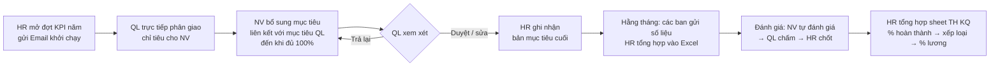

# Quy trình KPI hiện tại (bằng Excel và email)

> Tài liệu cho product owner và HR. Mô tả cách làm **hiện nay**, dựng lại từ biểu mẫu DATX và bộ
> email template. Nguồn chi tiết: `docs/source-map.md`. Quy trình mới trên hệ thống: `new-flow.md`.

---

## 1. Tổng quan

Hiện nay KPI được xây dựng, giao và chấm bằng **một bộ file Excel** (biểu mẫu DATX) và **email** do Ban
Nhân sự gửi. Không có hệ thống ghi nhận ai làm bước nào, lúc nào.

## 2. Xây dựng bộ KPI (biểu mẫu DATX)

- Sheet **"2. KPIs phòng ban"** liệt kê bộ KPI của toàn công ty và từng phòng ban: STT, chỉ tiêu, trọng
  số, cách tính, phân loại, định nghĩa, mục tiêu. Ví dụ toàn công ty: Doanh thu (20%), Tỉ suất lợi nhuận
  (20%), Số lượng KH (10%), Tỉ lệ KH cũ (20%), Nhân sự (10%), NSLĐ (20%).
- **Cách tính** ghi bằng chữ: "% thực tế / mục tiêu" (càng cao càng tốt) hoặc "% mục tiêu / thực tế"
  (càng thấp càng tốt). Cùng một chỉ tiêu "Tỉ lệ KH cũ" có chỗ ghi hai kiểu khác nhau (câu hỏi Q4).
- **Phân loại** lúc theo BSC (Tài chính, Khách hàng, Học hỏi phát triển…), lúc theo "Hiệu quả / Khối
  lượng / Chi phí" (câu hỏi Q5).
- Mỗi sheet phòng ban có khối **"Mục tiêu chung (3–5) — KGI"**, bộ KPI, lời nhắc KPI phải SMART, và cột
  **phân bổ mục tiêu theo tháng**.
- Theo slide DATX 2023: đi từ chiến lược → **KGI → CSF → KPI** → mục tiêu → rà soát.

## 3. Giao KPI — quy trình 4 bước qua email

HR gửi **"Email khởi chạy"** cho từng người phụ trách:

1. **Quản lý trực tiếp** phân giao một số chỉ tiêu cố định cho nhân viên từ bản KPI của chính mình.
2. **Nhân viên** thêm các mục tiêu mới và liên kết với mục tiêu của quản lý, đề xuất thêm nếu tổng
   trọng số nhỏ hơn 100%.
3. **Quản lý trực tiếp** phê duyệt, hoặc chỉnh sửa, hoặc trả lại cho nhân viên.
4. **Ban Nhân sự** ghi nhận bản mục tiêu.

Gần hạn, HR gửi **"Email nhắc Deadline"**: hạn của bước bạn đối với bản KPI của <người dùng> là ngày
<hạn>; **sau hạn, mục tiêu bị khóa và không chỉnh sửa được**.

## 4. Số liệu thực hiện

Các ban chức năng gửi kết quả KPI cho Nhân sự; HR nhập vào file. Không có nơi lưu bằng chứng, không
biết số nào nhập tay, số nào lấy từ hệ thống khác.

## 5. Đánh giá và tổng hợp kết quả

- Nhân viên tự đánh giá, quản lý chấm, HR chốt — trao đổi qua file và email.
- Sheet **"TH KQ"** tổng hợp theo nhân viên: % hoàn thành KPI, % hưởng lương KPI, xếp loại, lỗi vi phạm
  nội quy, lỗi trên bảng công, ngày nghỉ.
- Sheet này hiện **lỗi `#REF!`** ở các cột tính toán, nên chưa có thang xếp loại và bảng quy đổi % lương
  dùng được (câu hỏi Q2).

## 6. Điểm đau

| # | Vấn đề | Hệ quả |
|---|---|---|
| 1 | Công thức nằm trong ô Excel, mỗi file một kiểu | Lỗi `#REF!`, cùng chỉ tiêu tính hai cách |
| 2 | Không biết phiếu đang ở bước nào, của ai | HR phải hỏi từng người, nhắc hạn bằng email tay |
| 3 | Khóa sau hạn chỉ là lời nhắc trong email | Không có gì thực sự ngăn sửa sau hạn |
| 4 | Không có liên kết thật giữa KPI cha và con | Không thấy phần "chưa giao" của quản lý |
| 5 | Số liệu không có nguồn và bằng chứng đi kèm | Khó kiểm chứng khi chấm |
| 6 | Kết quả chỉ có cuối kỳ | Không có dashboard sống cho Ban điều hành |
