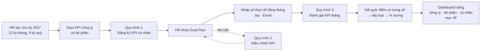
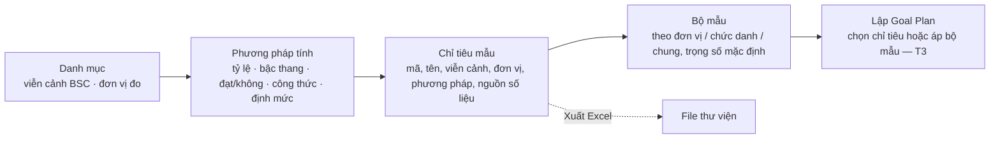
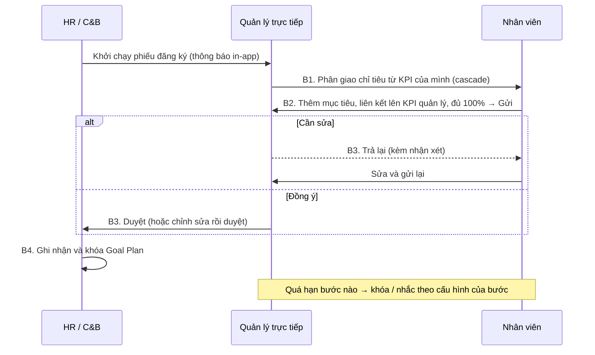
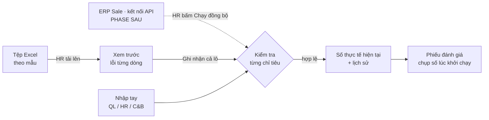
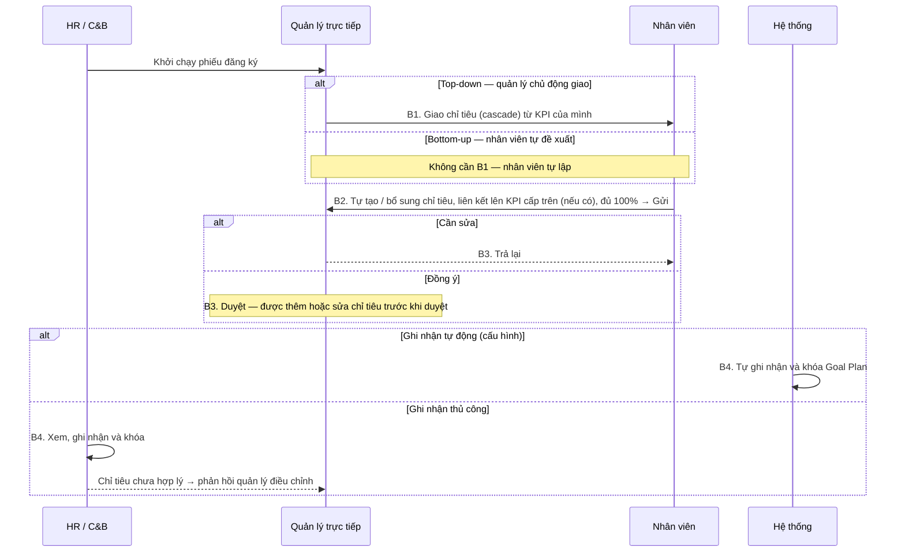
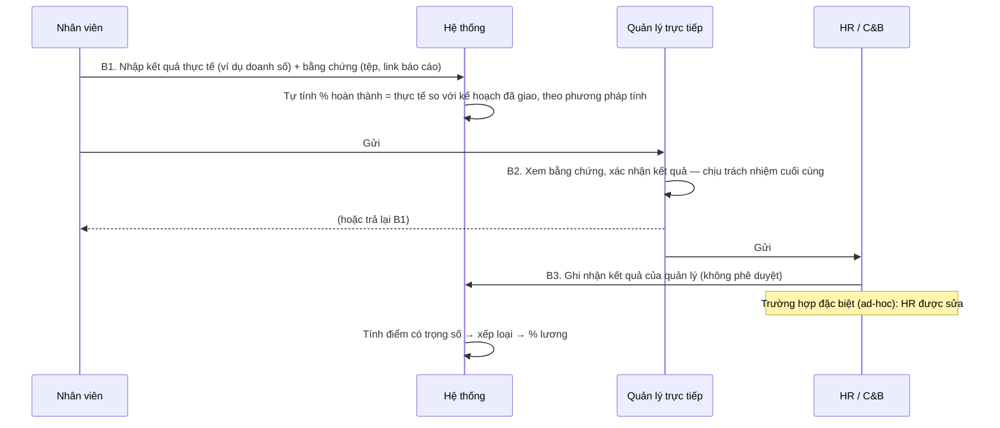

# Quy trình KPI trên hệ thống Syntra KPI (P1)

> Tài liệu làm việc cho product owner và HR — **đề xuất**, sẽ được chốt dần qua các track của Phase 2
> và buổi UAT ở Phase 4. Quy tắc chính thức: `.agents/knowledge/business-rules.md` (mã `BR-KPI-xx`).
> Cách làm hiện tại: `current-flow.md`.

---

## 1. Vòng đời một chu kỳ KPI



Ba tầng mục tiêu: **Công ty → Bộ phận → Cá nhân**, nối với nhau bằng **cascade** (quản lý giao xuống
một phần chỉ tiêu của mình) và **link** (nhân viên tự thêm mục tiêu và liên kết lên mục tiêu của quản
lý). Mỗi Goal Plan có 3–5 KGI và 5–8 KPI, tổng trọng số 100%, mỗi KPI phải có nguồn số liệu.

**Trạng thái chu kỳ** chỉ đi tới từng bước: *Đang lập kế hoạch → Đang thực hiện → Đang đánh giá → Đã
đóng*. Tên, ngày và các kỳ của chu kỳ chỉ sửa được khi còn *Đang lập kế hoạch*; muốn chuyển sang *Đang
thực hiện* phải có ít nhất một kỳ hợp lệ. Đóng chu kỳ thì mọi kỳ bị khóa số liệu và Goal Plan của chu
kỳ không sửa được nữa.

## 1A. Thư viện KPI và bộ mẫu (track T2)

HR / C&B chuẩn bị thư viện **trước** khi lập Goal Plan, để mọi kế hoạch dùng cùng tên, đơn vị đo và cách tính:



- **Viễn cảnh BSC** có đúng bốn, cố định: chỉ đổi tên hiển thị và thứ tự.
- **Chỉ tiêu mẫu** ở trạng thái *Nháp* được để trống nguồn dữ liệu; muốn *Đang áp dụng* thì phải có nguồn
  (KPI phải đo được). Chỉ chỉ tiêu *Đang áp dụng* mới chọn được khi lập Goal Plan hoặc bộ mẫu.
- **Nguồn dữ liệu** là báo cáo hoặc hệ thống lấy số (ERP Sale, MHTC, CMS báo cáo kế toán…), **không phải
  kết nối**. Trong P1, số của mọi nguồn đều được nhập tay hoặc import Excel (§4E).
- **Lưu trữ** chỉ ẩn chỉ tiêu khỏi danh sách chọn, không xóa và không ảnh hưởng mục tiêu đã giao. Chỉ tiêu
  đang nằm trong một bộ mẫu *Đang áp dụng* thì phải gỡ khỏi bộ mẫu trước.
- **Chỉ tiêu chuẩn** (từ thư viện mẫu) sửa được như chỉ tiêu tự tạo, trừ mã.
- **Phương pháp tính đã dùng cho mục tiêu** giữ nguyên cách tính (loại, trần, sàn, công thức, bậc) — đổi
  sẽ làm điểm các kỳ đang mở thay đổi âm thầm. Muốn tính khác thì tạo phương pháp mới.
- **Bộ mẫu**: tổng trọng số 100% và 5–8 chỉ tiêu là **khuyến nghị**, màn hình cảnh báo nhưng vẫn cho lưu;
  Goal Plan lập từ bộ mẫu mới là thứ phải đủ 100% và 5–8 chỉ tiêu để gửi duyệt.
- **Thêm từ bộ mẫu** (trên trang Goal Plan, cạnh "Thêm chỉ tiêu"): ai đang được sửa Goal Plan — HR khi Goal
  Plan còn Nháp, quản lý ở bước 1 và 3 của phiếu đăng ký, nhân viên ở bước 2 — chọn một bộ mẫu *Đang áp dụng*
  và thêm cả bộ một lần. Bộ mẫu được gợi ý trước theo chức danh của nhân viên, rồi theo đơn vị (và các đơn vị
  cấp trên), rồi bộ dùng chung; các bộ khác vẫn chọn được. Mỗi chỉ tiêu lấy tên, viễn cảnh, đơn vị đo, cách
  tính, nguồn số liệu từ thư viện và trọng số, mục tiêu mặc định từ bộ mẫu. **Chỉ thêm, không thay**: chỉ
  tiêu đã có trong Goal Plan, không còn áp dụng, hoặc chưa có nguồn số liệu thì bỏ qua và ghi rõ lý do.
  Màn xem trước cho biết tổng trọng số và số chỉ tiêu sau khi thêm, cùng chỉ tiêu còn thiếu mục tiêu; các
  điểm này chỉ cảnh báo, sửa trên Goal Plan trước khi gửi.
- **Xuất Excel** cả thư viện, bộ mẫu và danh mục mã. **Nhập từ Excel** sẽ có khi khung import chung (T4) xong.

## 2. Quy trình 1 — Đăng ký KPI (GOAL_SETTING)

Theo email template hiện tại, giữ nguyên 4 bước nhưng chạy trên hệ thống:



- Nút **Gửi** chỉ bật khi tổng trọng số đạt 100% (sai số ±0,01) và có 5–8 chỉ tiêu; nếu chưa đạt, hệ
  thống nói rõ còn thiếu gì.
- Quản lý thấy với mỗi KPI đã cascade: **đã giao cho NV / tự nhận / chưa giao / tự thực hiện**; phần
  "chưa giao" do hệ thống tính.
- Goal Plan của **công ty / bộ phận** được HR khởi tạo phiếu đăng ký bằng tay, người được đăng ký là
  trưởng đơn vị; mỗi Goal Plan chỉ có một phiếu đăng ký đang mở. Nút **Bắt đầu đăng ký** nằm trên từng
  dòng ở *Quản trị KPI › Chu kỳ › Goal Plan* (cột "Phiếu đăng ký" ghi "Chưa bắt đầu", hoặc "Chưa có trưởng
  đơn vị" khi chưa bắt đầu được). Hộp thoại cho thấy ai xử lý từng bước lúc này và hạn xử lý (mặc định
  bằng tổng thời hạn các bước, 11 ngày). Với quy trình 4 bước mặc định, phiếu của một phòng tới **giám
  đốc khối trước** (bước 1, giao chỉ tiêu), rồi tới **trưởng phòng** ở bước 2. Phiếu của công ty không có
  người nhận ở bước 1 và 3 (Tổng giám đốc không có quản lý trực tiếp): HR thao tác thay, và cần làm kịp vì
  quá hạn bước 1 thì Goal Plan tự khóa.
- **Phân giao từ công ty xuống bộ phận.** Trên Goal Plan công ty (hoặc của một khối), "Phân giao" cho chọn
  **Giao cho: Đơn vị | Nhân viên**. "Đơn vị" liệt kê Goal Plan của các đơn vị cấp dưới **gần nhất** có
  Goal Plan trong chu kỳ: khối chưa có Goal Plan thì đi thẳng xuống các phòng. Chỉ tiêu giao xuống thuộc
  trưởng đơn vị; "Đã giao / Tự giao / Chưa giao" tính như khi giao cho nhân viên.
- **Ai giao được vào Goal Plan của một phòng**: khi chưa có phiếu đăng ký — trưởng phòng hoặc HR (Goal Plan
  *Nháp*); khi phiếu đang chạy — người xử lý bước hiện tại, hoặc HR thao tác thay họ (được ghi cả hai
  người). Tổng giám đốc không giao trực tiếp được vào Goal Plan phòng. Thứ tự HR nên làm cho chu kỳ mới:
  lập Goal Plan công ty → tạo Goal Plan các phòng → phân giao → bắt đầu đăng ký từng phòng.
- Hết hạn ở một bước → hệ thống **khóa Goal Plan**, phiếu đứng yên ở bước đó. HR mở khóa phải ghi lý do
  và hạn mới; bước được tính lại từ lúc mở khóa nên lần chạy sau không khóa lại ngay.
- HR hủy phiếu đăng ký (kể cả khi đang bị khóa) thì Goal Plan về *Nháp*; việc mở khóa này được ghi
  lịch sử kèm lý do hủy.

## 3. Quy trình 2 — Điều chỉnh KPI (GOAL_CHANGE)

Goal Plan đã khóa chỉ thay đổi được qua phiếu điều chỉnh: người đề xuất → quản lý trực tiếp duyệt → HR
ghi nhận và khóa lại. Chỉ tiêu bị đổi hoặc hủy giữ lịch sử (Đang áp dụng → Đã thay đổi / Đã hủy).

- HR (hoặc quản lý) khởi tạo phiếu điều chỉnh bằng tay (không qua đợt khởi chạy) cho Goal Plan **đã
  khóa**; mỗi Goal Plan chỉ có **một** phiếu điều chỉnh đang mở. Người lập lưu nháp đề xuất được khi
  chưa ghi lý do, nhưng **gửi** thì mọi dòng phải có lý do.
- Phiếu ghi **danh sách đề xuất**: thêm / sửa / hủy chỉ tiêu, mỗi dòng kèm lý do. Trong lúc phiếu đang
  chạy, Goal Plan **vẫn khóa** và số liệu, đánh giá vẫn tính theo chỉ tiêu cũ.
- Chỉ khi bước cuối duyệt, hệ thống mới áp dụng: chỉ tiêu sửa sinh bản mới (bản cũ chuyển "Đã thay đổi"
  và vẫn tra lại được), chỉ tiêu hủy chuyển "Đã hủy".

## 4. Quy trình 3 — Đánh giá KPI tháng (KPI_EVAL)

```mermaid
sequenceDiagram
  participant SYS as Hệ thống
  participant NV as Nhân viên
  participant QL as Quản lý trực tiếp
  participant HR as HR / C&B
  SYS->>NV: Tự khởi chạy ngày 1 hằng tháng, hạn 7 ngày
  NV->>QL: B1. Nhập số thực tế từng chỉ tiêu + giải trình + bằng chứng — hệ thống tính %
  Note over NV,QL: Quá hạn → phiếu tự chuyển sang quản lý (SF4C PMGM.09)
  QL->>HR: B2. Quyết định % (mặc định = % hệ thống tính; chấm khác thì nhận xét)
  QL-->>NV: (hoặc trả lại B1)
  HR->>SYS: B3. Ghi nhận kết quả của quản lý (sửa trường hợp đặc biệt, có lý do)
  SYS->>SYS: Tính điểm có trọng số → xếp loại → % lương
```

- Số **thực tế** trên phiếu bắt đầu bằng số đã ghi nhận của kỳ (tay, Excel; phiếu quý cộng các tháng); nhân viên
  nhập lại ở B1, quản lý sửa được ở B2 (cập nhật 22/10, PEND-06 — xem mục 4G).
- Phiếu gửi được khi mọi chỉ tiêu ở bước hiện tại đã có điểm (B2, B3) và nhận xét / lý do khi bắt buộc; ở B1 %
  do hệ thống tính, chỉ tiêu chưa có số vẫn gửi được (tổng "tạm tính").
- Quá hạn chỉ xử lý **một lần mỗi bước**: nhắc hạn không lặp lại liên tục. Nếu bước được cấu hình
  **khóa** khi quá hạn, phiếu dừng tại bước đó; HR mở khóa Goal Plan phải nhập **hạn mới**, bước chạy lại
  từ lúc mở khóa.
- Thao tác thay (HR làm thay) và ủy quyền đều ghi nhận **cả hai người**.
- Đợt đánh giá tháng tự khởi chạy ngày 1 tháng sau (một lần cho mỗi kỳ), kể cả khi chu kỳ đã sang
  *Đang đánh giá* (tháng 12). HR cũng có thể khởi chạy *ngay* hoặc *hẹn ngày*; đợt hẹn ngày chỉ hủy
  được khi chưa chạy.
- Số thực tế trên phiếu là **ảnh chụp lúc khởi chạy**, không sửa trên phiếu.
- Nhắc hạn gửi trước hạn bước **theo cấu hình của bước** ("Nhắc trước … ngày", mẫu hiện tại: 1 ngày);
  hệ thống có thể nhắc lại ở mỗi lần chạy nhưng mỗi người chỉ nhận **một** thông báo cho mỗi lần vào bước.
  Ai nhận thông báo gì: mục 4D.

## 4A. Ai thấy gì, ai làm gì (Phase 1.3)

- **Quyền khác với lượt xử lý.** Quyền (`business-rules.md` §9) quyết định một người được *mở* màn hình nào và
  *xem* dữ liệu của ai. Còn ai được gửi, duyệt hay trả lại một phiếu thì do **người xử lý của bước** quyết định
  (BR-KPI-20), không phải do quyền. Vì vậy không có quyền "duyệt KPI".
- **Mỗi người nhận đủ quyền của mọi vai trò mình có.** Ai có hồ sơ nhân viên đều có vai trò Nhân viên, nên
  ai cũng có mục "Của tôi". Quản lý có thêm "Đội nhóm" và "Điều hành", HR và C&B có "Quản trị KPI", Quản trị
  hệ thống thấy tất cả.
- **Phạm vi dữ liệu:**
  - Nhân viên: của bản thân.
  - Quản lý: đơn vị mình phụ trách và các đơn vị con.
  - HR, C&B, Ban điều hành, Quản trị hệ thống: toàn công ty.
  - KPI công ty: mọi người đều xem được, vì cascade bắt đầu từ đó.
- **Nhập URL trực tiếp không vượt quyền được.** Trang ngoài quyền hiện thông báo "Bạn không có quyền thực
  hiện thao tác này" và nút về trang chủ.
- **Chạy thử nhiều vai trò không cần đăng nhập lại.** Thanh trên cùng có ô chọn **công ty** và ô chọn **người
  dùng** (nhóm theo vai trò, tìm theo tên, đơn vị, vai trò). Đổi công ty thì không còn thấy dữ liệu của công
  ty kia.
- **Ủy quyền**: không ủy quyền cho chính mình, không ủy quyền tiếp (người đang được ủy quyền không ủy
  quyền lại; người đang ủy quyền cho người khác không nhận thêm ủy quyền trùng thời gian), không tạo hai
  ủy quyền trùng người, trùng loại phiếu, trùng thời gian. Người ủy quyền hoặc HR thu hồi; quản lý cấp
  trên của người ủy quyền thì không.
- Người được ủy quyền / HR làm thay khi **lưu nháp** cũng được ghi cả hai người, như khi gửi/duyệt.

## 4B. Kết quả kỳ (Gate 1)

Sau khi phiếu đánh giá hoàn thành:

1. **Tính kết quả (C&B/HR).** Hệ thống tính bản nháp ("Tạm tính") cho mọi Goal Plan đã duyệt/khóa
   của kỳ. Cá nhân: lấy % HR chốt (cột cuối) trên phiếu đánh giá đã hoàn thành — chưa hoàn thành phiếu
   thì chưa có kết quả (giả định Q17). Công ty / phòng ban: tính từ số liệu thực tế. Tính lại bao nhiêu
   lần cũng được khi còn là bản nháp; kết quả đã chốt không bị tính lại.
2. **Điều chỉnh (C&B/HR).** Cộng/trừ điểm (vi phạm, chuyên cần) trên bản nháp; xếp loại và % lương
   KPI cập nhật ngay, kể cả khi điều chỉnh làm đổi loại.
3. **Chốt kết quả (C&B/HR).** Chốt một số hoặc toàn bộ bản nháp của kỳ. Điểm được làm tròn 2 chữ số
   một lần. Chỉ cần MỘT kết quả còn vướng (tổng trọng số ≠ 100%, chỉ tiêu chưa có điểm hoặc không tính
   được) thì không kết quả nào được chốt, và màn hình liệt kê mọi chỗ vướng.
4. **Khóa kết quả (C&B/HR).** Kết quả đã chốt được khóa, không sửa được nữa; bản nháp giữ nguyên. Khóa
   kết quả không khóa kỳ nhập số liệu.
5. **Xuất file lương (C&B).** C&B xuất file Excel gồm kết quả cá nhân **đã chốt hoặc đã khóa** của kỳ
   (giả định Q38): mã NV, họ tên, đơn vị, chức danh, điểm KPI (đã gồm điều chỉnh), điều chỉnh điểm, xếp
   loại, % hưởng lương KPI. Bản tạm tính và kết quả phòng ban/công ty không có trong file. Kết quả chưa có
   % hưởng lương KPI vẫn có trong file, cột % để trống kèm ghi chú (giả định Q39). Xuất file không đổi
   trạng thái kết quả; xuất lại bao nhiêu lần cũng được, mỗi lần một file trong lịch sử xuất file.
6. Khi kết quả của kỳ đã chốt, không nhập thêm số thực tế cho Goal Plan đó trong kỳ đó.
7. **Nhân viên xem "Kết quả của tôi"** sau khi HR chốt. Bản tạm tính hiện "Đang tổng hợp", không có số.

## 4C. Tổ chức và nhân sự (Track T1)

Quản trị hệ thống làm phần này một lần trước khi giao KPI, rồi cập nhật khi có thay đổi nhân sự. Màn hình:
**Hệ thống → Tổ chức** (Cơ cấu · Nhân sự · Chức danh · Công ty) và **Hệ thống → Người dùng & quyền**
(Tài khoản · Vai trò & quyền). Quy tắc chi tiết: `business-rules.md` §10.

- **Cây tổ chức.** Công ty → Khối → Phòng ban → Nhóm (được bỏ qua một cấp). Không ngừng dùng được đơn vị
  còn đơn vị trực thuộc đang dùng, còn nhân viên, hoặc còn bảng mục tiêu của chu kỳ chưa đóng; màn hình
  ghi rõ lý do bên cạnh nút.
- **Điều chuyển.** Thêm phân công chính mới từ ngày D thì phân công đang có tự kết thúc ngày D − 1, trong
  cùng một lần lưu. Từ ngày D, các bước "quản lý trực tiếp" trên phiếu đang mở chuyển cho quản lý mới
  (vì người xử lý được xác định lúc thao tác). Kiêm nhiệm không làm kết thúc phân công nào.
- **Nghỉ việc.** Nhập ngày làm việc cuối: tài khoản đăng nhập chuyển sang Ngừng dùng trước, rồi mới ghi
  nhận nghỉ việc (các phân công kết thúc vào ngày đó). Cấp dưới trực tiếp, đơn vị đang làm trưởng và ủy
  quyền **không tự đổi**: màn hình liệt kê để quản trị chỉ định người thay. Phiếu đang mở vẫn chạy tiếp.
- **Tài khoản.** Mỗi nhân viên có tối đa một tài khoản đang dùng; tài khoản của nhân viên luôn có vai trò
  Nhân viên (bản thân). Khi gán vai trò, màn hình cho biết phạm vi đó gồm bao nhiêu nhân viên.
- **Không tự khóa mình.** Hệ thống từ chối mọi thay đổi làm công ty không còn quản trị viên, làm vai trò
  Quản trị hệ thống mất quyền quản lý tổ chức/người dùng, hoặc làm chính người đang thao tác mất quyền
  quản lý người dùng.
- **Công ty.** Chỉ sửa tên, mã, múi giờ của công ty đang chọn. Chưa có tạo công ty mới hay tạm ngưng.
- **Nhập từ Excel (WBS 4.1.7).** Đã có file mẫu (sheet Nhân sự + mã đơn vị + mã chức danh) và quy tắc
  kiểm tra từng dòng. Nút "Nhập từ file" mở khi khung nhập dữ liệu dùng chung (T4) hoàn tất.

## 4D. Thông báo và nhật ký (Track T7)

Thông báo hiện trên **chuông** ở thanh trên cùng; bấm vào một thông báo thì mở màn hình liên quan và
thông báo được đánh dấu đã đọc. Giai đoạn này **chỉ gửi trong ứng dụng**, chưa gửi email.

| Khi nào | Ai nhận | Thông báo |
|---|---|---|
| Một đợt khởi chạy tạo phiếu | Người được đánh giá | Khởi chạy phiếu (quy trình mấy bước, đang ở bước nào, hạn) |
| Như trên, khi bước 1 không phải của người được đánh giá (đăng ký: bước 1 là quản lý) | Người xử lý bước 1 | Có phiếu cần xử lý |
| Phiếu chuyển sang bước tiếp theo (gửi, duyệt, hoặc tự chuyển do quá hạn) | Người xử lý bước mới | Có phiếu cần xử lý |
| Phiếu bị trả lại | Người nhận lại phiếu | Phiếu bị trả lại (ai trả, lý do) |
| HR mở khóa Goal Plan và đặt hạn mới | Người đang giữ phiếu | Có phiếu cần xử lý (hạn mới) |
| Trước hạn bước, theo lịch nhắc của bước | Người đang giữ phiếu | Nhắc hạn (và điều xảy ra khi quá hạn: khóa Goal Plan / tự chuyển bước) |

- Người được ủy quyền nhận thông báo **cùng** người ủy quyền.
- **Không ai nhận thông báo về thao tác của chính mình**, kể cả khi HR làm thay hay người được ủy quyền
  làm thay.
- Không có thông báo khi phiếu hoàn thành, bị hủy, hoặc khi bước đã quá hạn (giả định Q29): lời nhắc
  trước hạn đã nói điều gì sẽ xảy ra.
- Nội dung lấy từ **Mẫu thông báo** (Hệ thống → Mẫu thông báo); sự kiện nào thiếu mẫu thì không gửi.
- **Nhật ký** (Hệ thống → Nhật ký) ghi mọi thay đổi dữ liệu: ai làm, làm thay ai, lúc nào, trước/sau và
  lý do (khóa, mở khóa, hủy phiếu). Hiện chỉ Quản trị hệ thống xem được.
- Tệp đính kèm (bằng chứng, file import) tối đa 10 MB, chỉ nhận PDF, ảnh, Word, Excel, CSV, văn bản
  (giả định Q30).

## 4E. Số liệu thực hiện hằng tháng (Track T4)

Sau khi tháng kết thúc (ngày 1 tháng sau), số thực tế của từng chỉ tiêu được ghi vào hệ thống. **Phase 1 chỉ
có hai đường do người làm: nhập tay và import Excel — không tích hợp hệ thống khác hay API.** Đồng bộ API
(ERP Sale) là phase sau; màn hình vẫn giữ trong bản thử nghiệm trên dữ liệu mô phỏng và gắn nhãn "Phase sau".
Màn hình "Số liệu & import" mở sẵn tháng vừa kết thúc.



1. **Nhập tay.** Quản lý (đơn vị của mình), HR, C&B nhập số cho từng chỉ tiêu; nhân viên không nhập số
   (giả định Q33) mà tự đánh giá kèm bằng chứng trên phiếu.
2. **Nhập từ Excel.** HR tải mẫu đã điền sẵn chỉ tiêu của tháng, điền số, tải lên. Tệp sai mẫu bị chặn
   ngay, không tạo lô. Tệp đúng mẫu tạo một lô "Đang kiểm tra" với lỗi từng dòng; còn một dòng lỗi thì
   không ghi nhận được, sửa tệp và tải lên thành lô mới. Ghi nhận là ghi cả lô hoặc không ghi gì.
3. **Đồng bộ API — phase sau, chưa có trong P1.** HR chạy đồng bộ cho một tháng. Số do người nhập (tay, Excel) không bị ghi đè
   (giả định Q37); số bị từ chối được ghi vào nhật ký lần chạy.
4. Mọi đường đều qua cùng một kiểm tra: kế hoạch đã duyệt/khóa (Q35), kỳ chưa khóa, kết quả chưa chốt,
   chỉ tiêu còn hiệu lực, **chỉ nhập theo tháng** (quý, năm tự cộng từ các tháng — Q36), kỳ đã bắt đầu,
   đúng kiểu số/chữ. Số mới thay số hiện tại, số cũ vẫn giữ trong lịch sử.
5. **Bằng chứng** (tệp hoặc đường dẫn) gắn vào chỉ tiêu theo tháng; link trong tệp Excel thành bằng chứng
   của số vừa ghi.

## 4F. Dashboard sống và trợ lý (Phase 3)

Mở **Điều hành → Dashboard**. Ai thấy gì do quyền "Xem dashboard" và phạm vi của họ quyết định
(`business-rules.md` §11):

| Người xem | Bắt đầu ở | Thấy |
|---|---|---|
| Ban điều hành, HR, Quản trị hệ thống | Công ty | Mọi khối, phòng ban và nhân viên |
| Quản lý (vd. trưởng phòng Kinh doanh) | Đơn vị mình phụ trách | Đơn vị mình, đơn vị trực thuộc và nhân viên trong đó — không thấy công ty hay khối phía trên |
| Nhân viên | — (không có dashboard) | Phần "KPI của tôi" ở **Kết quả của tôi**: điểm, xếp loại, % hưởng lương KPI của kỳ đã chốt gần nhất, chênh lệch với kỳ trước và chỉ tiêu cần chú ý |


- **Tổng quan.** Chọn chu kỳ và kỳ; mặc định là tháng gần nhất đã có kết quả chốt. Mỗi đơn vị hiện điểm
  của chính kế hoạch đơn vị (đúng số đã lưu, không tính lại), xếp loại, chênh lệch với kỳ trước, số nhân
  viên đã có kết quả chốt và điểm trung bình nhân viên (không trọng số, chỉ kết quả đã chốt — giả định
  Q40). Khối không có kế hoạch riêng thì ghi "Chưa có kế hoạch". Bấm tên đơn vị để đi xuống; bấm tên
  nhân viên để xem từng chỉ tiêu.
- **Tạm tính.** Kết quả chưa chốt hiện nhãn "Tạm tính" và không vào các con số thống kê chính thức.
- **Cần chú ý.** Chỉ tiêu dưới 90% hoàn thành là "Dưới ngưỡng"; chưa có số là "Thiếu số liệu" (không
  bao giờ tính là 0); kết quả ở hai mức xếp loại thấp nhất là "Xếp loại thấp" (giả định Q41).
- **Nhân viên chuyển đơn vị hoặc nghỉ việc** được tính ở đơn vị họ thuộc vào ngày cuối kỳ (giả định Q43).
- **Vận hành.** Tiến độ đăng ký KPI của chu kỳ, phiếu đánh giá của kỳ theo trạng thái và theo bước,
  kết quả kỳ theo trạng thái và xếp loại, danh sách phiếu quá hạn (cùng cách tính với màn hình Duyệt &
  đánh giá). Nút "Xuất báo cáo vận hành (Excel)" — khác với file lương của C&B.
- **Trợ lý KPI (giả lập).** Tóm tắt đơn vị đang xem và trả lời khoảng 5 loại câu hỏi (điểm, cao nhất /
  thấp nhất, so với kỳ trước, chỉ tiêu cần chú ý, phiếu quá hạn) — chỉ từ số liệu đang hiển thị trong
  phạm vi người xem. Không phải đánh giá chính thức; không ảnh hưởng điểm.

## 4G. Điều chỉnh sau buổi họp 22/10/2026 — đã thống nhất, **chưa làm vào prototype**

> Nguồn: biên bản NoteX "Thiết kế và Phát triển Hệ thống Quản trị KPI" (22/10/2026, `docs/source-map.md`).
> Các mục dưới đây **thay thế** phần tương ứng ở mục 2, 4, 4E, 4F khi được làm; cho tới lúc đó prototype vẫn
> chạy như các mục trên. Mã `PEND-xx` khớp với `business-rules.md` §12. Điểm chưa rõ nằm ở mục 6 (Q44–Q58).
> Kế hoạch triển khai theo đợt: `docs/plans/KPI_update_plan_2210.md`.

### Đăng ký KPI: cả hai luồng chạy song song (PEND-01, 02, 03)



- **Chuỗi phân bổ Công ty → Khối → Phòng → Nhân viên.** KPI cấp trên giao xuống được cho **một đơn vị**
  (phòng ban) hoặc **một nhân viên cụ thể**. Giám đốc khối nhận KPI từ công ty (xem Q56 về Goal Plan của Khối).
  Phần giao xuống Goal Plan đơn vị gần nhất đã làm ngày 21/10 (mục 2).
- **Nhân viên tự tạo KPI** và liên kết lên chỉ tiêu cấp trên nếu có; không bắt buộc quản lý giao trước.
  Cách quản lý nhận KPI của chính mình (top-down hay bottom-up) chưa chốt (Q44).
- **B4 của HR là "ghi nhận và khóa"**, cấu hình được tự động hoặc thủ công (Q46). HR (ví dụ Trưởng phòng Nhân
  sự) được xem và phản hồi quản lý khi chỉ tiêu không hợp lý.

### Phân bổ mục tiêu năm theo quý và theo dõi lũy kế (PEND-04, 05)

- KPI giao **cho cả năm** (ví dụ doanh thu 15 tỷ), rồi phân bổ cho từng **quý** (hoặc tháng) trong cùng chu
  kỳ — **chia đều** hoặc **nhập tay** từng quý (ví dụ Q1 500 triệu, Q2 2 tỷ, Q3 5 tỷ, Q4 10 tỷ — xem Q50).
- Chỉ tiêu quý / tháng được theo dõi **lũy kế** (từ đầu chu kỳ đến kỳ đang xem) so với kế hoạch năm (Q51):
  cộng (SUM) thì cộng dồn, trung bình (AVG) thì trung bình các tháng có số, cuối kỳ (LAST) thì lấy số mới nhất.
  Tháng thiếu số không tính là 0 — số lũy kế ghi "chưa đủ". Hai cách so: với **mục tiêu lũy kế** (đúng tiến độ
  chưa) và với **mục tiêu năm** (đi được bao nhiêu phần của năm). *Đã làm 23/10 (B0):* phần tính
  (`cumulativeRules.ts`); chưa hiện trên màn hình (Đợt 4).

### Đánh giá KPI: nhân viên nhập kết quả, hệ thống tính % (PEND-06, 07, 08 — đã làm 23/10)



- Số **thực tế do nhân viên nhập** trên phiếu, không còn chỉ đọc (thay mục 4 và Q33; xem Q48). Quản lý được sửa
  số ở B2, kèm nhận xét. Phiếu tháng hoàn thành thì số đã sửa trên phiếu thành số thực tế hiện hành, nguồn
  "Phiếu đánh giá"; phiếu quý giữ số trên phiếu (số quý luôn cộng từ các tháng).
- **% hoàn thành do hệ thống tính** từ số trên phiếu và **mục tiêu của kỳ** (phiếu quý dùng mục tiêu quý, không
  dùng mục tiêu năm); nhân viên không tự gõ % (Q49). Không có số → không có %, không phải 0.
- **Quản lý trực tiếp quyết định** kết quả: % mặc định bằng % hệ thống tính; chấm khác thì bắt buộc nhận xét.
  **HR không duyệt**, chỉ ghi nhận (bước "HR ghi nhận kết quả", cột HR mặc định bằng cột quản lý); sửa trong trường
  hợp đặc biệt, bắt buộc lý do, có nhật ký (Q47).
- *Đã làm 23/10/2026 (Plan A, A1):* BR-KPI-16, 17, 23, 52.

### Phạm vi và nhịp đánh giá (PEND-09…12)

- **Phase 1** gồm: (mục 1) giao nhận và đánh giá KPI **theo quý và năm**; (mục 4) đánh giá hiệu suất **liên
  tục hằng tháng** và dashboard; (mục 3) **đánh giá thử việc lên chính thức**. Làm mục 1 và 4 trước, rồi mục 3.
- **Phase 2**: đánh giá 360 độ, Bell Curve (phân bổ chuẩn), đào tạo và phát triển (OD), năng lực (Competency).
- **Nhịp đánh giá** (thay Q3): đánh giá chính thức theo quý và năm; hằng tháng là đánh giá liên tục (Q52).
- **Đánh giá thử việc** chuyển từ P2 vào P1 (Q53).
- **Nguồn số liệu**: Phase 1 **chỉ nhập tay** — đã làm 21/10 theo hướng nhập tay + import Excel, đồng bộ API để Phase
  sau (Q54). Thư viện KPI theo tài liệu PMGM có **5 phương pháp tính** (Q55).
- **Import dữ liệu lịch sử** (ví dụ 10 năm từ Excel) do C&B / HR thực hiện, **ưu tiên thấp** (Q57).
- **Thứ tự**: cơ cấu tổ chức (công ty, phòng ban, nhân sự) → thư viện KPI → chu kỳ và các đợt đánh giá.
- **Triển khai thử nghiệm** đồng thời cho công ty Sinh Cha và công ty chị Vinh (tên theo biên bản), sau đó mở
  rộng ra các công ty thành viên.

### Quy trình 4 — Công việc tháng (WORK_PLAN, WORK_REVIEW) (PEND-14)

> Mục 4 của P1 = nghiệp vụ công việc tháng của CMC (PMGM.08–09; HR tr. 13, 25–26, 88–95, 141–150; Nhân viên
> tr. 67–73; Quản lý tr. 120–136), theo `ASSUMPTION Q59`. Kế hoạch chi tiết: `docs/plans/KPI_monthly_work_plan.md`.

```mermaid
sequenceDiagram
  participant SYS as Hệ thống
  participant NV as Nhân viên
  participant QL as Quản lý trực tiếp
  participant HR as HR / C&B
  SYS->>NV: Ngày 1 tháng M: khởi chạy phiếu "Kế hoạch công việc tháng M"
  NV->>QL: B1. Lập danh sách việc, trọng số đủ 100% (hoặc sao chép tháng trước)
  Note over NV,QL: Top-down: đợt khởi chạy chọn "Quản lý giao trước" (PEND-01)
  QL-->>NV: B2. Trả lại kèm nhận xét
  QL->>SYS: B2. Sửa / thêm / xóa, duyệt → kế hoạch khóa
  NV->>NV: Trong tháng: cập nhật % hoàn thành, trạng thái (không qua phiếu)
  SYS->>NV: Ngày 1 tháng M+1: khởi chạy phiếu "Đánh giá công việc tháng M"
  NV->>QL: B1. Tự chấm từng việc 0–100 + kỷ luật + ý kiến
  Note over NV,QL: Quá hạn → tự chuyển cho quản lý (BR-KPI-13)
  QL->>HR: B2. Chấm từng việc + kỷ luật; Hsht < 80 → bắt buộc Hsnv + giải trình
  QL-->>NV: (hoặc trả lại B1)
  HR->>SYS: B3. Ghi nhận (hoặc tự động — PEND-02); import điểm hàng loạt
  SYS->>SYS: Chốt kết quả tháng → Kết quả của tôi, đội nhóm, dashboard
```

- **Hai phiếu**: *Kế hoạch công việc tháng* (đầu tháng M) và *Đánh giá công việc tháng* (đầu tháng M+1). Phiếu
  đánh giá công việc tháng **là** đánh giá liên tục hằng tháng; phiếu đánh giá KPI chỉ còn cho quý và năm (Q60).
- **Điểm**: KQcv = Σ điểm việc × trọng số (70%); KLcv = điểm ý thức kỷ luật (30%);
  **Hsht = 70% × KQcv + 30% × KLcv**. Hsht **dưới** 80 (80 thì không) → quản lý bắt buộc nhập **Hsnv** kèm giải
  trình, Hsnv thay Hsht làm điểm cuối (Q61). Tỷ lệ và ngưỡng cấu hình theo công ty (Q62).
- **Việc bị hủy giữa tháng** (quản lý hủy kèm lý do) không tính vào KQcv; trọng số các việc còn lại chia lại
  cho đủ 100% (Q64). Liên kết việc với KPI là tùy chọn, không ảnh hưởng điểm (Q63).
- Kết quả tháng **chỉ theo dõi, không vào lương** (Q52).
- *Đã làm 23/10 (B0):* phần tính điểm (`workRules.ts`). Chưa có màn hình, phiếu hay dữ liệu.

### Dashboard theo vai trò (PEND-13)

| Người xem | Nội dung |
|---|---|
| Lãnh đạo | Tổng quan theo thẻ điểm cân bằng (BSC) cho công ty, khối, phòng ban |
| Quản lý | KPI của nhân viên trực tiếp, trạng thái đăng ký, kết quả đánh giá |
| HR | Phiếu đăng ký KPI, phiếu quá hạn, kết quả đánh giá theo kỳ |

Lọc theo kỳ **tháng, quý, 6 tháng** và hiển thị số **lũy kế** (Q51, Q58).

## 5. Khác biệt so với hiện tại

| # | Hiện tại (`current-flow.md`) | Trên hệ thống | Lý do | Quy tắc |
|---|---|---|---|---|
| 1 | Công thức trong ô Excel, mỗi file một kiểu | Phương pháp tính chung trong thư viện, một chỗ, có kiểm thử | Hết `#REF!`, cùng chỉ tiêu cùng cách tính | BR-KPI-30…36 |
| 2 | Nhắc hạn bằng email tay | Thông báo in-app tự động khi khởi chạy và trước hạn | HR không phải theo dõi tay | BR-KPI-13, 19 |
| 3 | "Khóa sau hạn" chỉ là lời nhắc | Khóa thật, hoặc tự chuyển bước, theo cấu hình | Quy tắc có hiệu lực | BR-KPI-13, 14 |
| 4 | Không thấy phần chưa giao | Hệ thống tính "chưa giao" cho từng KPI cascade | Quản lý giao đủ, không giao vượt | BR-KPI-07 |
| 5 | Số liệu không nguồn, không bằng chứng | Mỗi KPI có nguồn; mỗi số ghi rõ tay / Excel (API: phase sau); bằng chứng đính kèm | Kiểm chứng được khi chấm | BR-KPI-05, 52 |
| 6 | Tổng hợp cuối kỳ trong sheet TH KQ | Điểm, xếp loại, % hưởng lương KPI tính tự động; file lương xuất từ kết quả đã chốt; dashboard sống | Ban điều hành thấy ngay; C&B không chép số tay | BR-KPI-35, 40–46 |
| 7 | Phiếu đánh giá tháng gửi tay | Tự khởi chạy theo lịch (ngày 1 hằng tháng) | Không quên kỳ nào | BR-KPI-19 (D5) |
| 8 | Mỗi phòng tự gõ bộ KPI trong sheet riêng, tổng trọng số có bộ không đủ 100% | Thư viện chỉ tiêu mẫu và bộ mẫu dùng chung; trọng số lệch được cảnh báo | Cùng tên, cùng cách tính giữa các phòng | BR-KPI-74…80 |

**Thay đổi so với prototype hiện tại (buổi họp 22/10/2026, chưa làm — mục 4G):**

| Mã | Prototype hiện tại | Sau buổi họp | Lý do | Ảnh hưởng |
|---|---|---|---|---|
| PEND-01 | Đăng ký luôn bắt đầu bằng B1 quản lý giao (BR-KPI-12) | Top-down và bottom-up song song; nhân viên tự lập không cần B1 | Doanh nghiệp dùng cả hai cách | Mẫu quy trình đăng ký, `workflowRules`, `formRules.canSubmit` |
| PEND-02 | B4 HR ghi nhận và khóa, luôn thủ công | Cấu hình tự động hoặc thủ công | Giảm việc tay cho HR | Mẫu quy trình, `workflowRules` |
| PEND-03 | Đã giao được từ Goal Plan công ty / đơn vị xuống đơn vị gần nhất có kế hoạch (21/10); Khối có thể không có Goal Plan (Q40) | Công ty → Khối → Phòng → NV; giao cho đơn vị hoặc NV | Đúng cơ cấu tập đoàn | Còn lại: Goal Plan của mọi Khối, điểm Khối trên dashboard (Q40, Q56) |
| PEND-04 | Phân bổ theo kỳ dựng quý / năm từ tháng (BR-KPI-11) | Phân bổ năm → quý, chia đều hoặc nhập tay | Kế hoạch kinh doanh theo quý | `goalPlanRules`, `resultRules`. Đã có: chia quý, cảnh báo; phiếu quý dùng mục tiêu quý (23/10). Còn: tháng khi chỉ chia quý (Q67), nhãn |
| PEND-05 | Không có số lũy kế | Theo dõi lũy kế so với kế hoạch năm | Quản lý thấy tiến độ năm | Quy tắc mới, kết quả, dashboard |
| PEND-09 | Đánh giá chính theo tháng (Q3) | Chính thức theo quý và năm; tháng là đánh giá liên tục | Phạm vi P1 mục 1 và 4 | Khởi chạy, kết quả, % lương |
| PEND-10 | Đánh giá thử việc để P2 | Vào P1 (mục 3) | Phạm vi P1 | Loại phiếu mới (lớn) |
| PEND-12 | Chưa có import dữ liệu lịch sử | Có, do C&B / HR, ưu tiên thấp | Dữ liệu tham chiếu | Tính năng mới |
| PEND-13 | Dashboard: Tổng quan + Vận hành | Ba góc nhìn lãnh đạo / quản lý / HR; lọc tháng, quý, 6 tháng; lũy kế | Mỗi vai trò cần số khác nhau | `dashboardRules`, màn hình Dashboard |
| PEND-14 | Không có công việc tháng (Q10); kế hoạch việc tháng làm trên Excel / email | Phiếu kế hoạch và phiếu đánh giá công việc tháng tự khởi chạy, điểm KQcv / KLcv / Hsht tự tính, Hsnv khi dưới ngưỡng | Mục 4 của P1 (Q59) | Module mới: `workRules` (đã có phần tính), thực thể, hai mẫu quy trình, `/my/work`, `/team/work` |

## 6. Câu hỏi mở

Danh sách đầy đủ và giá trị mặc định đang dùng: plan §9 và `business-rules.md` §8. Những câu ảnh hưởng
trực tiếp đến quy trình:

| # | Câu hỏi | Mặc định | Người trả lời |
|---|---|---|---|
| Q3 | Đánh giá chính theo tháng hay quý? | Tháng — **buổi họp 22/10 đã trả lời: quý và năm, tháng là đánh giá liên tục** (PEND-09; chi tiết còn mở ở Q52) | HR |
| Q7 | P1 có "Lấy ý kiến", "Thêm người duyệt", bước hợp tác không? | Không (để P2) | Product owner + HR |
| Q10 | "Kế hoạch công việc tháng" (PMGM.08) có thuộc P1 không? | Không — **22/10: mở lại**, xem Q59 | Product owner |
| — | Goal Plan có trạng thái "Bị trả lại" riêng không? (Plan có, ERD chưa có) | Có — chốt ở Phase 1.1 | System architect + HR |
| — | Bước nào khóa khi quá hạn, bước nào tự chuyển? | Đăng ký: khóa; đánh giá: tự chuyển | HR |
| Q12 | Danh mục quyền, quyền mặc định của từng vai trò và phạm vi dữ liệu? (Các tài liệu nguồn không nêu) | Như `business-rules.md` §9 | Product owner + HR |
| Q13 | % lương KPI có chia theo số ngày làm việc khi nhân viên vào hoặc nghỉ giữa kỳ? | Không chia | HR + C&B |
| Q17 | Nhân viên có kết quả kỳ khi chưa hoàn thành phiếu đánh giá không (ví dụ lấy từ số thực tế, hoặc cột quản lý)? | Không — chỉ lấy cột cuối của phiếu đánh giá đã hoàn thành | Product owner + HR / C&B |
| Q18 | Có nhập số thực tế cho kỳ chưa bắt đầu được không? | Không | Product owner + HR / C&B |
| Q19–Q24 | Quy tắc tổ chức, điều chuyển, nghỉ việc, quản lý ngoài đơn vị, quản lý công ty (các tài liệu nguồn không nêu) | Như `business-rules.md` §8 và §10 | Product owner + HR |
| Q25 | Chỉ tiêu mẫu có bắt buộc nguồn dữ liệu không? | Chỉ khi Đang áp dụng | HR |
| Q26 | Bộ mẫu có bắt buộc đủ 100% và 5–8 chỉ tiêu không? | Không — chỉ cảnh báo | HR |
| Q27 | Lưu trữ chỉ tiêu mẫu nghĩa là gì? | Ẩn khỏi danh sách chọn; không được khi còn trong bộ mẫu đang áp dụng | HR |
| Q28 | Công ty có sửa được chỉ tiêu chuẩn không? | Có, trừ mã | Product owner |
| Q29 | Có báo cho người giữ phiếu khi bước đã quá hạn (phiếu tự chuyển hoặc Goal Plan bị khóa) không? | Không — lời nhắc trước hạn đã nói trước | Product owner + HR |
| Q30 | Giới hạn dung lượng và định dạng tệp đính kèm? | 10 MB; PDF, ảnh, Word, Excel, CSV, văn bản | Product owner + HR |
| — | HR có được xem Nhật ký không? (Hiện chỉ Quản trị hệ thống) | Chưa — chỉ Quản trị hệ thống | Product owner |
| Q31 | Tỉ lệ đóng góp của liên kết (link) có dùng để tính điểm không? | Không — chỉ để tham khảo | HR |
| Q32 | Chu kỳ không bắt đầu từ tháng 1 thì "Q1" là tháng 1–3 hay 3 tháng đầu chu kỳ? | 3 tháng đầu chu kỳ | HR |
| Q33 | Ai nhập số thực tế bằng tay — nhân viên có nhập không? | Không: quản lý, HR, C&B nhập; nhân viên tự đánh giá kèm bằng chứng | Product owner + HR |
| Q35 | Có nhập số cho chỉ tiêu khi Goal Plan chưa duyệt/khóa không? | Không | Product owner + HR |
| Q36 | Quý, nửa năm, năm có số thực tế riêng không? | Không: chỉ nhập theo tháng, kỳ dài hơn tự cộng | HR |
| Q37 | Đồng bộ API có ghi đè số người đã nhập (tay, Excel) không? | Không: bỏ qua và ghi nhật ký | HR |
| Q38 | Kết quả nào được xuất sang lương, và xuất có khóa kết quả không? | Kết quả cá nhân đã chốt hoặc đã khóa; xuất không đổi trạng thái | Product owner + C&B |
| Q39 | Kết quả đã chốt nhưng chưa có % hưởng lương KPI (chưa có quy tắc, chưa xếp loại): chặn xuất hay vẫn xuất? | Vẫn xuất, cột % để trống kèm ghi chú | C&B |
| Q40 | Khối (không có kế hoạch riêng) hiện điểm gì? | "Chưa có kế hoạch" + điểm trung bình nhân viên đã chốt, không trọng số | Product owner + HR |
| Q41 | Khi nào chỉ tiêu / kết quả "cần chú ý"? | Chỉ tiêu dưới 90% hoàn thành; kết quả ở hai mức xếp loại thấp nhất | HR |
| Q42 | Dashboard so sánh với kỳ nào? | Kỳ liền trước cùng loại trong chu kỳ; thiếu số thì không so sánh | Product owner |
| Q43 | Nhân viên chuyển đơn vị / nghỉ việc tính ở đơn vị nào? | Đơn vị họ thuộc vào ngày cuối của từng kỳ | Product owner (đã chốt 19/10/2026) |

**Câu hỏi mở từ buổi họp 22/10/2026** (mục 4G). "Đề xuất" là giá trị sẽ dùng khi làm, cho tới khi có câu trả lời.

| # | Câu hỏi | Đề xuất | Người trả lời |
|---|---|---|---|
| Q44 | Quản lý nhận KPI của chính mình theo top-down hay bottom-up? | Cả hai, như nhân viên | Nhóm phát triển (action item) |
| Q45 | Bottom-up: phiếu đăng ký bắt đầu ở bước nào khi quản lý không giao gì? | Bước 1 của quản lý thành tùy chọn: quản lý "Chuyển cho nhân viên" không cần giao, hoặc HR khởi chạy thẳng vào bước của nhân viên | Product owner + HR |
| Q46 | Ghi nhận và khóa tự động cấu hình ở đâu, mặc định gì? | Theo mẫu quy trình đăng ký; mặc định thủ công | HR |
| Q47 | HR sửa kết quả "trường hợp đặc biệt" thế nào? | Sửa cột cuối kèm lý do bắt buộc, ghi nhật ký; mặc định cột cuối = kết quả quản lý | HR + C&B |
| Q48 | Nhân viên nhập thực tế trên phiếu: nhập tay của quản lý / HR (mục 4E) còn không, số nào thắng? | Giữ nhập tay của quản lý / HR; số trên phiếu do nhân viên nhập ở B1, quản lý sửa được ở B2 | Product owner + HR |
| Q49 | % hệ thống tính có được sửa không? | Nhân viên không sửa; quản lý sửa được kèm nhận xét | HR |
| Q50 | Ví dụ phân bổ quý (500 tr + 2 tỷ + 5 tỷ + 10 tỷ = 17,5 tỷ) không bằng mục tiêu năm 15 tỷ — số quý là riêng từng quý hay lũy kế? | Riêng từng quý; lệch tổng chỉ cảnh báo (như BR-KPI-11) | HR |
| Q51 | Lũy kế tính thế nào cho chỉ tiêu tỷ lệ hay tồn kho? | Cộng dồn với chỉ tiêu cộng (SUM); trung bình (AVG) và số cuối kỳ (LAST) theo cách tổng hợp của KPI | HR |
| Q52 | Đánh giá liên tục hằng tháng có chấm điểm và tính lương không? Kỳ nào ra % lương? | Tháng chỉ theo dõi, không ra % lương; quý và năm chấm điểm và ra % lương | HR + C&B |
| Q53 | Đánh giá thử việc: các bước, tiêu chí (KPI hay năng lực), khi nào khởi chạy? | Ba bước như đánh giá KPI: nhân viên tự đánh giá → quản lý trực tiếp quyết định → HR ghi nhận; tiêu chí chỉ là KPI thử việc (năng lực để P2); kết quả Đạt / Không đạt / Gia hạn, quản lý chọn kèm nhận xét; tự khởi chạy 7 ngày trước ngày hết thử việc; Đạt thì HR ghi nhận xong nhân viên chuyển sang *Chính thức*. Chốt với HR trước Đợt 6 | Product owner + HR |
| Q54 | "Chỉ nhập tay" có bỏ cả import Excel số thực tế không? | **Đã chốt 21/10:** không — P1 nhập tay và import Excel; đồng bộ API để Phase sau | Product owner |
| Q55 | Tài liệu PMGM có 5 phương pháp tính; prototype có 6 — bỏ phương pháp nào? | **Đã đối chiếu 23/10:** không tài liệu nào liệt kê 5 phương pháp. PMGM mô tả một cơ chế định mức (mục tiêu số hoặc Đạt / Không đạt, chỉ tiêu xuôi / ngược, L1–L3 có % từng mức; HR tr. 23, 28; Quản lý tr. 54); DATX có "% thực tế / mục tiêu", "% mục tiêu / thực tế" và một quy tắc bậc. Năm phương pháp có nguồn: Càng cao càng tốt, Càng thấp càng tốt, Bậc thang, Đạt / Không đạt, Định mức L1–L3. **Công thức** không có nguồn, seed không dùng → ẩn khỏi danh sách chọn, không xóa | HR + BA |
| Q56 | Khối có Goal Plan riêng không? Quản lý trực tiếp khác quản lý theo khối thế nào? | Khối có Goal Plan khi giám đốc khối nhận KPI; vẫn chờ BA làm rõ (action item của Trang) | BA + HR |
| Q57 | Import dữ liệu lịch sử: dữ liệu gì (số thực tế, kết quả, xếp loại), bao nhiêu năm, hiển thị ở đâu? | Chỉ kết quả kỳ (nhân viên, kỳ, điểm %, xếp loại), không có số thực tế, không tính lại; bao nhiêu năm cũng được, mỗi năm vào một chu kỳ lịch sử đã đóng, kết quả *Đã khóa*, chỉ đọc; hiện ở lịch sử kết quả của nhân viên và kỳ trước trên dashboard. C&B / HR import bằng khung import chung. Ưu tiên thấp | HR + C&B |
| Q58 | Dashboard "6 tháng" là nửa năm của chu kỳ hay 6 tháng gần nhất? | Nửa năm của chu kỳ (kỳ Half) | Product owner |
| Q59 | Mục 4 của P1 là "công việc tháng" của CMC (PMGM.08–09) hay chỉ theo dõi KPI tháng? (mở lại Q10) | Công việc tháng của CMC — `docs/plans/KPI_monthly_work_plan.md` | Product owner |
| Q60 | Phiếu đánh giá công việc tháng thay phiếu KPI_EVAL tháng, hay hai phiếu song song? | Thay: phiếu công việc tháng là đánh giá liên tục hằng tháng; KPI_EVAL chỉ khởi chạy cho kỳ quý và năm | Product owner + HR |
| Q61 | Hsnv là điểm hay xếp hạng; thang giá trị? (CMC chỉ ghi "Hsnv – Ranking") | Điểm 0–100, thay Hsht làm điểm cuối; chỉ bắt buộc khi Hsht dưới ngưỡng | HR |
| Q62 | Tỷ lệ 70/30 và ngưỡng 80 cố định hay theo công ty? | Theo công ty, mặc định 70 / 30 / 80; một thang 0–100 cho điểm việc, kỷ luật và Hsnv | HR |
| Q63 | Việc tháng có liên kết KPI không, có bắt buộc không? | Tùy chọn, không ảnh hưởng điểm | Product owner |
| Q64 | Việc bị hủy giữa tháng: bỏ khỏi KQcv và chia lại trọng số, hay giữ với điểm 0? | Quản lý hủy kèm lý do; bỏ khỏi KQcv, trọng số còn lại chuẩn hóa về 100 | HR |
| Q65 | Hạn lập kế hoạch và hạn đánh giá? | Lập: nhân viên đến ngày 3, quản lý duyệt đến ngày 5 tháng M; đánh giá: cùng hạn đánh giá đang có (ngày 13 tháng sau) | HR |
| Q66 | Nhân viên vào làm / nghỉ giữa tháng có phiếu không? | Có, nếu còn làm việc ngày khởi chạy; không chia theo ngày công | HR |
| Q67 | Chỉ tiêu chỉ phân bổ theo quý: mục tiêu tháng là bao nhiêu? (Hiện dùng mục tiêu năm — sai với chỉ tiêu cộng) | Cộng (SUM): mục tiêu quý chia số tháng của quý; trung bình / cuối kỳ: bằng mục tiêu quý | HR |

**Sau Đợt 0 (23/10/2026):** Q2, Q44–Q67 chưa có câu trả lời. Mỗi thay đổi làm theo cột "Đề xuất" và ghi
`ASSUMPTION Qn` trong quy tắc nó viết, để không phải chờ; câu trả lời khác đề xuất là một thay đổi quy tắc. Q2 vẫn
dùng thang mẫu cho tới khi chị Phương gửi bảng quy đổi thật. Q59–Q66 chặn bước nào: `KPI_monthly_work_plan.md` §4 (Plan B).

## 7. Quyết định đã chốt

*(Ghi ngày, quyết định và lý do khi từng điểm trên được chốt.)*

**22/10/2026 — Buổi họp thiết kế hệ thống, phạm vi Phase 1 (chưa làm vào prototype).** Chi tiết: mục 4G,
`business-rules.md` §12.

- **Giao nhận KPI linh hoạt**: top-down (quản lý giao) và bottom-up (nhân viên tự đề xuất) chạy song song.
- **Quản lý trực tiếp chịu trách nhiệm cuối cùng** về kết quả; **HR không phê duyệt**, chỉ ghi nhận và can
  thiệp khi đặc biệt.
- **Hệ thống tự tính % hoàn thành** từ số thực tế và kế hoạch.
- **Phân bổ mục tiêu năm theo quý**, chia đều hoặc nhập tay; theo dõi lũy kế.
- **Phạm vi P1**: giao nhận và đánh giá theo quý / năm, đánh giá liên tục hằng tháng, dashboard, đánh giá thử
  việc. 360, Bell Curve, OD, năng lực để P2.
- **Thử nghiệm** đồng thời ở công ty Sinh Cha và công ty chị Vinh.
- *Lý do:* xác nhận luồng với doanh nghiệp và chốt phạm vi bản đầu để ước lượng và lên timeline.

- **19/10/2026 — Chọn người dùng, không chọn vai trò.** Quyền của một người là tổng quyền mọi vai trò người đó
  có (BR-KPI-60). Bộ chuyển trên thanh trên chỉ đổi công ty và người dùng. *Lý do: một khái niệm ít hơn để giải
  thích khi demo, và giống hệ thống thật.*
- **19/10/2026 — Quản lý xem theo đơn vị phụ trách và các đơn vị con.** Phạm vi "cấp dưới trực tiếp" vẫn dùng
  được cho trưởng nhóm không phụ trách đơn vị.
- **19/10/2026 — Quản trị hệ thống có toàn bộ quyền** và thấy cả 5 nhóm menu. Đây là điểm khác plan §7.1.

**19/10/2026 — Phase 1.5, các quy tắc tính và quy trình (product owner duyệt).** Chi tiết: `business-rules.md`.

- **Không có điểm thì không phải 0%.** Chỉ tiêu chưa có số thực tế hoặc không tính được (mục tiêu = 0,
  không khớp bậc/định mức) được coi là chưa có điểm; còn chỉ tiêu như vậy thì HR không chốt được kết quả.
- **Trần bắt buộc** với các phương pháp tỷ lệ và công thức. Không đặt sàn thì sàn là 0%.
- **Định mức L1/L2/L3:** cần ít nhất 2 mức; giữa hai mức thì nội suy; vượt mức cao nhất thì lấy điểm mức
  cao nhất; chưa đạt L1 thì 0%.
- **Xếp loại** đọc điểm đã làm tròn 2 chữ số (89,995 → 90,00 → loại B).
- **Người nghỉ việc giữa kỳ** vẫn được đánh giá cho kỳ có làm việc; phần chỉ tiêu đã giao cho họ quay
  về "chưa giao"; % lương KPI không chia theo số ngày làm việc (giả định Q13).
- **Khóa khi quá hạn** chỉ dùng cho phiếu đăng ký. Không ai được duyệt phiếu của chính mình. HR được làm
  thay ở bước không có người xử lý, để phiếu không bị kẹt.

**19/10/2026 — Gate 1, luồng quy trình (product owner duyệt).**

- Chu kỳ chỉ đi tới từng bước; chỉ sửa chu kỳ và kỳ khi *Đang lập kế hoạch*; đóng chu kỳ khóa mọi kỳ.
- Đánh giá tự khởi chạy cả trong chu kỳ *Đang đánh giá*.
- Hệ thống không tự lọc nhắc hạn trùng; mỗi lần nhắc mang một khóa cố định để thông báo chỉ ghi một lần.

**19/10/2026 — Gate 1, kết quả kỳ (product owner duyệt).**

- Kết quả cá nhân chỉ lấy từ phiếu đánh giá đã hoàn thành (giả định Q17).
- Chốt kết quả theo nguyên tắc "tất cả hoặc không": còn một kết quả vướng thì không chốt kết quả nào.
- Phòng ban/công ty được xếp loại nhưng không có % lương.
- Kỳ đã chốt kết quả thì không nhập thêm số thực tế; chưa đến kỳ thì cũng chưa nhập được (giả định Q18).

**19/10/2026 — Track T1, tổ chức và phân quyền (product owner duyệt).** Chi tiết: `business-rules.md` §10.

- **Chỉ sửa công ty hiện tại**; không tạo công ty mới, không tạm ngưng trong bản thử nghiệm.
- **Ma trận quyền sửa được** theo từng vai trò, có bước xác nhận liệt kê quyền thêm/bỏ; vai trò Quản trị
  hệ thống luôn giữ quyền quản lý tổ chức và người dùng.
- **Nhập tổ chức từ Excel:** T1 làm file mẫu và quy tắc kiểm tra; việc nhập dùng khung chung của T4.
- **Quản lý trực tiếp ngoài đơn vị** được phép, có cảnh báo.
**19/10/2026 — Track T2, thư viện KPI (product owner duyệt).** Chi tiết: `business-rules.md` §3b.

- **Xuất Excel trước, nhập sau.** Nhập thư viện từ Excel sẽ dùng khung import chung của T4, không làm riêng.
- **Bộ mẫu chỉ cảnh báo** khi tổng trọng số khác 100% hoặc số chỉ tiêu ngoài 5–8; chỉ chặn việc thêm chỉ
  tiêu Nháp/Lưu trữ vào bộ mẫu.
- **Phương pháp tính đã dùng cho mục tiêu thì khóa cách tính**; tên, mô tả, mã vẫn sửa được.
**19/10/2026 — Track T7, thông báo và nhật ký (product owner duyệt theo khuyến nghị).**

- Không gửi thông báo khi bước đã quá hạn (giả định Q29); lời nhắc trước hạn nói rõ điều sẽ xảy ra.
- Tệp đính kèm tối đa 10 MB, chỉ các định dạng văn phòng, ảnh và văn bản (giả định Q30).
- Nhật ký giữ quyền xem như hiện tại (Quản trị hệ thống); việc mở cho HR chờ product owner chốt.
- Người được ủy quyền nhận thông báo cùng người ủy quyền.
**19/10/2026 — Track T3, kế hoạch mục tiêu (product owner duyệt).** Chi tiết: `business-rules.md` BR-KPI-05,
07, 08, 11, 26–28.

- **Kỳ tạo tự động**: 12 tháng (hạn nhập số ngày 5, hạn đánh giá ngày 13 tháng sau) và 4 quý; HR xem trước
  rồi mới áp dụng. Tạo lại không làm mất kỳ đã có.
- **Phân giao (cascade)**: quản lý giao một phần chỉ tiêu cho nhân viên khi phiếu đăng ký của nhân viên đang
  ở bước của quản lý (bước 1, hoặc bước duyệt). Hệ thống tạo chỉ tiêu trong Goal Plan của nhân viên, mục tiêu
  bằng phần giao; giao vượt mục tiêu thì báo ngay. Sau khi đã giao, hạ mục tiêu hay tăng "tự giao" của chỉ
  tiêu cha mà vượt phần đã giao thì không lưu được.
- **"Gửi" nằm trên trang Goal Plan**, cạnh danh sách "Cần xử lý trước khi gửi"; ở bước của quản lý nút là
  "Chuyển cho nhân viên". Duyệt / trả lại vẫn ở trang Duyệt & đánh giá.
- **Chỉ tiêu riêng tư**: chỉ chủ chỉ tiêu, quản lý các cấp của họ và HR / C&B / Ban điều hành xem được.
- **Phân bổ theo kỳ lệch mục tiêu chỉ cảnh báo**, không chặn lưu hay gửi — nhưng cảnh báo hiện cả trên
  Goal Plan và danh sách của quản lý / HR, vì số quý và năm cộng từ các tháng.
- **Import Goal Plan** (mẫu một chỉ tiêu một dòng): quy tắc kiểm tra đã có; màn hình tải file làm cùng khung
  import của track số liệu (T4).
**19/10/2026 — Track T4, số liệu thực hiện (product owner duyệt).**

- Nhân viên không nhập số thực tế; quản lý, HR, C&B nhập (giả định Q33).
- Chỉ nhập số cho chỉ tiêu của Goal Plan đã duyệt hoặc đã khóa (Q35); chỉ nhập theo tháng (Q36).
- Đồng bộ API không ghi đè số do người nhập (Q37); import Excel thì ghi đè, có cảnh báo trước khi ghi nhận. (Đồng bộ API là phase sau — xem quyết định 21/10/2026.)
- Import Excel ghi cả lô hoặc không ghi gì; tệp sửa lại được tải lên thành lô mới.
**19/10/2026 — Track T6, kết quả và file lương (product owner duyệt).**

- File lương lấy kết quả cá nhân đã chốt hoặc đã khóa; xuất file không khóa kết quả (giả định Q38).
- Kết quả chưa có % hưởng lương KPI vẫn có trong file, để trống kèm ghi chú (giả định Q39).
- Chỉ C&B (và quản trị hệ thống) xuất file lương; HR tính, điều chỉnh, chốt và khóa.
- Thang xếp loại mẫu chỉ xem, chưa sửa trên màn hình cho tới khi có câu trả lời Q2; quy tắc quy đổi thì
  sửa được để thử.
- Nhân viên chỉ thấy số của kết quả đã chốt.
**19/10/2026 — Phase 3, dashboard và trợ lý (product owner duyệt).** Chi tiết: `business-rules.md` §11.

- Dashboard một màn hình đi từ công ty xuống nhân viên; quản lý bắt đầu ở đơn vị mình. Nhân viên xem
  "KPI của tôi" trong Kết quả của tôi.
- Điểm hiển thị đúng như đã lưu; kết quả tạm tính có nhãn và không vào thống kê chính thức.
- Khối chưa có kế hoạch riêng: hiện điểm trung bình nhân viên (Q40); ngưỡng cần chú ý 90% và hai mức
  xếp loại thấp nhất (Q41); so với kỳ liền trước (Q42); người chuyển đơn vị tính theo từng kỳ (Q43).
- Trợ lý KPI là bản giả lập, chỉ đọc số liệu đang hiển thị trong phạm vi người xem.

**21/10/2026 — Tầng công ty → bộ phận trên màn hình (product owner duyệt).** Chi tiết: `business-rules.md`
BR-KPI-07, 19.

- HR bắt đầu đăng ký Goal Plan công ty / bộ phận ngay trên danh sách Goal Plan của chu kỳ; hộp thoại nêu
  người xử lý từng bước và hạn mặc định bằng tổng thời hạn các bước.
- Phân giao từ Goal Plan công ty / khối xuống Goal Plan của đơn vị cấp dưới gần nhất có kế hoạch.
- Quy trình mặc định không đổi: giám đốc khối nhận bước 1, trưởng phòng bước 2. Quy tắc ai được sửa
  không đổi; HR thao tác thay ở mọi bước.

**21/10/2026 — Thêm chỉ tiêu từ bộ mẫu vào Goal Plan (product owner yêu cầu).** Chi tiết: `business-rules.md`
BR-KPI-77.

- Nút "Thêm từ bộ mẫu" trên Goal Plan, cho người đang được sửa Goal Plan; chỉ thêm, không thay chỉ tiêu có sẵn.
- Gợi ý theo chức danh, đơn vị, rồi bộ dùng chung. Phiếu đăng ký khởi chạy vẫn tạo Goal Plan rỗng; tự áp
  bộ mẫu lúc khởi chạy để sau.

**21/10/2026 — Phase 1 chỉ nhập số tay và import Excel (product owner).** Chi tiết: `business-rules.md`
BR-KPI-55, 56.

- Phase 1 không tích hợp hệ thống khác hay API. Số thực tế vào hệ thống bằng nhập tay hoặc import Excel.
- Màn "Đồng bộ API" và "Kết nối API" giữ trong bản thử nghiệm để minh họa phase sau, dữ liệu mô phỏng, gắn
  nhãn "Phase sau" trên menu và đầu trang.
