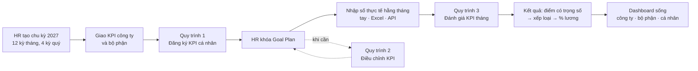
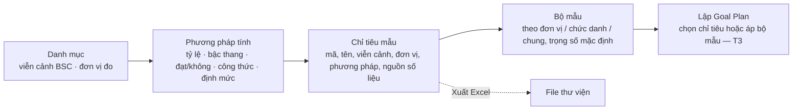
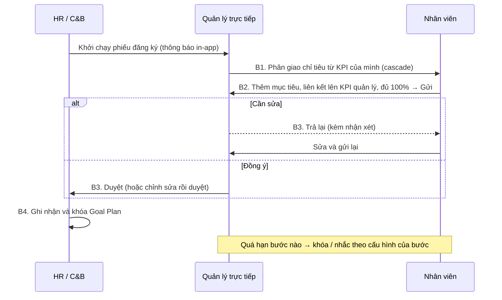
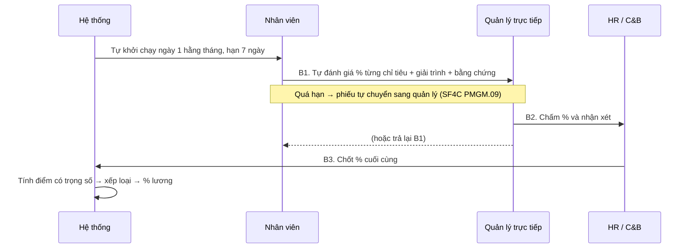

# Quy trình KPI trên hệ thống Syntra KPI (P1)

> Tài liệu làm việc cho product owner và HR — **đề xuất**, sẽ được chốt dần qua các track của Phase 2
> và buổi UAT ở Phase 4. Quy tắc chính thức: `.agents/knowledge/business-rules.md` (mã `BR-KPI-xx`).
> Cách làm hiện tại: `current-flow.md`.

---

## 1. Vòng đời một chu kỳ KPI

Ba tầng mục tiêu: **Công ty → Bộ phận → Cá nhân**, nối với nhau bằng **cascade** (quản lý giao xuống
một phần chỉ tiêu của mình) và **link** (nhân viên tự thêm mục tiêu và liên kết lên mục tiêu của quản
lý). Mỗi Goal Plan có 3–5 KGI và 5–8 KPI, tổng trọng số 100%, mỗi KPI phải có nguồn số liệu.

**Trạng thái chu kỳ** chỉ đi tới từng bước: *Đang lập kế hoạch → Đang thực hiện → Đang đánh giá → Đã
đóng*. Tên, ngày và các kỳ của chu kỳ chỉ sửa được khi còn *Đang lập kế hoạch*; muốn chuyển sang *Đang
thực hiện* phải có ít nhất một kỳ hợp lệ. Đóng chu kỳ thì mọi kỳ bị khóa số liệu và Goal Plan của chu
kỳ không sửa được nữa.

## 1A. Thư viện KPI và bộ mẫu (track T2)

HR / C&B chuẩn bị thư viện **trước** khi lập Goal Plan, để mọi kế hoạch dùng cùng tên, đơn vị đo và cách tính:

- **Viễn cảnh BSC** có đúng bốn, cố định: chỉ đổi tên hiển thị và thứ tự.
- **Chỉ tiêu mẫu** ở trạng thái *Nháp* được để trống nguồn dữ liệu; muốn *Đang áp dụng* thì phải có nguồn
  (KPI phải đo được). Chỉ chỉ tiêu *Đang áp dụng* mới chọn được khi lập Goal Plan hoặc bộ mẫu.
- **Lưu trữ** chỉ ẩn chỉ tiêu khỏi danh sách chọn, không xóa và không ảnh hưởng mục tiêu đã giao. Chỉ tiêu
  đang nằm trong một bộ mẫu *Đang áp dụng* thì phải gỡ khỏi bộ mẫu trước.
- **Chỉ tiêu chuẩn** (từ thư viện mẫu) sửa được như chỉ tiêu tự tạo, trừ mã.
- **Phương pháp tính đã dùng cho mục tiêu** giữ nguyên cách tính (loại, trần, sàn, công thức, bậc) — đổi
  sẽ làm điểm các kỳ đang mở thay đổi âm thầm. Muốn tính khác thì tạo phương pháp mới.
- **Bộ mẫu**: tổng trọng số 100% và 5–8 chỉ tiêu là **khuyến nghị**, màn hình cảnh báo nhưng vẫn cho lưu;
  Goal Plan lập từ bộ mẫu mới là thứ phải đủ 100% và 5–8 chỉ tiêu để gửi duyệt.
- **Xuất Excel** cả thư viện, bộ mẫu và danh mục mã. **Nhập từ Excel** sẽ có khi khung import chung (T4) xong.

## 2. Quy trình 1 — Đăng ký KPI (GOAL_SETTING)

Theo email template hiện tại, giữ nguyên 4 bước nhưng chạy trên hệ thống:

- Nút **Gửi** chỉ bật khi tổng trọng số đạt 100% (sai số ±0,01) và có 5–8 chỉ tiêu; nếu chưa đạt, hệ
  thống nói rõ còn thiếu gì.
- Quản lý thấy với mỗi KPI đã cascade: **đã giao cho NV / tự nhận / chưa giao / tự thực hiện**; phần
  "chưa giao" do hệ thống tính.
- Goal Plan của **công ty / bộ phận** được HR khởi tạo phiếu đăng ký bằng tay, người nhận là trưởng đơn
  vị; mỗi Goal Plan chỉ có một phiếu đăng ký đang mở.
- Hết hạn ở một bước → hệ thống **khóa Goal Plan**, phiếu đứng yên ở bước đó. HR mở khóa phải ghi lý do
  và hạn mới; bước được tính lại từ lúc mở khóa nên lần chạy sau không khóa lại ngay.
- HR hủy phiếu đăng ký (kể cả khi đang bị khóa) thì Goal Plan về *Nháp*; việc mở khóa này được ghi
  lịch sử kèm lý do hủy.

## 3. Quy trình 2 — Điều chỉnh KPI (GOAL_CHANGE)

Goal Plan đã khóa chỉ thay đổi được qua phiếu điều chỉnh: người đề xuất → quản lý trực tiếp duyệt → HR
ghi nhận và khóa lại. Chỉ tiêu bị đổi hoặc hủy giữ lịch sử (Đang áp dụng → Đã thay đổi / Đã hủy).

- HR (hoặc quản lý) khởi tạo phiếu điều chỉnh bằng tay (không qua đợt khởi chạy) cho Goal Plan **đã
  khóa**; mỗi Goal Plan chỉ có **một** phiếu điều chỉnh đang mở. Người lập lưu nháp đề xuất được khi
  chưa ghi lý do, nhưng **gửi** thì mọi dòng phải có lý do.
- Phiếu ghi **danh sách đề xuất**: thêm / sửa / hủy chỉ tiêu, mỗi dòng kèm lý do. Trong lúc phiếu đang
  chạy, Goal Plan **vẫn khóa** và số liệu, đánh giá vẫn tính theo chỉ tiêu cũ.
- Chỉ khi bước cuối duyệt, hệ thống mới áp dụng: chỉ tiêu sửa sinh bản mới (bản cũ chuyển "Đã thay đổi"
  và vẫn tra lại được), chỉ tiêu hủy chuyển "Đã hủy".

## 4. Quy trình 3 — Đánh giá KPI tháng (KPI_EVAL)

- Số **thực tế** trên phiếu lấy từ dữ liệu đã nhập (tay, Excel, API) và **chỉ đọc**.
- Phiếu chỉ gửi được khi mọi chỉ tiêu ở bước hiện tại đã có điểm (và nhận xét nếu bắt buộc).
- Quá hạn chỉ xử lý **một lần mỗi bước**: nhắc hạn không lặp lại liên tục. Nếu bước được cấu hình
  **khóa** khi quá hạn, phiếu dừng tại bước đó; HR mở khóa Goal Plan phải nhập **hạn mới**, bước chạy lại
  từ lúc mở khóa.
- Thao tác thay (HR làm thay) và ủy quyền đều ghi nhận **cả hai người**.
- Đợt đánh giá tháng tự khởi chạy ngày 1 tháng sau (một lần cho mỗi kỳ), kể cả khi chu kỳ đã sang
  *Đang đánh giá* (tháng 12). HR cũng có thể khởi chạy *ngay* hoặc *hẹn ngày*; đợt hẹn ngày chỉ hủy
  được khi chưa chạy.
- Số thực tế trên phiếu là **ảnh chụp lúc khởi chạy**, không sửa trên phiếu.
- Nhắc hạn gửi trước hạn bước 1 ngày; hệ thống có thể nhắc lại ở mỗi lần chạy nhưng mỗi người chỉ
  nhận **một** thông báo cho mỗi lần vào bước.

## 4A. Ai thấy gì, ai làm gì (Phase 1.3)

- **Quyền khác với lượt xử lý.** Quyền (`business-rules.md` §9) quyết định một người được *mở* màn hình nào và
  *xem* dữ liệu của ai. Còn ai được gửi, duyệt hay trả lại một phiếu thì do **người xử lý của bước** quyết định
  (BR-KPI-20), không phải do quyền. Vì vậy không có quyền "duyệt KPI".
- **Mỗi người nhận đủ quyền của mọi vai trò mình có.** Ai có hồ sơ nhân viên đều có vai trò Nhân viên, nên
  ai cũng có mục "Của tôi". Quản lý có thêm "Đội nhóm" và "Điều hành", HR và C&B có "Quản trị KPI", Quản trị
  hệ thống thấy tất cả.
- **Phạm vi dữ liệu:**
  - Nhân viên: của bản thân.
  - Quản lý: đơn vị mình phụ trách và các đơn vị con.
  - HR, C&B, Ban điều hành, Quản trị hệ thống: toàn công ty.
  - KPI công ty: mọi người đều xem được, vì cascade bắt đầu từ đó.
- **Nhập URL trực tiếp không vượt quyền được.** Trang ngoài quyền hiện thông báo "Bạn không có quyền thực
  hiện thao tác này" và nút về trang chủ.
- **Chạy thử nhiều vai trò không cần đăng nhập lại.** Thanh trên cùng có ô chọn **công ty** và ô chọn **người
  dùng** (nhóm theo vai trò, tìm theo tên, đơn vị, vai trò). Đổi công ty thì không còn thấy dữ liệu của công
  ty kia.
- **Ủy quyền**: không ủy quyền cho chính mình, không ủy quyền tiếp (người đang được ủy quyền không ủy
  quyền lại; người đang ủy quyền cho người khác không nhận thêm ủy quyền trùng thời gian), không tạo hai
  ủy quyền trùng người, trùng loại phiếu, trùng thời gian. Người ủy quyền hoặc HR thu hồi; quản lý cấp
  trên của người ủy quyền thì không.
- Người được ủy quyền / HR làm thay khi **lưu nháp** cũng được ghi cả hai người, như khi gửi/duyệt.

## 4B. Kết quả kỳ (Gate 1)

Sau khi phiếu đánh giá hoàn thành:

1. **Tính kết quả (C&B/HR).** Hệ thống tính bản nháp ("Tạm tính") cho mọi Goal Plan đã duyệt/khóa
   của kỳ. Cá nhân: lấy % HR chốt (cột cuối) trên phiếu đánh giá đã hoàn thành — chưa hoàn thành phiếu
   thì chưa có kết quả (giả định Q17). Công ty / phòng ban: tính từ số liệu thực tế. Tính lại bao nhiêu
   lần cũng được khi còn là bản nháp; kết quả đã chốt không bị tính lại.
2. **Điều chỉnh (C&B/HR).** Cộng/trừ điểm (vi phạm, chuyên cần) trên bản nháp; xếp loại và % lương
   KPI cập nhật ngay, kể cả khi điều chỉnh làm đổi loại.
3. **Chốt kết quả (C&B/HR).** Chốt một số hoặc toàn bộ bản nháp của kỳ. Điểm được làm tròn 2 chữ số
   một lần. Chỉ cần MỘT kết quả còn vướng (tổng trọng số ≠ 100%, chỉ tiêu chưa có điểm hoặc không tính
   được) thì không kết quả nào được chốt, và màn hình liệt kê mọi chỗ vướng.
4. **Khóa kết quả (C&B/HR).** Kết quả đã chốt được khóa để chuyển lương; bản nháp giữ nguyên.
5. Khi kết quả của kỳ đã chốt, không nhập thêm số thực tế cho Goal Plan đó trong kỳ đó.

## 5. Khác biệt so với hiện tại

| # | Hiện tại (`current-flow.md`) | Trên hệ thống | Lý do | Quy tắc |
|---|---|---|---|---|
| 1 | Công thức trong ô Excel, mỗi file một kiểu | Phương pháp tính chung trong thư viện, một chỗ, có kiểm thử | Hết `#REF!`, cùng chỉ tiêu cùng cách tính | BR-KPI-30…36 |
| 2 | Nhắc hạn bằng email tay | Thông báo in-app tự động khi khởi chạy và trước hạn | HR không phải theo dõi tay | BR-KPI-13, 19 |
| 3 | "Khóa sau hạn" chỉ là lời nhắc | Khóa thật, hoặc tự chuyển bước, theo cấu hình | Quy tắc có hiệu lực | BR-KPI-13, 14 |
| 4 | Không thấy phần chưa giao | Hệ thống tính "chưa giao" cho từng KPI cascade | Quản lý giao đủ, không giao vượt | BR-KPI-07 |
| 5 | Số liệu không nguồn, không bằng chứng | Mỗi KPI có nguồn; mỗi số ghi rõ tay / Excel / API; bằng chứng đính kèm | Kiểm chứng được khi chấm | BR-KPI-05, 52 |
| 6 | Tổng hợp cuối kỳ trong sheet TH KQ | Điểm, xếp loại, % lương tính tự động; dashboard sống | Ban điều hành thấy ngay | BR-KPI-35, 40–44 |
| 7 | Phiếu đánh giá tháng gửi tay | Tự khởi chạy theo lịch (ngày 1 hằng tháng) | Không quên kỳ nào | BR-KPI-19 (D5) |
| 8 | Mỗi phòng tự gõ bộ KPI trong sheet riêng, tổng trọng số có bộ không đủ 100% | Thư viện chỉ tiêu mẫu và bộ mẫu dùng chung; trọng số lệch được cảnh báo | Cùng tên, cùng cách tính giữa các phòng | BR-KPI-74…76 |

## 6. Câu hỏi mở

Danh sách đầy đủ và giá trị mặc định đang dùng: plan §9 và `business-rules.md` §8. Những câu ảnh hưởng
trực tiếp đến quy trình:

| # | Câu hỏi | Mặc định | Người trả lời |
|---|---|---|---|
| Q3 | Đánh giá chính theo tháng hay quý? | Tháng | HR |
| Q7 | P1 có "Lấy ý kiến", "Thêm người duyệt", bước hợp tác không? | Không (để P2) | Product owner + HR |
| Q10 | "Kế hoạch công việc tháng" (PMGM.08) có thuộc P1 không? | Không | Product owner |
| — | Goal Plan có trạng thái "Bị trả lại" riêng không? (Plan có, ERD chưa có) | Có — chốt ở Phase 1.1 | System architect + HR |
| — | Bước nào khóa khi quá hạn, bước nào tự chuyển? | Đăng ký: khóa; đánh giá: tự chuyển | HR |
| Q12 | Danh mục quyền, quyền mặc định của từng vai trò và phạm vi dữ liệu? (Các tài liệu nguồn không nêu) | Như `business-rules.md` §9 | Product owner + HR |
| Q13 | % lương KPI có chia theo số ngày làm việc khi nhân viên vào hoặc nghỉ giữa kỳ? | Không chia | HR + C&B |
| Q17 | Nhân viên có kết quả kỳ khi chưa hoàn thành phiếu đánh giá không (ví dụ lấy từ số thực tế, hoặc cột quản lý)? | Không — chỉ lấy cột cuối của phiếu đánh giá đã hoàn thành | Product owner + HR / C&B |
| Q18 | Có nhập số thực tế cho kỳ chưa bắt đầu được không? | Không | Product owner + HR / C&B |
| Q25 | Chỉ tiêu mẫu có bắt buộc nguồn dữ liệu không? | Chỉ khi Đang áp dụng | HR |
| Q26 | Bộ mẫu có bắt buộc đủ 100% và 5–8 chỉ tiêu không? | Không — chỉ cảnh báo | HR |
| Q27 | Lưu trữ chỉ tiêu mẫu nghĩa là gì? | Ẩn khỏi danh sách chọn; không được khi còn trong bộ mẫu đang áp dụng | HR |
| Q28 | Công ty có sửa được chỉ tiêu chuẩn không? | Có, trừ mã | Product owner |

## 7. Quyết định đã chốt

*(Ghi ngày, quyết định và lý do khi từng điểm trên được chốt.)*

- **19/10/2026 — Chọn người dùng, không chọn vai trò.** Quyền của một người là tổng quyền mọi vai trò người đó
  có (BR-KPI-60). Bộ chuyển trên thanh trên chỉ đổi công ty và người dùng. *Lý do: một khái niệm ít hơn để giải
  thích khi demo, và giống hệ thống thật.*
- **19/10/2026 — Quản lý xem theo đơn vị phụ trách và các đơn vị con.** Phạm vi "cấp dưới trực tiếp" vẫn dùng
  được cho trưởng nhóm không phụ trách đơn vị.
- **19/10/2026 — Quản trị hệ thống có toàn bộ quyền** và thấy cả 5 nhóm menu. Đây là điểm khác plan §7.1.

**19/10/2026 — Phase 1.5, các quy tắc tính và quy trình (product owner duyệt).** Chi tiết: `business-rules.md`.

- **Không có điểm thì không phải 0%.** Chỉ tiêu chưa có số thực tế hoặc không tính được (mục tiêu = 0,
  không khớp bậc/định mức) được coi là chưa có điểm; còn chỉ tiêu như vậy thì HR không chốt được kết quả.
- **Trần bắt buộc** với các phương pháp tỷ lệ và công thức. Không đặt sàn thì sàn là 0%.
- **Định mức L1/L2/L3:** cần ít nhất 2 mức; giữa hai mức thì nội suy; vượt mức cao nhất thì lấy điểm mức
  cao nhất; chưa đạt L1 thì 0%.
- **Xếp loại** đọc điểm đã làm tròn 2 chữ số (89,995 → 90,00 → loại B).
- **Người nghỉ việc giữa kỳ** vẫn được đánh giá cho kỳ có làm việc; phần chỉ tiêu đã giao cho họ quay
  về "chưa giao"; % lương KPI không chia theo số ngày làm việc (giả định Q13).
- **Khóa khi quá hạn** chỉ dùng cho phiếu đăng ký. Không ai được duyệt phiếu của chính mình. HR được làm
  thay ở bước không có người xử lý, để phiếu không bị kẹt.

**19/10/2026 — Gate 1, luồng quy trình (product owner duyệt).**

- Chu kỳ chỉ đi tới từng bước; chỉ sửa chu kỳ và kỳ khi *Đang lập kế hoạch*; đóng chu kỳ khóa mọi kỳ.
- Đánh giá tự khởi chạy cả trong chu kỳ *Đang đánh giá*.
- Hệ thống không tự lọc nhắc hạn trùng; mỗi lần nhắc mang một khóa cố định để thông báo chỉ ghi một lần.

**19/10/2026 — Gate 1, kết quả kỳ (product owner duyệt).**

- Kết quả cá nhân chỉ lấy từ phiếu đánh giá đã hoàn thành (giả định Q17).
- Chốt kết quả theo nguyên tắc "tất cả hoặc không": còn một kết quả vướng thì không chốt kết quả nào.
- Phòng ban/công ty được xếp loại nhưng không có % lương.
- Kỳ đã chốt kết quả thì không nhập thêm số thực tế; chưa đến kỳ thì cũng chưa nhập được (giả định Q18).

**19/10/2026 — Track T2, thư viện KPI (product owner duyệt).** Chi tiết: `business-rules.md` §3b.

- **Xuất Excel trước, nhập sau.** Nhập thư viện từ Excel sẽ dùng khung import chung của T4, không làm riêng.
- **Bộ mẫu chỉ cảnh báo** khi tổng trọng số khác 100% hoặc số chỉ tiêu ngoài 5–8; chỉ chặn việc thêm chỉ
  tiêu Nháp/Lưu trữ vào bộ mẫu.
- **Phương pháp tính đã dùng cho mục tiêu thì khóa cách tính**; tên, mô tả, mã vẫn sửa được.
