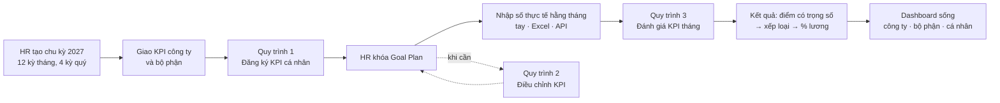
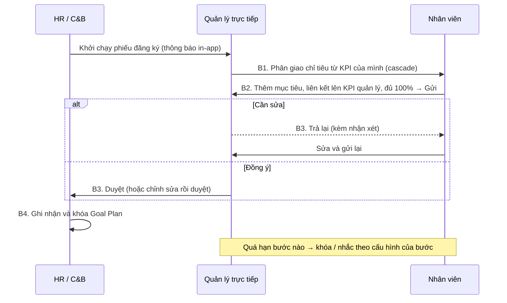
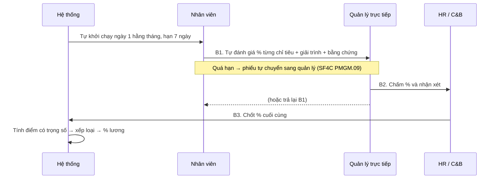

# Quy trình KPI trên hệ thống Syntra KPI (P1)

> Tài liệu làm việc cho product owner và HR — **đề xuất**, sẽ được chốt dần qua các track của Phase 2
> và buổi UAT ở Phase 4. Quy tắc chính thức: `.agents/knowledge/business-rules.md` (mã `BR-KPI-xx`).
> Cách làm hiện tại: `current-flow.md`.

---

## 1. Vòng đời một chu kỳ KPI

Ba tầng mục tiêu: **Công ty → Bộ phận → Cá nhân**, nối với nhau bằng **cascade** (quản lý giao xuống
một phần chỉ tiêu của mình) và **link** (nhân viên tự thêm mục tiêu và liên kết lên mục tiêu của quản
lý). Mỗi Goal Plan có 3–5 KGI và 5–8 KPI, tổng trọng số 100%, mỗi KPI phải có nguồn số liệu.

## 2. Quy trình 1 — Đăng ký KPI (GOAL_SETTING)

Theo email template hiện tại, giữ nguyên 4 bước nhưng chạy trên hệ thống:

- Nút **Gửi** chỉ bật khi tổng trọng số đạt 100% (sai số ±0,01) và có 5–8 chỉ tiêu; nếu chưa đạt, hệ
  thống nói rõ còn thiếu gì.
- Quản lý thấy với mỗi KPI đã cascade: **đã giao cho NV / tự nhận / chưa giao / tự thực hiện**; phần
  "chưa giao" do hệ thống tính.

## 3. Quy trình 2 — Điều chỉnh KPI (GOAL_CHANGE)

Goal Plan đã khóa chỉ thay đổi được qua phiếu điều chỉnh: người đề xuất → quản lý trực tiếp duyệt → HR
ghi nhận và khóa lại. Chỉ tiêu bị đổi hoặc hủy giữ lịch sử (Đang áp dụng → Đã thay đổi / Đã hủy).

## 4. Quy trình 3 — Đánh giá KPI tháng (KPI_EVAL)

- Số **thực tế** trên phiếu lấy từ dữ liệu đã nhập (tay, Excel, API) và **chỉ đọc**.
- Phiếu chỉ gửi được khi mọi chỉ tiêu ở bước hiện tại đã có điểm (và nhận xét nếu bắt buộc).
- Thao tác thay (HR làm thay) và ủy quyền đều ghi nhận **cả hai người**.

## 5. Khác biệt so với hiện tại

| # | Hiện tại (`current-flow.md`) | Trên hệ thống | Lý do | Quy tắc |
|---|---|---|---|---|
| 1 | Công thức trong ô Excel, mỗi file một kiểu | Phương pháp tính chung trong thư viện, một chỗ, có kiểm thử | Hết `#REF!`, cùng chỉ tiêu cùng cách tính | BR-KPI-30…36 |
| 2 | Nhắc hạn bằng email tay | Thông báo in-app tự động khi khởi chạy và trước hạn | HR không phải theo dõi tay | BR-KPI-13, 19 |
| 3 | "Khóa sau hạn" chỉ là lời nhắc | Khóa thật, hoặc tự chuyển bước, theo cấu hình | Quy tắc có hiệu lực | BR-KPI-13, 14 |
| 4 | Không thấy phần chưa giao | Hệ thống tính "chưa giao" cho từng KPI cascade | Quản lý giao đủ, không giao vượt | BR-KPI-07 |
| 5 | Số liệu không nguồn, không bằng chứng | Mỗi KPI có nguồn; mỗi số ghi rõ tay / Excel / API; bằng chứng đính kèm | Kiểm chứng được khi chấm | BR-KPI-05, 52 |
| 6 | Tổng hợp cuối kỳ trong sheet TH KQ | Điểm, xếp loại, % lương tính tự động; dashboard sống | Ban điều hành thấy ngay | BR-KPI-35, 40–43 |
| 7 | Phiếu đánh giá tháng gửi tay | Tự khởi chạy theo lịch (ngày 1 hằng tháng) | Không quên kỳ nào | BR-KPI-19 (D5) |

## 6. Câu hỏi mở

Danh sách đầy đủ và giá trị mặc định đang dùng: plan §9 và `business-rules.md` §8. Những câu ảnh hưởng
trực tiếp đến quy trình:

| # | Câu hỏi | Mặc định | Người trả lời |
|---|---|---|---|
| Q3 | Đánh giá chính theo tháng hay quý? | Tháng | HR |
| Q7 | P1 có "Lấy ý kiến", "Thêm người duyệt", bước hợp tác không? | Không (để P2) | Product owner + HR |
| Q10 | "Kế hoạch công việc tháng" (PMGM.08) có thuộc P1 không? | Không | Product owner |
| — | Goal Plan có trạng thái "Bị trả lại" riêng không? (Plan có, ERD chưa có) | Có — chốt ở Phase 1.1 | System architect + HR |
| — | Bước nào khóa khi quá hạn, bước nào tự chuyển? | Đăng ký: khóa; đánh giá: tự chuyển | HR |

## 7. Quyết định đã chốt

*(Ghi ngày, quyết định và lý do khi từng điểm trên được chốt.)*
