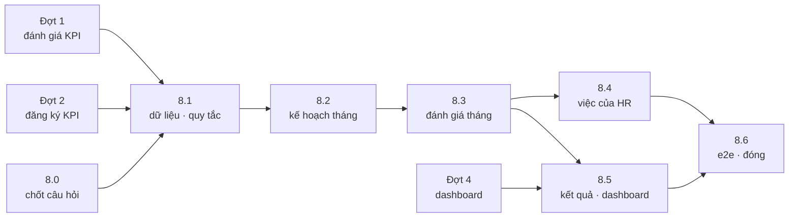

# Kế hoạch triển khai mục 4 — Giao, nhận, đánh giá công việc tháng

> Phiên bản 1.0 · 23/10/2026 · Người lập: Claude cho @harleyng
> **Là Đợt 8 của** `docs/plans/KPI_update_plan_2210.md` (dùng chung quy tắc §2, đợt 0 và bảng rủi ro của file đó).
> **Nguồn:** CMC PMGM — HR tr. 13 (mục 4), 25–26 (trường của "Kế hoạch công việc tháng"), 88–95 (khởi chạy định
> kỳ), 141–150 (import điểm tổng thể tháng, định tuyến phiếu) · Nhân viên tr. 67–73 · Quản lý tr. 120–136 ·
> SF4C PMGM.08–09 · biên bản 22/10/2026 §2.8 (P1 gồm mục 4).
> **Mục đích:** đưa nghiệp vụ "công việc tháng" của CMC vào prototype, chia thành các bước làm được, mỗi bước có
> thiết kế, việc cần làm, ca kiểm thử và điều kiện "xong". Đây là kế hoạch, **chưa có dòng code nào được sửa**.

---

## 1. Tóm tắt

**Bài toán.** Đầu tháng, nhân viên và quản lý thống nhất danh sách công việc của tháng (có trọng số). Trong tháng,
nhân viên cập nhật tiến độ. Cuối tháng, cả hai chấm điểm từng việc và chấm ý thức kỷ luật; hệ thống ra **điểm hoàn
thành công việc tháng (Hsht)**. Dưới 80 điểm thì quản lý phải quyết định **Hsnv** kèm giải trình. HR ghi nhận, có
thể import điểm hàng loạt.

**Mâu thuẫn phạm vi cần chốt trước (đợt 8.0).** `Q10` đang ghi "Kế hoạch công việc tháng **không** thuộc P1", còn
biên bản 22/10 §2.8 đưa **mục 4** vào P1 dưới tên "đánh giá hiệu suất liên tục hằng tháng". Kế hoạch này giả định
mục 4 = nghiệp vụ công việc tháng của CMC (đề xuất Q59) và **đảo Q10**. Nếu product owner chọn khác, chỉ đợt 8.0
còn giá trị.

| Bước | Nội dung | Cỡ / làn (CLAUDE.md) | Bị chặn bởi |
|---|---|---|---|
| 8.0 | Chốt câu hỏi, PEND-14, tài liệu quy trình, ERD | Flow/Spec (tài liệu) | Q59, Q60 |
| 8.1 | Dữ liệu và quy tắc: thực thể, contract, mock, `workRules`, seed | **Large** (contract + fixture) · KPI Rules | 8.0 |
| 8.2 | Kế hoạch tháng: phiếu WORK_PLAN, màn hình nhân viên / quản lý, cập nhật tiến độ | **Large** · Workflow | 8.1, PEND-01 |
| 8.3 | Đánh giá tháng: phiếu WORK_REVIEW, KQcv / KLcv / Hsht / Hsnv | **Large** · KPI Rules + Workflow | 8.2, PEND-07, 08 |
| 8.4 | Việc của HR: khởi chạy định kỳ, theo dõi, import điểm, hoàn tất hàng loạt | Medium · Workflow | 8.3, PEND-02 |
| 8.5 | Kết quả tháng và dashboard | Medium | 8.3, Đợt 4 (PEND-13) |
| 8.6 | E2E, design review, đóng PEND-14 | QA | 8.1–8.5 |



**Vị trí trong lịch chung.** Biên bản yêu cầu **mục 1 và 4 trước**. Đợt 8 dùng lại cơ chế của đợt 1 (HR ghi nhận —
PEND-08) và đợt 2 (bắt đầu từ bước nhân viên — PEND-01; tự động ghi nhận, HR trả về — PEND-02), và cùng sửa
`workflowRules` / `catalog.ts`. Vì vậy làm **sau đợt 1 và 2**, **trước hoặc song song với đợt 3** (đợt 3 không đụng
phiếu công việc tháng), và **trước đợt 4** để dashboard có số công việc tháng ngay lần đầu. Đợt 8.0 làm cùng đợt 0.

## 2. Quy trình CMC (tóm tắt nguồn)

| Việc | Ai | Nguồn |
|---|---|---|
| Đề xuất công việc tháng: thêm việc vào mục "Kế hoạch tháng N" (cách 1: màn hình Mục tiêu; cách 2: trên phiếu) | Nhân viên tự đề xuất, **hoặc** quản lý đề xuất cho nhân viên | NV tr. 68–71; QL tr. 121–127, 131–134 |
| Quản lý sửa / thêm / xóa việc, nhận xét tổng quan, gửi tiếp hoặc trả về | Quản lý | QL tr. 126–127 |
| Cuối tháng tự đánh giá từng việc, cập nhật % hoàn thành, gửi | Nhân viên | NV tr. 72–73; QL tr. 135–136 |
| Chấm từng việc + kỷ luật, nhận xét, gửi tiếp hoặc trả về | Quản lý | QL tr. 128–130 |
| Khởi chạy phiếu định kỳ; import điểm tổng thể hàng loạt rồi chuyển phiếu sang hoàn thành; định tuyến phiếu | HR | HR tr. 88–95, 141–150 |
| Quá hạn tự chuyển cho quản lý trực tiếp | Hệ thống | SF4C PMGM.09 |

**Trường của một việc** (HR tr. 25–26, QL tr. 123–124): hiển thị (công khai / riêng tư), loại (kế hoạch tháng N),
tên công việc*, sản phẩm / quy trình, mô tả, đơn vị đo, trọng số trong tháng, ngày bắt đầu, ngày kết thúc,
% hoàn thành, trạng thái thực hiện, ghi chú.

**Cách chấm trên phiếu CMC** (NV tr. 73, QL tr. 129):

| Phần | Trọng số | Cách chấm |
|---|---|---|
| Kết quả công việc tháng (KQcv) | 70% | Mỗi việc 0–100; KQcv = Σ điểm × trọng số việc |
| Đánh giá tính kỷ luật (KLcv) | 30% | Một tiêu chí "Ý thức chấp hành kỷ luật và thái độ làm việc", 1–100 |
| **Hsht** | — | **Hsht = 70% × KQcv + 30% × KLcv** |
| **Hsnv** | — | Bắt buộc khi Hsht < 80: quản lý quyết định, **kèm giải trình**; nhãn "Hsnv – Ranking" |

## 3. Giải pháp tổng quát

### 3.1 Luồng người dùng

```mermaid
sequenceDiagram
  participant SYS as Hệ thống
  participant NV as Nhân viên
  participant QL as Quản lý trực tiếp
  participant HR as HR / C&B
  SYS->>NV: Ngày 1 tháng M: khởi chạy phiếu "Kế hoạch công việc tháng M"
  NV->>QL: B1. Lập danh sách việc, trọng số đủ 100% (hoặc sao chép tháng trước)
  Note over NV,QL: Top-down: đợt khởi chạy chọn "Quản lý giao trước" (PEND-01)
  QL-->>NV: B2. Trả lại kèm nhận xét
  QL->>SYS: B2. Sửa / thêm / xóa, duyệt → kế hoạch khóa
  NV->>NV: Trong tháng: cập nhật % hoàn thành, trạng thái (không qua phiếu)
  SYS->>NV: Ngày 1 tháng M+1: khởi chạy phiếu "Đánh giá công việc tháng M"
  NV->>QL: B1. Tự chấm từng việc 0–100 + KLcv + ý kiến
  Note over NV,QL: Quá hạn → tự chuyển cho quản lý (BR-KPI-13)
  QL->>HR: B2. Chấm từng việc + KLcv; Hsht < 80 → bắt buộc Hsnv + giải trình
  QL-->>NV: (hoặc trả lại B1)
  HR->>SYS: B3. Ghi nhận (hoặc tự động — PEND-02); import điểm hàng loạt
  SYS->>SYS: Chốt kết quả tháng → Kết quả của tôi, đội nhóm, dashboard
```

### 3.2 Quyết định thiết kế (đề xuất — chốt ở 8.0)

| # | Quyết định | Đề xuất | Lý do |
|---|---|---|---|
| D-W1 | Một phiếu cho cả tháng (như CMC) hay hai phiếu | **Hai phiếu**: `WORK_PLAN` (đầu tháng) và `WORK_REVIEW` (đầu tháng sau) | Bộ máy quy trình hiện tại không có bước "chờ đến cuối tháng"; hai phiếu dùng lại đúng mẫu GOAL_SETTING + KPI_EVAL, quá hạn và nhắc hạn đúng từng giai đoạn. Dễ đảo ngược: gộp lại sau chỉ là đổi mẫu |
| D-W2 | Mô hình việc tháng là Goal Plan loại mới hay thực thể riêng | **Thực thể riêng** `WorkPlan` + `WorkTask` | Goal của KPI gắn thư viện, phương pháp tính, mục tiêu theo kỳ, cascade — việc tháng không có những thứ đó. Không làm phức tạp `goalPlanRules` |
| D-W3 | Quan hệ với phiếu KPI_EVAL tháng (PEND-09) | **Phiếu công việc tháng là "đánh giá liên tục hằng tháng"**; phiếu KPI chỉ còn quý / năm. Phiếu tháng có phần **"KPI tháng (tham khảo)"** chỉ đọc | Một nhân viên chỉ nhận **một** phiếu đánh giá mỗi tháng; khớp biên bản "tháng là liên tục, quý / năm là chính thức" (Q60) |
| D-W4 | Việc tháng có liên kết KPI không | **Tùy chọn** `linkedGoalId` (một KPI trong Goal Plan đã khóa của chính nhân viên); không ảnh hưởng điểm | Thấy việc phục vụ KPI nào, không trộn cách tính (Q63) |
| D-W5 | Trọng số 70/30 và ngưỡng 80 | **Cấu hình theo tenant**, mặc định 70 / 30 / 80 | Mỗi công ty con có thể khác (Q62) |
| D-W6 | Hsnv | Thang **điểm 0–100** (thay Hsht làm điểm cuối) cho tới khi HR gửi thang "Ranking" | Nguồn chỉ có nhãn "Ranking", không có giá trị (Q61) |
| D-W7 | Kết quả tháng vào lương | **Không** — theo đề xuất Q52 | Tháng là theo dõi; quý / năm mới ra % lương |

## 4. Bước 8.0 — Chốt câu hỏi và tài liệu

| Câu hỏi | Nội dung | Đề xuất | Người trả lời | Chặn |
|---|---|---|---|---|
| Q59 | Mục 4 của P1 là "công việc tháng" của CMC hay chỉ theo dõi KPI tháng? (đảo Q10) | Công việc tháng của CMC | Product owner | Toàn bộ đợt 8 |
| Q60 | Phiếu công việc tháng thay phiếu KPI_EVAL tháng, hay hai phiếu song song? | Thay (D-W3) | Product owner + HR | 8.3, PEND-09 |
| Q61 | Hsnv là điểm hay xếp hạng; thang giá trị? | Điểm 0–100 (D-W6) | HR | 8.3 |
| Q62 | 70/30 và ngưỡng 80 cố định hay theo công ty? | Theo tenant, mặc định 70/30/80 | HR | 8.1 |
| Q63 | Việc tháng có liên kết KPI không, có bắt buộc không? | Tùy chọn, không ảnh hưởng điểm | Product owner | 8.2 |
| Q64 | Việc bị hủy giữa tháng: loại khỏi KQcv và chia lại trọng số, hay giữ với điểm 0? | Quản lý hủy kèm lý do; loại khỏi KQcv, trọng số còn lại chuẩn hóa về 100 | HR | 8.1 |
| Q65 | Hạn: lập kế hoạch đến ngày mấy; đánh giá đến ngày mấy tháng sau? | Lập kế hoạch: ngày 5 tháng M; đánh giá: cùng hạn đánh giá đang có (ngày 13 tháng sau) | HR | 8.4 |
| Q66 | Nhân viên vào làm / nghỉ giữa tháng có phiếu không? | Có phiếu nếu còn làm việc ngày khởi chạy; không chia theo ngày công | HR | 8.4 |

**Việc tài liệu (Flow/Spec — dùng `/update-flow`):**

- [ ] `business-rules.md`: thêm **PEND-14** vào §12; Q10 ghi "đảo — xem Q59"; thêm Q59–Q66 vào §8 kèm
  `ASSUMPTION` theo cột "Đề xuất".
- [ ] `docs/flows/new-flow.md`: mục mới **"Quy trình 4 — Công việc tháng (WORK_PLAN, WORK_REVIEW)"** (sơ đồ §3.1),
  dòng mới ở bảng §5 ("Kế hoạch việc tháng trên Excel / email" → "phiếu tự khởi chạy, điểm tự tính"), PEND-14 ở
  bảng thay đổi, Q59–Q66 ở §6.
- [ ] `docs/source-map.md`: PMGM.08 đổi từ *Out (Q10)* sang *In (PEND-14)*; thêm các trang HR / NV / QL ở §2.
- [ ] `docs/erd/kpi_erd.mermaid`: bảng `WORK_PLAN`, `WORK_TASK`, `WORK_REVIEW`, `WORK_RESULT` (8.1).
- [ ] `docs/plans/KPI_repo_plan.md` §1: P1 gồm mục 4 = công việc tháng (cùng việc tài liệu của đợt 0).

**Xong khi.** Product owner trả lời Q59 (ít nhất); PEND-14 có trong §12; `npm run guides:check` không đổi.

## 5. Bước 8.1 — Dữ liệu và quy tắc

**Chuyên gia.** `system-architect` (contract, fixture, cách ly tenant) + `hr-performance-expert` (công thức) + `qa`.

### Thực thể (`src/data/types.ts` — dùng `/add-entity`)

| Thực thể | Trường chính | Ghi chú |
|---|---|---|
| `WorkPlan` | `employeeId`, `periodId` (kỳ **Month**), `status` (dùng `GOAL_PLAN_STATUSES`), `approvedAt`, `approvedBy` | Một kế hoạch cho mỗi (nhân viên, kỳ tháng) |
| `WorkTask` | `workPlanId`, `name`*, `product`, `description`, `unitText`, `weight`, `startDate`, `dueDate`, `progressPct`, `progressStatus`, `note`, `visibility`, `linkedGoalId?`, `createdBy`, `cancelledAt?`, `cancelReason?` | Không xóa cứng sau khi kế hoạch được duyệt — hủy kèm lý do |
| `WorkReview` | `formId`, `workPlanId`, theo cột SELF / MANAGER / FINAL: `disciplineScore`, `comment`; `hsnv`, `hsnvReason` | Đầu vào của phần KLcv và Hsnv |
| `WorkReviewItem` | `formId`, `taskId`, theo cột: `score`, `comment` | Điểm từng việc, giống `EvaluationItem` |
| `WorkResult` | `employeeId`, `periodId`, `kqcv`, `klcv`, `hsht`, `hsnv`, `finalScore`, `status` | Ảnh chụp khi phiếu hoàn thành; dashboard và Kết quả đọc từ đây |
| `WorkScoringConfig` | `resultWeight` (70), `disciplineWeight` (30), `hsnvThreshold` (80), `scoreMin`, `scoreMax` | Một bản ghi cho mỗi tenant (Q62) |

**Tập cố định mới** (thêm cùng bảng nhãn và `business-rules.md`, Critical rule 2):

- `FORM_TYPES` += `WORK_PLAN` ("Kế hoạch công việc tháng"), `WORK_REVIEW` ("Đánh giá công việc tháng").
- `WORK_TASK_STATUSES` = `NotStarted` · `InProgress` · `Done` · `Cancelled` ("Chưa bắt đầu", "Đang thực hiện",
  "Hoàn thành", "Đã hủy").
- `TASK_VISIBILITIES` = `Public` · `Private` ("Công khai", "Riêng tư").
- `LAUNCH_TRIGGERS` += `PERIOD_START` (khởi chạy vào đầu kỳ, `offsetDays` tính từ ngày đầu kỳ).
- `FormInstance` += `workPlanId: Id | null`.

### Contract `DataGateway` (`src/integrations/data/types.ts`)

Mọi hàm nhận `tenantId` trước; hàm ghi nhận `actorUserId` thứ hai; giờ lấy từ `clock`; mọi id trong payload phải
thuộc tenant (Critical rule 4).

- Đọc: `listWorkPlans(tenantId, filter)` · `getWorkPlan(tenantId, id)` · `listWorkTasks(tenantId, workPlanId)` ·
  `getWorkReview(tenantId, formId)` · `listWorkResults(tenantId, filter)` · `getWorkScoringConfig(tenantId)`.
- Ghi: `saveWorkTasks(tenantId, actor, workPlanId, patch)` (thêm / sửa / hủy theo bước) ·
  `updateTaskProgress(tenantId, actor, taskId, { progressPct, progressStatus, note })` ·
  `saveWorkReview(tenantId, actor, formId, patch)` · `importWorkScores(tenantId, actor, rows)` (8.4) ·
  `saveWorkScoringConfig(tenantId, actor, config)`.
- Mock: nhóm mới trong `src/integrations/data/mock/`; tạo `WorkPlan` khi phiếu WORK_PLAN khởi chạy; chụp
  `WorkResult` khi WORK_REVIEW hoàn thành; ghi nhật ký như mọi EDIT.

### Quy tắc — file mới `src/lib/workRules.ts` (+ `workRules.test.ts`)

Mọi phép tính chỉ nằm ở đây (Critical rule 5). Không có điểm → `null`, **không bao giờ 0** (giống BR-KPI-32).

| Hàm | Việc |
|---|---|
| `taskWeightIssues(tasks)` | Việc chưa hủy: trọng số > 0, tổng = 100 (dung sai 0,01) → lỗi để chặn gửi |
| `effectiveWeights(tasks)` | Bỏ việc đã hủy, chuẩn hóa trọng số còn lại về 100 (Q64) |
| `kqcv(items, tasks, column)` | Σ điểm × trọng số hiệu lực / 100; thiếu điểm của một việc chưa hủy → `null` |
| `hsht(kqcv, klcv, config)` | `resultWeight% × KQcv + disciplineWeight% × KLcv`; một bên `null` → `null` |
| `hsnvRequired(hsht, config)` | `hsht < hsnvThreshold` (ngưỡng không tính — 80 thì không bắt buộc) |
| `reviewSubmitIssues(review, items, step)` | Thiếu điểm việc / KLcv; điểm ngoài thang; Hsnv bắt buộc mà thiếu Hsnv hoặc giải trình |
| `finalWorkScore(hsht, hsnv)` | `hsnv ?? hsht` |
| `planSubmitIssues(plan, tasks, step)` | Kế hoạch rỗng; trọng số; ngày kết thúc trước ngày bắt đầu hoặc ngoài tháng |
| `taskEditBlockers(plan, task, actor, step)` | Ai được sửa gì ở bước nào; sau khi duyệt chỉ sửa tiến độ |

**Kiểm thử (`workRules.test.ts`).** Bảng ca: 3 việc 50/30/20 với điểm 100/80/0; tổng trọng số 99,99 / 100,01 /
101; việc hủy giữa tháng → chuẩn hóa; tất cả việc bị hủy → KQcv `null`; KLcv thiếu → Hsht `null`; Hsht = 79,99 /
80 / 80,01 với ngưỡng 80; Hsnv thiếu giải trình → lỗi; cấu hình 60/40; điểm −1 / 101 → lỗi; `linkedGoalId` không
ảnh hưởng điểm.

**Cách ly tenant** (`mockGateway.test.ts`): mỗi hàm đọc không trả bản ghi tenant khác; mỗi hàm ghi từ chối
`workPlanId` / `taskId` / `linkedGoalId` / `formId` của tenant khác.

### Seed (`src/data/fixtures/` — **Large**, `system-architect` review, gom vào một commit)

- [ ] `catalog.ts`: hai mẫu quy trình (§6, §7), hai quy tắc khởi chạy, `WorkScoringConfig` mặc định, thông báo dùng
  lại sự kiện sẵn có (`FORM_LAUNCHED`, `STEP_ASSIGNED`, `DEADLINE_REMIND`, `RETURNED`).
- [ ] `demoCo.ts` / `timeline.ts`: 3 tháng gần nhất cho vài nhân viên mẫu — một tháng đã chốt (có một người
  Hsht < 80 với Hsnv), một tháng đang đánh giá, một tháng đang lập kế hoạch.
- [ ] `seed.test.ts`: trọng số mỗi kế hoạch đã duyệt = 100; mỗi `WorkResult` khớp `workRules`.

**Xong khi.** Gate xanh; tenant isolation test có đủ hàm mới; `component-registry.md` và `architecture.md` có
thực thể và hook mới.

## 6. Bước 8.2 — Kế hoạch công việc tháng (WORK_PLAN)

**Chuyên gia.** `workflow-expert` + `system-architect` → `ui-ux` (màn hình) → `qa`. Dùng `/add-workflow`, `/new-page`.

**Mẫu quy trình `WORK_PLAN` (2 bước).**

| Bước | Người | Hành động | Hạn | Quá hạn |
|---|---|---|---|---|
| 1. Nhân viên lập kế hoạch | SELF | SUBMIT, EDIT | đến ngày 3 | AUTO_FORWARD (quản lý lập thay) |
| 2. Quản lý duyệt kế hoạch | DIRECT_MANAGER | APPROVE, RETURN, EDIT | đến ngày 5 | REMIND |

- **Top-down (CMC 8.1):** đợt khởi chạy chọn "Bắt đầu từ: quản lý giao trước" — dùng lại `FormLaunch.startStepNo`
  của PEND-01, với mẫu ba bước (quản lý giao → nhân viên bổ sung → quản lý duyệt). Không làm cơ chế riêng.
- APPROVE ở bước 2 → `WorkPlan` *Đã khóa*; việc chỉ còn sửa được tiến độ. Đổi việc sau khi khóa: quản lý thêm /
  hủy việc kèm lý do (ghi nhật ký) — **không** làm phiếu điều chỉnh riêng ở P1.
- **Sao chép tháng trước:** nút trên bước 1, chép tên / sản phẩm / mô tả / đơn vị / trọng số của việc chưa xong,
  ngày lấy theo tháng mới; tiến độ về 0.

**Màn hình (Vietnamese inline, `useNavigate()` — không `asChild`).**

- [ ] **Nhân viên** `/my/work` "Công việc tháng" (nhóm *Của tôi* trong `navConfig.ts`): chọn tháng; bảng việc
  (tên, sản phẩm, trọng số, hạn, % hoàn thành, trạng thái); tổng trọng số luôn hiện, đỏ khi ≠ 100%; nút "Thêm
  việc", "Sao chép tháng trước", "Gửi kế hoạch". Sau khi khóa: ô % và trạng thái sửa tại chỗ.
- [ ] **Phiếu** `/my/tasks/...` → `FormDetailPage` với thân mới `WorkPlanFormBody.tsx` (cạnh `GoalPlanFormBody`).
- [ ] **Quản lý** `/team/work` "Công việc tháng của đội" (nhóm *Đội nhóm*): mỗi nhân viên trực tiếp một dòng —
  trạng thái kế hoạch, số việc, % hoàn thành bình quân có trọng số, trạng thái phiếu đánh giá, Hsht; bấm vào xem
  kế hoạch.
- [ ] Hook: `src/hooks/queries/useWorkPlans.ts` (key bắt đầu bằng tenant; mutation `invalidateQueries`).
- [ ] Chi tiết tuyến thêm vào bảng route ở `.agents/knowledge/architecture.md`.

**Kiểm thử.** Gửi khi tổng ≠ 100 → ERR (dùng mã sẵn có trong `errorCatalog.ts`, thêm mã mới nếu cần); quản lý trả
về → bước 1, kế hoạch *Bị trả lại*; quá hạn bước 1 → chuyển quản lý, ghi `AUTO_FORWARD`; nhân viên sửa việc sau
khi khóa → bị chặn trừ tiến độ; quản lý hủy việc không lý do → lỗi; sao chép tháng trước không mang việc đã xong;
nhân viên không thấy kế hoạch của người khác (BR-KPI-60…64); việc *Riêng tư* chỉ nhân viên và quản lý trực tiếp
thấy.

**Xong khi.** Một nhân viên mẫu lập → quản lý duyệt → kế hoạch khóa, chạy được trên dev server 8082.

## 7. Bước 8.3 — Đánh giá công việc tháng (WORK_REVIEW)

**Chuyên gia.** `hr-performance-expert` + `workflow-expert` + `qa`.

**Mẫu quy trình `WORK_REVIEW` (3 bước)** — cùng hình dạng KPI_EVAL sau đợt 1:

| Bước | Người | Cột | Hành động | Quá hạn |
|---|---|---|---|---|
| 1. Tự đánh giá | SELF | SELF | SUBMIT, EDIT | AUTO_FORWARD (BR-KPI-13, PMGM.09) |
| 2. Quản lý đánh giá | DIRECT_MANAGER | MANAGER | SUBMIT, RETURN, EDIT | REMIND |
| 3. HR ghi nhận | HR | FINAL | APPROVE, RETURN, EDIT; `autoApprove` theo cấu hình (PEND-02) | REMIND |

- Phiếu đọc kế hoạch **đã khóa** của tháng đó. Kế hoạch chưa khóa lúc khởi chạy → phiếu vẫn tạo, bước 1 báo
  "Kế hoạch tháng chưa được duyệt" và quản lý duyệt nhanh ngay trên phiếu (không chặn cả đợt).
- Cột MANAGER mặc định bằng cột SELF; cột FINAL tự điền bằng cột MANAGER khi vào bước 3 (như PEND-08).
- Hsht, KQcv tính trực tiếp từ `workRules` mỗi lần hiển thị; ô **Hsnv + giải trình** chỉ hiện và bắt buộc khi
  Hsht < ngưỡng.
- **Phần "KPI tháng (tham khảo)"** (D-W3): bảng chỉ đọc các KPI của nhân viên trong tháng — thực tế, mục tiêu, %
  từ `resultRules`. Không chấm, không vào Hsht.

**Màn hình.** `WorkReviewFormBody.tsx` — bố cục theo phiếu CMC: *Kết quả công việc (70%)* · *Kỷ luật (30%)* ·
*Tổng hợp* (KQcv, KLcv, Hsht, Hsnv). Cột của người khác hiện bên phải như `EvaluationFormBody`. Chạy
`/design-review critique` trước khi gộp.

**Kiểm thử.** Đủ điểm → gửi được; thiếu một việc → chặn; Hsht 79 không Hsnv → chặn; Hsht 80 → không đòi Hsnv;
quản lý trả về → bước 1 giữ điểm cũ; quá hạn bước 1 → quản lý chấm, cột SELF trống; HR sửa FINAL không lý do →
lỗi (PEND-08); hoàn thành → đúng một `WorkResult`; tháng đã chốt không mở lại được trừ HR (giống mở khóa,
BR-KPI-14).

**Xong khi.** E2E nhân viên → quản lý → HR cho một tháng, `WorkResult` khớp tính tay.

## 8. Bước 8.4 — Việc của HR

**Chuyên gia.** `workflow-expert` + `system-architect` → `qa`. Dùng `/add-import-template` cho phần import.

- [ ] **Khởi chạy định kỳ.** Hai quy tắc: WORK_PLAN `PERIOD_START` +0 ngày (ngày 1 tháng M), WORK_REVIEW
  `PERIOD_END` +1 ngày (ngày 1 tháng M+1). `workflowRules` / scheduler: `PERIOD_START` bắn **một lần mỗi (quy tắc,
  kỳ)** như `PERIOD_END` (BR-KPI-19). HR vẫn khởi chạy *ngay* / *hẹn ngày* như hiện tại. Màn hình
  `/admin/launches/rules` có thêm lựa chọn "Đầu kỳ".
- [ ] **Theo dõi.** `/admin/launches/forms` lọc được hai loại phiếu mới; tab *Vận hành* của dashboard đếm phiếu
  quá hạn của chúng.
- [ ] **Import điểm hàng loạt** (HR tr. 141–149): mẫu Excel điền sẵn nhân viên × tháng (mã NV, họ tên, mã phiếu,
  KQcv, KLcv, Hsnv, giải trình); xem trước, kiểm tra từng dòng (phiếu không thuộc tenant, phiếu đã hoàn thành, điểm
  ngoài thang, Hsnv bắt buộc thiếu giải trình); xác nhận → ghi cột FINAL và **chuyển phiếu sang hoàn thành** (hành
  động hệ thống, nhật ký ghi người import). Thay cho hai bước "import điểm" + "định tuyến phiếu" của SuccessFactors.
- [ ] **Cấu hình chấm** `WorkScoringConfig` trong trang Chu kỳ hoặc Kết quả (Q62).

**Kiểm thử.** `PERIOD_START` không bắn lại khi scheduler chạy hai lần; kỳ đã qua không tự khởi chạy ngược; import
dòng hợp lệ + dòng lỗi → chỉ dòng hợp lệ được ghi, báo lỗi theo dòng; import phiếu tenant khác → bị loại; import
khi phiếu đang ở bước 1 → hoàn thành phiếu, ghi nhật ký đủ người làm.

## 9. Bước 8.5 — Kết quả tháng và dashboard

**Chuyên gia.** `cpo` → `cto` + `ui-ux` → `qa`. Gắn vào Đợt 4 (PEND-13).

- [ ] **Kết quả của tôi** (`/my/results`): khối "Công việc tháng" — Hsht / Hsnv từng tháng, đường xu hướng,
  nhận xét của quản lý.
- [ ] **Quản lý:** cột Hsht tháng gần nhất ở `/team/work` và góc nhìn quản lý của dashboard.
- [ ] **HR / lãnh đạo:** thẻ trên dashboard — tỷ lệ kế hoạch đã duyệt đúng hạn, điểm Hsht bình quân theo đơn vị,
  số người Hsht < 80. Lọc theo Tháng / Quý / 6 tháng: kỳ dài hơn = **trung bình các tháng có kết quả** (đặt trong
  `dashboardRules`, có test; ghi `ASSUMPTION`).
- [ ] Không vào file lương (D-W7, BR-KPI-81).

**Kiểm thử.** Tháng chưa chốt hiện "tạm tính"; quản lý chỉ thấy cấp dưới trực tiếp; trung bình quý bỏ tháng
không có kết quả.

## 10. Bước 8.6 — Hoàn tất

- [ ] E2E `@smoke`: lập kế hoạch → duyệt → cập nhật tiến độ → tự đánh giá → quản lý chấm (một ca Hsnv) → HR ghi
  nhận → kết quả hiện ở Kết quả của tôi và dashboard.
- [ ] `/design-review audit` cho `/my/work`, `/team/work`, hai thân phiếu.
- [ ] Đóng PEND-14 theo §2.5 của `KPI_update_plan_2210.md`: BR mới (dự kiến **BR-KPI-91…98**: việc tháng, trọng số,
  hai phiếu, công thức Hsht, Hsnv, import điểm, khởi chạy đầu kỳ, kết quả không vào lương) thay ghi chú *Pending*;
  Q59–Q66 ghi câu trả lời; `new-flow.md` bỏ "chưa làm"; `/log-decision`.
- [ ] Gate: `npm run typecheck && npm run test && npm run build && npm run lint`; kiểm tra trên dev server 8082.

## 11. Rủi ro

| Rủi ro | Ảnh hưởng | Cách giảm |
|---|---|---|
| Product owner hiểu "mục 4" là theo dõi KPI tháng, không phải công việc tháng | Làm thừa cả đợt | Chốt Q59 ở 8.0 trước khi viết code |
| Hai phiếu đánh giá mỗi tháng (KPI_EVAL + WORK_REVIEW) nếu Q60 chọn "song song" | Nhân viên quá tải, dữ liệu trùng | Đề xuất D-W3; nếu song song thì khởi chạy cùng ngày, chung hạn |
| Sửa `workflowRules` / `catalog.ts` cùng lúc với đợt 1–3 | Xung đột, gate đỏ | Làm sau đợt 1 và 2; fixture của 8.1 gom một commit |
| Thang Hsnv thật khác điểm 0–100 | Đổi kiểu dữ liệu | Hsnv ở `WorkReview` / `WorkResult` tách riêng, `finalWorkScore` là chỗ duy nhất đổi |
| Bộ máy quy trình không có "chờ đến cuối tháng" nếu sau này muốn gộp một phiếu | Làm lại mẫu | D-W1 chọn hai phiếu; gộp sau cần thêm bước có `startsAt` — ghi trong decisions-log |
