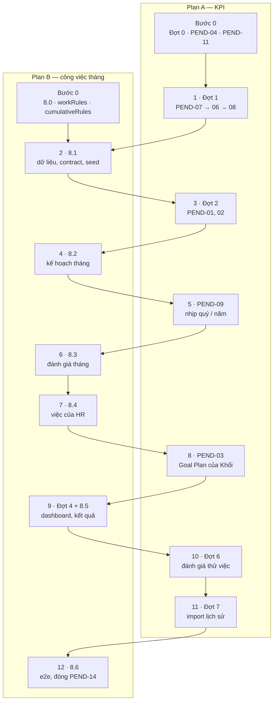

# Plan A — Luồng KPI (đăng ký, đánh giá, nhịp, Khối, thử việc, lịch sử)

> Phiên bản 1.0 · 23/10/2026 · Người lập: Claude cho @harleyng
> **Chạy song song với** `docs/plans/KPI_plan_B_monthly_work.md` (Plan B). Hai luồng dùng chung **thứ tự merge**
> ở §2.
> **Chi tiết từng việc nằm ở** `docs/plans/KPI_update_plan_2210.md` (gọi tắt "plan 22/10"). File này chỉ sắp
> thứ tự, điểm chờ và điều kiện merge, không lặp lại thiết kế.

---

## 1. Cách chạy

- Làm trong worktree riêng: `git worktree add ../kpi-plan-a -b track/plan-a`.
- Mỗi bước: bốn phase của `CLAUDE.md` → rebase lên `main` mới nhất → gate
  `npm run typecheck && npm run test && npm run build && npm run lint` + `npm run test:e2e:smoke` → merge vào `main`
  → push.
- **Chỉ merge khi đến lượt** (§2). Nếu bước đã xong mà chưa đến lượt: tiếp tục bước sau trên nhánh, merge sau.
- Sau mỗi lần merge có đổi contract hoặc fixture: báo Plan B rebase (quy tắc 11 của `CLAUDE.md`).

## 2. Thứ tự merge chung (Plan A + Plan B)

| Lượt | Luồng | Bước | Vì sao ở vị trí này |
|---|---|---|---|
| 1 | A | Đợt 1 (PEND-07 → 06 → 08) | Đổi `EvaluationItem`, `formRules`, bước HR của KPI_EVAL — nền cho mọi phiếu đánh giá |
| 2 | B | 8.1 dữ liệu | Cùng sửa `types.ts`, contract, seed với Đợt 1 |
| 3 | A | Đợt 2 (PEND-01, 02) | Sửa `workflowRules` + `catalog.ts`; rebase trên 8.1 |
| 4 | B | 8.2 kế hoạch tháng | Cần `startStepNo` (PEND-01) |
| 5 | A | PEND-09 | Đổi quy tắc khởi chạy và mẫu KPI_EVAL; cần Q60 |
| 6 | B | 8.3 đánh giá tháng | Cần PEND-08, 02 và quyết định ở PEND-09 |
| 7 | B | 8.4 việc của HR | Cùng sửa quy tắc khởi chạy với PEND-09 |
| 8 | A | PEND-03 | Sửa seed; dashboard cần điểm Khối |
| 9 | B | Đợt 4 + 8.5 | Cùng sửa dashboard; cần PEND-05, PEND-03 |
| 10 | A | Đợt 6 | Loại phiếu mới; sửa `types.ts`, `catalog.ts` |
| 11 | A | Đợt 7 | Cần kết quả quý / năm (PEND-09) |
| 12 | B | 8.6 | E2E cuối cho toàn bộ |

## 3. Các bước của Plan A

| Bước | Nội dung | Chi tiết | Chờ trước khi merge | Xong khi |
|---|---|---|---|---|
| A0 ✅ 23/10 | Chốt Q44–Q58 và Q2 (cùng Plan B chốt **Q59, Q60**); kiểm chứng PEND-04; đối chiếu 5 phương pháp (PEND-11) | Plan 22/10 §3, §6 (PEND-04), §8 (PEND-11) | Không — tài liệu và kiểm chứng, merge lúc nào cũng được | Mọi câu hỏi có câu trả lời hoặc `ASSUMPTION Qn`; PEND-04 ghi "đã chạy" hoặc danh sách việc phải sửa |
| A1 ✅ 23/10 | **Đợt 1**: PEND-07 → 06 → 08 (+ phiếu quý dùng mục tiêu quý) | Plan 22/10 §4 | Lượt 1 — không chờ | BR-KPI-16, 17, 23 viết lại; e2e phiếu đánh giá qua 3 bước |
| A2 | **Đợt 2**: PEND-01, 02 | Plan 22/10 §5 | Lượt 3 — chờ Plan B merge 8.1 | BR-KPI-12, 14, 20 viết lại; `autoApprove` và HR trả về chạy được |
| A3 | **PEND-09** (và PEND-04 nếu phải sửa `calcRules.targetForPeriod`) | Plan 22/10 §6 | Lượt 5 — chờ Plan B merge 8.2; **Q60 đã chốt** | KPI_EVAL chỉ khởi chạy kỳ quý / năm (nếu Q60 theo đề xuất); file lương chỉ có quý / năm |
| A4 | **PEND-03**: Goal Plan của Khối | Plan 22/10 §8 | Lượt 8 — chờ Plan B merge 8.4 | E2E Công ty → Khối → Phòng → NV |
| A5 | **Đợt 6**: đánh giá thử việc | Plan 22/10 §9 | Lượt 10 — chờ Plan B merge Đợt 4 + 8.5; **Q53 đã chốt** | Phiếu thử việc chạy hết một vòng |
| A6 | **Đợt 7**: import lịch sử | Plan 22/10 §10 | Lượt 11 — ngay sau A5 | Import một năm mẫu, kết quả chỉ đọc |

**Kết quả A0 (23/10/2026).** Không có câu trả lời mới từ HR / C&B / BA: Q2, Q44–Q60 và Q67 (mới) chạy theo
`ASSUMPTION Qn` ở `business-rules.md` §8. PEND-04: phân bổ và cảnh báo đã chạy; còn phiếu kỳ quý dùng mục tiêu năm,
tháng khi chỉ phân bổ quý (Q67), nhãn — danh sách ở plan 22/10 §6, làm ở A1 (phần phiếu) và A3. PEND-11: FORMULA là
phương pháp không có nguồn (plan 22/10 §8).

**Ngoài lượt merge (làm lúc nào cũng được):** PEND-11 ẩn phương pháp thừa — file `libraryRules` / danh sách chọn,
không đụng file của Plan B; merge ngay khi xong.

## 4. File dùng chung với Plan B

| File | Plan A sửa ở | Plan B sửa ở |
|---|---|---|
| `src/data/types.ts` | A1, A2, A5 | B1 |
| `src/integrations/data/types.ts` + mock | A1, A2, A5 | B1, B4 |
| `src/data/fixtures/catalog.ts`, seed | A1, A2, A3, A4, A5 | B1, B2, B3, B4 |
| `src/lib/workflowRules.ts` | A2, A3 | B4 |
| `src/lib/dashboardRules.ts`, Dashboard | A4 (điểm Khối) | B5 |
| `business-rules.md`, `new-flow.md` | mọi bước | mọi bước |

Xung đột ở các file này chủ yếu là **thêm dòng**; khi rebase giữ cả hai phía, chạy lại gate.
