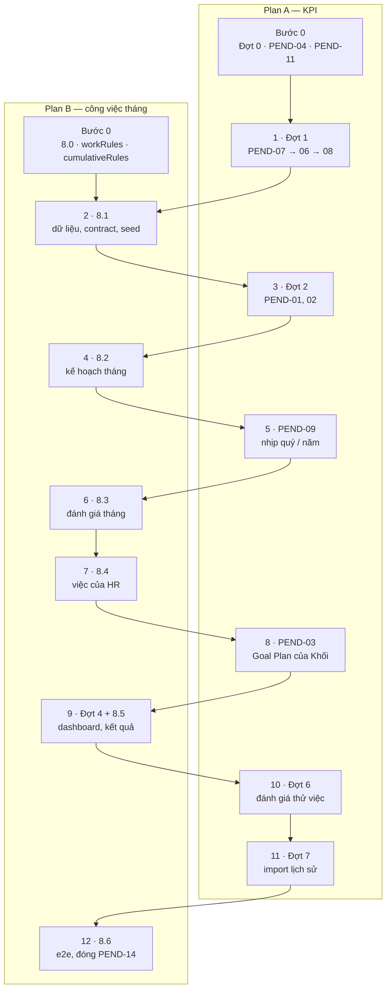

# Plan B — Luồng công việc tháng (mục 4) + lũy kế + dashboard

> Phiên bản 1.0 · 23/10/2026 · Người lập: Claude cho @harleyng
> **Chạy song song với** `docs/plans/KPI_plan_A_kpi.md` (Plan A). Hai luồng dùng chung **thứ tự merge** ở §2.
> **Chi tiết từng việc nằm ở** `docs/plans/KPI_monthly_work_plan.md` (gọi tắt "plan công việc tháng") và
> `docs/plans/KPI_update_plan_2210.md` (PEND-05, Đợt 4). File này chỉ sắp thứ tự, điểm chờ và điều kiện merge.

---

## 1. Cách chạy

- Làm trong worktree riêng: `git worktree add ../kpi-plan-b -b track/plan-b`.
- Mỗi bước: bốn phase của `CLAUDE.md` → rebase lên `main` mới nhất → gate
  `npm run typecheck && npm run test && npm run build && npm run lint` + `npm run test:e2e:smoke` → merge vào `main`
  → push.
- **Chỉ merge khi đến lượt** (§2). Nếu bước đã xong mà chưa đến lượt: tiếp tục bước sau trên nhánh, merge sau.
- Sau mỗi lần merge có đổi contract hoặc fixture: báo Plan A rebase (quy tắc 11 của `CLAUDE.md`).
- **Không làm gì ngoài bước 0 cho tới khi Q59 có câu trả lời** — nếu mục 4 không phải công việc tháng, Plan B chỉ
  còn PEND-05 và Đợt 4.

## 2. Thứ tự merge chung (Plan A + Plan B)

Bảng lý do của từng lượt: `KPI_plan_A_kpi.md` §2.

## 3. Các bước của Plan B

| Bước | Nội dung | Chi tiết | Chờ trước khi merge | Xong khi |
|---|---|---|---|---|
| B0 | **8.0** chốt Q59–Q66 + tài liệu (PEND-14, đảo Q10); `src/lib/workRules.ts` + test (chỉ phần tính); `src/lib/cumulativeRules.ts` + test (**PEND-05**) | Plan công việc tháng §4, §5 (bảng quy tắc); plan 22/10 §6 (PEND-05) | Không — file mới và tài liệu, merge lúc nào cũng được | Q59 có câu trả lời; hai file rules xanh test; PEND-14 có trong `business-rules.md` §12 |
| | *B0 xong 23/10/2026:* `workRules.ts`, `cumulativeRules.ts` + test (chỉ phần tính); Q59–Q66 ghi `ASSUMPTION` theo đề xuất (chưa có câu trả lời của product owner / HR); tài liệu 8.0. ERD để 8.1 | | | |
| B1 | **8.1** thực thể, contract `DataGateway`, mock, seed, test cách ly tenant | Plan công việc tháng §5 | Lượt 2 — chờ Plan A merge Đợt 1 | Gate xanh; `system-architect` duyệt contract + fixture |
| B2 | **8.2** phiếu WORK_PLAN, `/my/work`, `/team/work`, cập nhật tiến độ | Plan công việc tháng §6 | Lượt 4 — chờ Plan A merge Đợt 2 (`startStepNo`) | Lập → duyệt → khóa chạy trên dev server 8082 |
| B3 | **8.3** phiếu WORK_REVIEW, KQcv / KLcv / Hsht / Hsnv | Plan công việc tháng §7 | Lượt 6 — chờ Plan A merge PEND-09; **Q60, Q61 đã chốt** | E2E NV → QL → HR, `WorkResult` khớp tính tay |
| B4 | **8.4** khởi chạy `PERIOD_START`, theo dõi, import điểm, hoàn tất hàng loạt | Plan công việc tháng §8 | Lượt 7 — ngay sau B3 | `PERIOD_START` bắn một lần mỗi kỳ; import báo lỗi theo dòng |
| B5 | **Đợt 4 (PEND-13) + 8.5**: dashboard theo vai trò, lọc kỳ, lũy kế, thẻ công việc tháng, Kết quả của tôi | Plan 22/10 §7; plan công việc tháng §9 | Lượt 9 — chờ Plan A merge PEND-03 | Ba góc nhìn lãnh đạo / quản lý / HR; lũy kế khớp Goal Plan |
| B6 | **8.6** e2e `@smoke` toàn luồng, `/design-review audit`, đóng PEND-14 | Plan công việc tháng §10 | Lượt 12 — sau khi Plan A merge Đợt 7 | Gate xanh trên `main` có đủ hai luồng |

## 4. Có thể làm sớm trên nhánh (chưa merge)

Để không ngồi chờ ở các điểm chờ, Plan B làm trước được những phần **chỉ thêm file mới**:

- Trong lúc chờ lượt 2: màn hình 8.2 (`/my/work`, `/team/work`, `WorkPlanFormBody.tsx`) với dữ liệu giả cục bộ.
- Trong lúc chờ lượt 6: `WorkReviewFormBody.tsx` và bảng ca kiểm thử của 8.3.
- Trong lúc chờ lượt 9: mẫu Excel import điểm (8.4 đã xong) và phần `dashboardRules` dùng `cumulativeRules`.

File dùng chung với Plan A và bước nào sửa chúng: `KPI_plan_A_kpi.md` §4.
