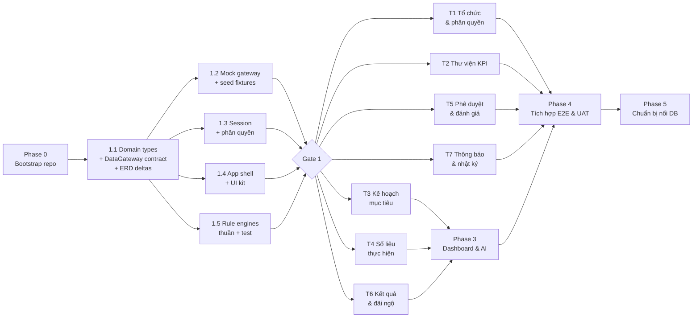

# Kế hoạch dựng repo `kpi-management` — Syntra KPI (prototype Phase 1)

> Phiên bản 1.0 · 19/10/2026 · Người lập: Claude cho @harleyng
> **Repo:** `kpi-management`, đặt tại `/Users/m116gb/Downloads/Syntra/Internal/KPI/kpi-management/` (tên package `kpi-management`; tên hiển thị trên giao diện "Syntra KPI").
> Phạm vi: **prototype chạy được toàn bộ vòng đời KPI của P1**, dữ liệu giả lập trong trình duyệt.
> **Chưa nối database**, **chưa đa ngôn ngữ**, đăng nhập giả lập. Thiết kế sẵn **multi-tenant** từ đầu.

---

## 1. Mục tiêu và giới hạn

| | Có trong repo này | Chưa làm |
|---|---|---|
| Nghiệp vụ | Toàn bộ 42 work package của WBS 4.0 Phase 1 (mục 7) | Tính năng P2/P3: hiệu suất liên tục, năng lực & 360, thử việc/HĐLĐ, calibration, thương mại hóa |
| Dữ liệu | Gateway dữ liệu giả lập (in-memory + localStorage), seed từ biểu mẫu DATX | Supabase/Postgres, migration, RLS |
| Đăng nhập | Chọn công ty, người dùng, vai trò từ seed (giả lập) | SSO, mật khẩu |
| Tích hợp | Connector ERP Sale **giả lập** sau cùng một contract | Gọi API thật |
| AI | Trợ lý AI **giả lập** sau contract `InsightGateway` | Gọi LLM thật |
| Thông báo | In-app | Email thật |
| Ngôn ngữ | UI tiếng Việt viết trực tiếp. Code, comment, tài liệu kỹ thuật tiếng Anh | i18n, tiếng Anh |

Mục đích của prototype: product owner và HR chạy thử đủ vòng **giao KPI → nhập số → đánh giá → ra điểm → dashboard** để chốt quy trình trước khi làm thật. Vì vậy chất lượng kỹ thuật vẫn giữ như OmniX Studio: typecheck, build và lint phải xanh; quy tắc tính toán là hàm thuần có test.

---

## 2. Nguồn đầu vào

| Nguồn | Đường dẫn | Dùng cho |
|---|---|---|
| Biên bản họp yêu cầu | https://notexapp.com/share/6acdac7b1ec40e06d9b64dc5 | Mục tiêu, BSC, 3 tầng, đánh giá 3 bước, dashboard sống |
| ERD (P1–P3, 67 bảng) | `/Users/m116gb/Downloads/Tool/kpi_erd.mermaid` | Domain types, tên thực thể, quan hệ |
| WBS phát triển chức năng P1 | Mục 7 của tài liệu này (bản đầy đủ) | Danh sách work package, chia track |
| User guide CMC — HR | `…/KPI/Request/CMC_PMGM_Userguide_HR.pdf` | Field của Goal, import, khởi chạy phiếu, khóa/mở |
| User guide CMC — Quản lý | `…/KPI/Request/CMC_PMGM_User_guide_Manager_v1.0.pdf` | Luồng đăng ký, duyệt, điều chỉnh, đánh giá |
| Quy trình phê duyệt SF4C | `…/KPI/Request/SF4C_PMGM_Quytrinhpheduyet_v2.0_Ctel.docx` | Danh mục quy trình PMGM.01–14 |
| Email template | `…/KPI/Request/Email template for KPI.docx` | Quy trình 4 bước, email khởi chạy và nhắc hạn |
| Biểu mẫu KPI DATX | `…/KPI/Request/DATX-Bieu mau xay dung bo KPIs.xlsx` | Seed thư viện KPI, bộ mẫu theo phòng |
| Slide KPI DATX 2023 | `…/KPI/Request/DATX_KPI_Huong dan va trien khai 2023.pptx` | KGI → CSF → KPI, 6 bước triển khai |

`…` = `/Users/m116gb/Downloads/Syntra/Internal/KPI`. Các file nguồn **không commit vào repo** vì nặng và là tài liệu nội bộ. Repo chỉ giữ `docs/source-map.md` trỏ tới chúng, kèm số trang.

---

## 3. Quyết định kỹ thuật

### 3.1 Stack: giữ nguyên như OmniX Studio

React 18 + TypeScript strict + Vite (SWC) · shadcn-ui + Tailwind + Radix · TanStack React Query v5 · Zustand · React Router 6 · react-hook-form + zod · date-fns · sonner · Vitest + Testing Library · Playwright.

Thêm: `recharts` (dashboard) và `exceljs` (đọc/ghi Excel cho import/export). Phải chốt `exceljs` ở Phase 1: không dùng gói `xlsx` trên npm vì bản ở đó đã cũ.

Bỏ so với OmniX: `@supabase/supabase-js`, `@mediapipe/*`, `@dnd-kit/*`, toàn bộ `src/i18n`.

### 3.2 Lớp dữ liệu: gateway giả lập, đổi được sang DB thật

Làm theo đúng mẫu `StreamingGateway` của OmniX:

```
components/pages → React Query hooks (src/hooks/queries/*) → DataGateway (contract)
                                                                ├── mockGateway  (in-memory + localStorage, seed fixtures)  ← dùng bây giờ
                                                                └── supabaseGateway (stub, chưa làm)                         ← phase nối DB
```

- `src/integrations/data/types.ts`: contract, mỗi domain một nhóm hàm async.
- `src/integrations/data/index.ts`: `getDataGateway()`, chọn adapter theo `VITE_DATA_ADAPTER` (mặc định `mock`).
- **Không component nào import `mockGateway` trực tiếp.**
- Mock có độ trễ giả lập và **công tắc bơm lỗi** (dev toolbar) để kiểm tra giao diện báo lỗi.
- **Mọi hàm của gateway nhận `tenantId` và lọc theo nó.** Có test riêng đảm bảo tenant A không đọc được dữ liệu tenant B. Đây là cách giữ multi-tenant khi chưa có RLS.
- ID dùng chuỗi `crypto.randomUUID()`. ERD ghi `bigint` là cho DB sau này.

### 3.3 Danh tính và phân quyền giả lập

- `SessionContext`: tenant hiện tại, người dùng hiện tại, vai trò. Có **bộ chuyển người dùng** trên TopBar để demo luồng nhiều vai (NV → QL → HR) không cần đăng nhập lại.
- `src/lib/permissionRules.ts`: `can(user, action, resource)` với phạm vi `Self / DirectReports / OrgUnit (+con) / Tenant`, theo bảng `USER_ROLE` trong ERD.
- Menu điều hướng lọc theo quyền.

### 3.4 Quy ước còn lại

- UI tiếng Việt viết thẳng trong JSX. Riêng câu báo lỗi lấy từ `src/lib/errorCatalog.ts` (`ERR-KPI-01…`), không gõ lại.
- Trạng thái chỉ lấy từ tập cố định trong `src/data/types.ts` (Goal Plan, Form, Period…), không tự đặt nhãn mới.
- Quy tắc nghiệp vụ là **hàm thuần trong `src/lib/*Rules.ts`**, có `*.test.ts` đặt cạnh. **Test của `src/lib` là gate** ở repo này, khác OmniX, vì đây là logic tính điểm và lương.

---

## 4. Chỉnh ERD theo user guide CMC (làm ở Phase 1.1, trước khi code)

Đọc user guide CMC cho thấy 6 chỗ ERD hiện tại còn thiếu. Vì chưa có DB, sửa lúc này chỉ tốn sửa `types.ts`. Mỗi mục cần ghi bằng `/log-decision`.

| # | Phát hiện | Nguồn | Đề xuất |
|---|---|---|---|
| D1 | Mỗi chỉ tiêu có **định mức L1/L2/L3**, mỗi mức kèm "nguyên tắc đánh giá" (đạt L1 → 0%, đạt L2 → 100%). Định mức đặt **theo từng chỉ tiêu được giao**, không theo phương pháp tính dùng chung | HR tr. 23, 28; import cột P–T tr. 63 | Thêm `GoalTargetLevel { goalId, levelCode (L1/L2/L3), targetValue, targetText, scorePct }`. Thêm kiểu tính `LEVELS` vào `CALC_METHOD`. Cần chốt có nội suy giữa các mức không (Q1) |
| D2 | Chỉ tiêu có **Visibility** (công khai/riêng tư) | HR tr. 21–22 | Thêm `GOAL.visibility` |
| D3 | Khi giao xuống, quản lý theo dõi **đã giao cho NV / tự nhận / chưa giao / tự thực hiện** | HR tr. 24 | Thêm `GOAL_ALIGNMENT.allocatedValue`. "Chưa giao" là giá trị suy ra = mục tiêu cha − Σ allocatedValue |
| D4 | **Loại chỉ tiêu** KRItc / KRIpt × (Tài chính, Khách hàng, Quy trình nội bộ, Học hỏi phát triển) | HR tr. 22 | Giữ `BSC_PERSPECTIVE` và thêm `GOAL.kriType`. Cần hỏi HR nghĩa của "tc" và "pt" (Q6) |
| D5 | **Đợt khởi chạy phiếu** có loại, mẫu, ngày (ngay / sau / định kỳ), kỳ đánh giá, hạn, danh sách người nhận | HR tr. 89–93 | Thêm `FormLaunch` (một đợt sinh nhiều `FORM_INSTANCE`). **Chuyển `FORM_LAUNCH_RULE` từ P2 lên P1** vì phiếu đánh giá tháng cần tự khởi chạy |
| D6 | Biểu mẫu chặn gửi khi tổng trọng số ≠ 100% hoặc còn mục chưa chấm/chưa bình luận | Quản lý tr. 26 | Viết thành `formRules.canSubmit()`, không thêm bảng |

Ngoài ra, trên bảng chỉ tiêu, nút "Lấy ý kiến", "Thêm người duyệt" và bước "Hợp tác" (Quản lý tr. 26) **chưa đưa vào P1**. Ghi vào câu hỏi mở Q7.

---

## 5. Field của các màn hình chính

Liệt kê tối thiểu cho từng form. Cột "Nguồn" để đối chiếu khi làm UI.

### 5.1 Thêm/sửa chỉ tiêu trong Goal Plan (track T3)
| Field | Bắt buộc | Ghi chú | Nguồn |
|---|---|---|---|
| Hiển thị (công khai/riêng tư) | ✓ | D2 | HR tr. 22 |
| Loại chỉ tiêu (viễn cảnh BSC + KRI) | ✓ | D4 | HR tr. 22 |
| KGI | | Chọn trong Goal Plan | Slide DATX tr. 21–22 |
| Tên chỉ tiêu | ✓ | Chọn từ thư viện hoặc tự nhập | HR tr. 22 |
| Đơn vị đo | ✓ | %, tỷ, người… | HR tr. 22 |
| Trọng số | ✓ | Tổng = 100% mới gửi được | HR tr. 22; Quản lý tr. 26 |
| Mô tả, công thức | | Kế thừa từ thư viện | HR tr. 22 |
| Ngày bắt đầu / kết thúc | ✓ | | HR tr. 23 |
| Kiểu mục tiêu: số hoặc chữ (Đạt/Không đạt) | ✓ | | HR tr. 23 |
| Định mức L1/L2/L3 + điểm mỗi mức | | D1 | HR tr. 23, 28 |
| Phương pháp tính, trần % | ✓ | Mặc định từ thư viện | DATX sheet "2. KPIs phòng ban" |
| Nguồn số liệu | ✓ | Yêu cầu "KPI phải đo được" | Biên bản họp mục 2.3 |
| Phân bổ theo tháng | | | DATX cột "Phân bổ mục tiêu theo tháng" |
| Giao xuống: cho NV / tự nhận / chưa giao | | Chỉ quản lý thấy | HR tr. 24 |
| Thực tế, tài liệu đính kèm, URL | | Hiện ở chế độ cập nhật kết quả | HR tr. 24 |

### 5.2 Mẫu import Goal Plan (T3, dùng khung import của T4)
Theo HR tr. 61–63, giản lược: `username`, `loại chỉ tiêu`, `tên chỉ tiêu`, `đơn vị đo`, `trọng số`, `mô tả`, `ngày bắt đầu`, `ngày kết thúc`, `kiểu định mức (số/chữ)`, `L1`, `L2`, `L3`, `điểm mỗi mức`, `mã KPI thư viện` (thêm mới, để nối thư viện). Mỗi chỉ tiêu một dòng. CMC dùng 3 dòng cho một mục tiêu, prototype không cần.

### 5.3 Mẫu import số thực tế (T4)
`mã chỉ tiêu được giao` hoặc `username + mã KPI thư viện`, `kỳ`, `giá trị thực tế`, `giá trị dạng chữ`, `ghi chú`, `link bằng chứng`. Nguồn: HR tr. 75–76 (CMC xuất báo cáo danh sách mục tiêu rồi import lại).

### 5.4 Khởi chạy phiếu (T5)
| Field | Nguồn |
|---|---|
| Loại phiếu (đăng ký / điều chỉnh / đánh giá) và quy trình mẫu | HR tr. 90 |
| Thời điểm: ngay / hẹn ngày / định kỳ (ví dụ ngày 1 hằng tháng) | HR tr. 91 |
| Kỳ đánh giá (chu kỳ + kỳ) | HR tr. 92 |
| Hạn hoàn thành (ví dụ 7 ngày sau ngày khởi chạy) | HR tr. 92 |
| Người nhận: tất cả / theo đơn vị / theo bộ lọc | HR tr. 93 |

### 5.5 Phiếu đánh giá KPI (T5)
Mỗi chỉ tiêu một dòng: tên, trọng số, mục tiêu/định mức, **thực tế (lấy từ T4, chỉ đọc)**, % tự đánh giá + giải trình, % quản lý + nhận xét, % HR chốt, bằng chứng. Cuối phiếu có tổng điểm tự tính. Thanh hành động: Lưu nháp · Gửi · Trả về bước trước · Hủy. Nguồn: Quản lý tr. 20–29, 98–109; Email template; biên bản họp mục 2.3.

---

## 6. Các phase và quan hệ phụ thuộc

### 6.1 Sơ đồ



### 6.2 Bảng tổng hợp

| Phase | Chạy | Phụ thuộc | Nội dung | Gate ra |
|---|---|---|---|---|
| **0. Bootstrap** | **Tuần tự**, làm đầu tiên | — | Dựng repo theo khuôn OmniX: tooling, CLAUDE.md, agents, skills, hooks, knowledge base, CI. Đẩy lên GitHub (`harleyng/kpi-management`, private) và deploy Vercel (nối với GitHub, push `main` = deploy production, có Deployment Protection). Xem file prompt khởi tạo | `npm run dev` hiện app shell; typecheck, build, lint, test, guides:check đều xanh; CI trên GitHub xanh; URL Vercel mở được |
| **1.1 Domain & contract** | **Tuần tự**, chặn mọi thứ phía sau | 0 | `src/data/types.ts` cho 47 bảng P1 + D1–D6; các tập trạng thái cố định; contract `DataGateway`; ghi quyết định D1–D6 | Contract được duyệt (system-architect + cto) |
| **1.2 Mock gateway + seed** | **Song song** với 1.3, 1.4, 1.5 | 1.1 | In-memory + localStorage theo tenant, độ trễ, bơm lỗi, `resetSeed()`; fixtures (mục 6.4) | Test cô lập tenant xanh |
| **1.3 Session + quyền** | **Song song** | 1.1 | SessionContext, bộ chuyển người dùng/vai trò, `permissionRules` | Test ma trận quyền xanh |
| **1.4 App shell + UI kit** | **Song song** | 1.1 | AppShell, menu theo vai trò, PageHeader, DataTable, StatusBadge, EmptyState, ErrorState, ConfirmDialog, FormField, **KpiPicker**, **EmployeePicker**, **OrgUnitTree** | Mọi route hiện PlaceholderPanel |
| **1.5 Rule engines** | **Song song** | 1.1 | `calcRules` (5 kiểu + LEVELS, trần/sàn), `scoreRules` (điểm có trọng số, roll-up), `goalPlanRules` (trọng số 100%, 5–8 chỉ tiêu, khóa), `alignmentRules` (chống vòng lặp, chưa giao), `workflowRules` (máy trạng thái, SLA, quá hạn), `ratingRules` (xếp loại → % lương), `formRules.canSubmit` | Test xanh, phủ các ca biên trong mục 8 |
| **Gate 1** | | 1.2–1.5 xong | | Fixtures đóng băng thành **contract giữa các track** |
| **2. Module tracks** | **7 track song song** | Gate 1 | Mục 6.3 | Mỗi track tự qua phase 4 của workflow |
| **3. Dashboard & AI** | **Tuần tự** sau T3, T4, T6. Có thể dựng khung trên seed trước | T3, T4, T6 | WBS 4.7.1–4.7.4. `InsightGateway` giả lập | Dashboard đúng số với kịch bản seed |
| **4. Tích hợp E2E & UAT** | **Tuần tự** | Mọi track + 3 | Kịch bản Playwright cả vòng đời (mục 8.2); buổi UAT với HR | Kịch bản chính chạy xanh; HR ký biên bản UAT |
| **5. Chuẩn bị nối DB** | **Tuần tự**, khi quyết định | 4 | SQL schema từ ERD (chưa apply), RLS theo tenant, stub `supabaseGateway`, checklist chuyển adapter | Tài liệu được duyệt |

### 6.3 Bảy track của Phase 2: phụ thuộc mềm và cách gỡ

Các track **chạy song song được vì cùng dựa trên seed fixtures**, không track nào phải đợi màn hình của track khác. Phụ thuộc mềm là chỗ các track gặp nhau, xử lý bằng component dùng chung (đã có từ 1.4) hoặc hàm gateway có sẵn:

| Track | WBS | Dùng từ track khác | Cách gỡ |
|---|---|---|---|
| **T1** Tổ chức & phân quyền | 4.1.1–4.1.7 | — | Độc lập |
| **T2** Thư viện KPI | 4.2.1–4.2.5 | Khung import (T4) cho 4.2.5 | Làm 4.2.5 **sau cùng** trong T2 |
| **T3** Kế hoạch mục tiêu | 4.3.1–4.3.7 | Chọn KPI từ thư viện (T2); khung import (T4) | `KpiPicker` có từ 1.4 và đọc seed; 4.3.7 làm sau cùng |
| **T4** Số liệu thực hiện | 4.4.1–4.4.6 | Danh sách GOAL (T3) | Đọc GOAL từ seed. **Khung import 4.4.3 làm đầu tiên** vì 3 track khác dùng |
| **T5** Phê duyệt & đánh giá | 4.5.1–4.5.5 + D5 | Hiển thị Goal Plan (T3); số thực tế (T4) | Phiếu đọc thẳng gateway. Workflow engine đã có ở 1.5 |
| **T6** Kết quả & đãi ngộ | 4.6.1–4.6.4 | % chốt của phiếu đánh giá (T5) | Seed có sẵn phiếu đã chốt. Engine tính đã có ở 1.5 |
| **T7** Thông báo & nhật ký | 4.8.1–4.8.4 | Sự kiện từ T3, T5 | Gateway phát sự kiện qua một event bus; T7 chỉ lắng nghe |

**Thứ tự merge vào `main` khuyến nghị:** T1 → T2 → T7 → T3 → T4 → T5 → T6. Mỗi track làm trong một git worktree riêng. Mỗi lần merge phải qua `typecheck && test && build && lint`. Nếu track nào cần **sửa fixtures hoặc contract**, việc đó là thay đổi Large: phải qua system-architect và báo cho các track khác.

### 6.4 Seed fixtures: điều kiện để chạy song song

`src/data/fixtures/*.ts`, nạp bằng `resetSeed()`:

- **2 tenant**: "Syntra" (dữ liệu đầy đủ) và "Demo Co" (ít dữ liệu, chỉ để test cô lập).
- **Tổ chức Syntra**: 3 khối, khoảng 8 phòng (theo các sheet DATX: Marketing, CSKH, Mua hàng, Vận hành, Công nghệ, HCNS, Kế toán, Kế hoạch), khoảng 40 nhân viên có quan hệ quản lý trực tiếp; đủ 6 vai trò.
- **Thư viện**: chỉ tiêu và bộ mẫu lấy từ sheet "2. KPIs phòng ban" (khoảng 14 bộ, 60–80 chỉ tiêu), đã sửa lỗi phát hiện ở Q4/Q5.
- **Chu kỳ 2027**, 12 kỳ tháng và 4 kỳ quý.
- **Goal Plan ở đủ mọi trạng thái** (Nháp, Đã gửi, Bị trả lại, Đã duyệt, Đã khóa), để track nào cũng có dữ liệu cho mọi trạng thái.
- **Số thực tế 3 tháng**, trong đó có dòng thủ công, dòng import và dòng "API".
- **Phiếu ở đủ mọi bước**, có phiếu quá hạn và phiếu đã chốt.
- **Thang xếp loại + bảng % lương mẫu.** Đánh dấu rõ là giả định, chờ Q2.

---

## 7. WBS Phase 1: danh sách work package theo track

| Mã | Work package | Track |
|---|---|---|
| 4.1.1 | Quản lý tenant | T1 |
| 4.1.2 | Cây tổ chức | T1 |
| 4.1.3 | Chức danh & hồ sơ nhân viên | T1 |
| 4.1.4 | Phân công & quan hệ báo cáo | T1 |
| 4.1.5 | Tài khoản & đăng nhập (giả lập) | T1 |
| 4.1.6 | Vai trò, quyền & phạm vi dữ liệu | T1 (logic ở 1.3) |
| 4.1.7 | Import tổ chức & nhân sự | T1 |
| 4.2.1 | Danh mục nền (viễn cảnh BSC, đơn vị đo) | T2 |
| 4.2.2 | Phương pháp tính (thêm LEVELS) | T2 (logic ở 1.5) |
| 4.2.3 | Chỉ tiêu mẫu | T2 |
| 4.2.4 | Bộ KPI mẫu | T2 |
| 4.2.5 | Import/Export thư viện | T2 |
| 4.3.1 | Chu kỳ & kỳ đánh giá | T3 |
| 4.3.2 | Goal Plan & KGI | T3 |
| 4.3.3 | Chỉ tiêu trong kế hoạch (+ D1, D2, D4) | T3 |
| 4.3.4 | Cascade & liên kết (+ D3) | T3 |
| 4.3.5 | Phân bổ mục tiêu theo kỳ | T3 |
| 4.3.6 | Khóa, mở khóa & lịch sử | T3 |
| 4.3.7 | Import kế hoạch hàng loạt | T3 |
| 4.4.1 | Danh mục nguồn dữ liệu | T4 |
| 4.4.2 | Nhập số thực tế thủ công | T4 |
| 4.4.3 | Khung import Excel theo lô (dùng chung) | T4 |
| 4.4.4 | Khung kết nối API (giả lập) | T4 |
| 4.4.5 | Connector ERP Sale (giả lập) | T4 |
| 4.4.6 | Quản lý bằng chứng | T4 |
| 4.5.1 | Workflow engine (giao diện cấu hình) | T5 (logic ở 1.5) |
| 4.5.2 | Quy trình đăng ký KPI | T5 |
| 4.5.3 | Quy trình điều chỉnh KPI | T5 |
| 4.5.4 | Quy trình đánh giá KPI | T5 |
| 4.5.5 | Hộp việc & ủy quyền | T5 |
| (D5) | Đợt khởi chạy & lịch tự khởi chạy | T5 |
| 4.6.1 | Engine % hoàn thành | 1.5 (T6 làm màn hình) |
| 4.6.2 | Tổng hợp điểm theo trọng số | 1.5 (T6 làm màn hình) |
| 4.6.3 | Thang xếp loại & quy đổi lương | T6 |
| 4.6.4 | Chốt kết quả & xuất lương | T6 |
| 4.7.1 | Dashboard điều hành | Phase 3 |
| 4.7.2 | Dashboard quản lý & cá nhân | Phase 3 |
| 4.7.3 | Báo cáo vận hành | Phase 3 |
| 4.7.4 | Trợ lý AI (giả lập) | Phase 3 |
| 4.8.1 | Mẫu thông báo | T7 |
| 4.8.2 | Gửi & lịch nhắc (in-app) | T7 |
| 4.8.3 | Lưu trữ tệp (giả lập bằng blob URL) | T7 |
| 4.8.4 | Nhật ký audit | T7 |

### 7.1 Menu theo vai trò (để Phase 1.4 dựng route)

| Nhóm | Mục | Vai trò thấy |
|---|---|---|
| Của tôi | KPI của tôi · Việc cần xử lý · Kết quả của tôi | Tất cả |
| Đội nhóm | KPI đội nhóm · Duyệt & đánh giá | Quản lý |
| Điều hành | Dashboard | BOD, Quản lý, HR |
| Quản trị KPI | Chu kỳ · Thư viện KPI · Bộ mẫu · Khởi chạy phiếu · Số liệu & import · Kết quả & lương | HR, C&B |
| Hệ thống | Tổ chức · Người dùng & quyền · Nguồn dữ liệu · Mẫu thông báo · Nhật ký | Admin |

---

## 8. Kiểm thử

### 8.1 Ca biên bắt buộc có unit test (Phase 1.5)
- `RATIO_DOWN` khi thực tế = 0; `RATIO_UP` khi mục tiêu = 0; vượt trần; dưới sàn.
- `LEVELS`: đúng L1, giữa L1 và L2, vượt L3 (theo quyết định Q1).
- Tổng trọng số 99,99% hoặc 100,01% do làm tròn: so sánh với sai số cho phép, không so `=== 100`.
- Liên kết tạo vòng (A → B → A); giao vượt mục tiêu cha; người nghỉ việc giữa kỳ.
- Workflow: trả lại ở bước cuối; quá hạn → tự chuyển; ủy quyền hết hạn giữa chừng; thao tác thay (proxy) ghi đủ hai người.
- Cô lập tenant: mọi hàm đọc của gateway gọi với tenant B không trả dữ liệu tenant A.

### 8.2 Kịch bản E2E chính (Phase 4)
HR tạo chu kỳ 2027 → giao KPI công ty → TP Sale cascade xuống 2 NV → NV bổ sung và link → TP trả lại 1 phiếu → NV sửa và gửi → TP duyệt → HR khóa → nhập số T01 (tay + Excel + "API") → HR khởi chạy phiếu đánh giá T01 → NV tự đánh giá kèm bằng chứng → TP chấm → HR chốt → kết quả và % lương → dashboard BOD hiển thị đúng số → đổi sang tenant "Demo Co" không thấy dữ liệu Syntra.

---

## 9. Câu hỏi mở (cần chốt trước hoặc trong Phase 1)

| # | Câu hỏi | Ảnh hưởng | Gợi ý mặc định nếu chưa có trả lời |
|---|---|---|---|
| Q1 | Kiểu LEVELS có nội suy tuyến tính giữa L1–L2–L3 không? | 1.5 | Có nội suy, chặn trần ở mức cao nhất |
| Q2 | Thang xếp loại và bảng quy đổi % lương KPI? Sheet "TH KQ" của DATX đang lỗi `#REF!` | 1.5, T6 | Dùng thang A+/A/B/C/D mẫu, ghi rõ là giả định |
| Q3 | Đánh giá chính theo tháng hay quý? | T5, seed | Tháng (theo biên bản họp) |
| Q4 | "Tỉ lệ KH cũ" là càng cao càng tốt? File DATX ghi hai kiểu khác nhau | Seed | Càng cao càng tốt |
| Q5 | Thống nhất phân loại theo BSC hay theo "Hiệu quả / Khối lượng / Chi phí"? | T2, seed | BSC là chính, phân loại kia làm nhãn phụ |
| Q6 | KRItc và KRIpt nghĩa là gì, Syntra có cần không? | D4 | Ẩn trường này cho tới khi có trả lời |
| Q7 | P1 có cần "Lấy ý kiến", "Thêm người duyệt", bước hợp tác không? | T5 | Không, để P2 |
| Q8 | Số thực tế của KPI cha: đo độc lập hay cộng dồn từ con? | 1.5, Phase 3 | Đo độc lập; cộng dồn chỉ khi bật cờ trên từng KPI |
| Q9 | KGI có mục tiêu bằng số không? | 1.1 | Có trường nhưng không bắt buộc, không chấm điểm |
| Q10 | "Kế hoạch công việc tháng" của CMC (HR tr. 25–26, PMGM.08/09) có thuộc P1 không? | Phạm vi | Không. P1 chỉ có KPI |

---

## 10. Rủi ro

| Rủi ro | Biện pháp |
|---|---|
| Fixtures bị sửa tùy tiện làm vỡ track khác | Fixtures là contract sau Gate 1; sửa phải qua system-architect và báo các track |
| Logic tính điểm bị viết lại trong component | Hook PostToolUse nhắc; CTO review; mọi phép tính đi qua `src/lib/*Rules.ts` |
| Rò dữ liệu giữa tenant khi chuyển sang DB | Test cô lập tenant ở gateway, sau này giữ nguyên làm test tích hợp cho RLS |
| Link Vercel bị chia sẻ ra ngoài | Bật Vercel Deployment Protection; không seed dữ liệu nhân sự thật |
| Prototype bị hiểu là sản phẩm thật | Banner "Dữ liệu giả lập" trên TopBar; không nhập dữ liệu nhân sự thật |
| Câu hỏi mở chưa chốt làm chậm 1.5 | Dùng giá trị mặc định ở mục 9, gắn cờ `ASSUMPTION` trong code và business-rules.md |
