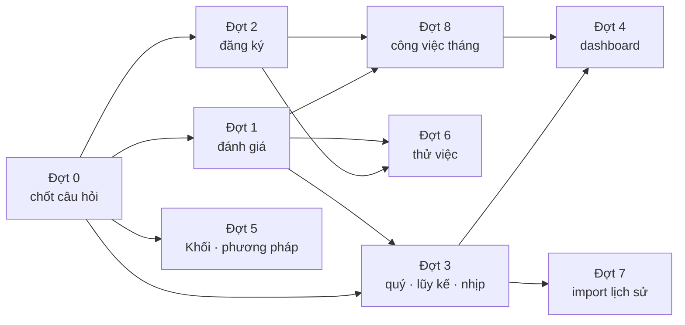

# Kế hoạch triển khai cập nhật sau buổi họp 22/10/2026

> Phiên bản 1.1 · 23/10/2026 · Người lập: Claude cho @harleyng · 1.1: thêm Đợt 8 (mục 4 — công việc tháng)
> **Nguồn:** biên bản NoteX 22/10/2026 (`docs/source-map.md`) · đề xuất quy trình `docs/flows/new-flow.md` §4G ·
> danh sách thay đổi `business-rules.md` §12 (PEND-01…13) · câu hỏi mở `business-rules.md` §8 (Q44–Q58).
> **Mục đích:** biến 13 thay đổi đã thống nhất thành các đợt làm được, mỗi đợt có thiết kế, việc cần làm,
> ca kiểm thử và điều kiện "xong". Đây là kế hoạch, **chưa có dòng code nào được sửa**.

---

## 1. Tóm tắt

| Đợt | Nội dung | PEND | Cỡ / làn (CLAUDE.md) | Bị chặn bởi |
|---|---|---|---|---|
| 0 | Chốt câu hỏi, cập nhật phạm vi plan | — | Trivial (tài liệu) | — |
| 1 | Đánh giá: hệ thống tính %, nhân viên nhập thực tế, HR chỉ ghi nhận | 07 → 06 → 08 | **Large** (contract + fixture) · KPI Rules + Workflow | Q47, Q48, Q49 |
| 2 | Đăng ký: bottom-up, ghi nhận và khóa tự động, HR trả về quản lý | 01, 02 | **Large** (contract + fixture) · Workflow | Q44, Q45, Q46 |
| 3 | Mục tiêu theo quý, lũy kế, nhịp đánh giá quý / năm | 04 → 05 → 09 | KPI Rules (04, 05) · **Large** (09) | Q50, Q51, Q52 |
| 4 | Dashboard theo vai trò, lọc kỳ, lũy kế | 13 | Medium | Đợt 3 (lũy kế), Q58 |
| 5 | Phần còn lại: Goal Plan của Khối, 5 phương pháp tính | 03, 11 | **Large** (03) · KPI Rules (11) | Q40, Q55, Q56 |
| 6 | Đánh giá thử việc (mục 3 của P1) | 10 | **Large** — module mới | Q53 |
| 7 | Import dữ liệu lịch sử (ưu tiên thấp) | 12 | **Large** | Q57 |
| 8 | Mục 4 — giao, nhận, đánh giá công việc tháng (kế hoạch riêng: `KPI_monthly_work_plan.md`) | 14 | **Large** — module mới · KPI Rules + Workflow | Q59–Q66; đợt 1, 2 |

Thứ tự theo biên bản: **mục 1 và 4 trước** (đợt 1–5 và **đợt 8**), **mục 3 sau** (đợt 6), import lịch sử cuối
cùng. Đợt 8 làm sau đợt 1 và 2 (dùng lại PEND-01, 02, 08), song song được với đợt 3, và trước đợt 4.

**Chạy song song hai luồng:** `KPI_plan_A_kpi.md` (Plan A — đợt 0–3, 5–7) và `KPI_plan_B_monthly_work.md`
(Plan B — đợt 8, PEND-05, đợt 4), với một thứ tự merge chung 12 lượt.

Đợt 1 và đợt 2 sửa hai phần khác nhau của `workflowRules` / seed (đánh giá và đăng ký), nên làm **lần lượt**,
không song song trên cùng file. Đợt 5 độc lập, chen vào lúc nào cũng được.

## 2. Quy tắc chung cho mọi PEND

1. **Bốn phase** như `CLAUDE.md`: phân tích → thiết kế (chuyên gia theo làn) → làm, viết test cùng code → gate
   `npm run typecheck && npm run test && npm run build && npm run lint`.
2. **Đổi fixture hoặc contract `DataGateway` sau Gate 1 = Large**: `system-architect` review, ghi rõ trong commit.
3. **Mọi phép tính nằm trong `src/lib/*Rules.ts`**, hàm thuần có test; không tính trong JSX, hook hay mock.
4. **Trạng thái và hành động mới** thêm vào tập cố định trong `src/data/types.ts` + bảng nhãn + `business-rules.md`
   cùng lúc. Lỗi mới thêm vào `src/lib/errorCatalog.ts`.
5. **Khi một PEND xong:** chuyển nội dung vào BR nó thay thế, xóa ghi chú *Pending* ở BR đó, xóa dòng ở §12,
   ghi câu trả lời vào Q tương ứng (§8), cập nhật `new-flow.md` (bỏ "chưa làm" ở §4G, dòng ở bảng §5) và chạy
   `/log-decision`.
6. **Kiểm tra trên dev server 8082** sau mỗi thay đổi giao diện.

## 3. Đợt 0 — chốt câu hỏi trước khi làm

| Câu hỏi | Nội dung ngắn | Người trả lời | Chặn |
|---|---|---|---|
| Q49 | % hệ thống tính có được sửa không, ai sửa? | HR | PEND-07 |
| Q48 | Số thực tế trên phiếu và số nhập tay / Excel: số nào thắng? | Product owner + HR | PEND-06 |
| Q47 | HR sửa kết quả "đặc biệt": cần lý do, ghi nhật ký? | HR + C&B | PEND-08 |
| Q44, Q45 | Quản lý nhận KPI theo luồng nào; bottom-up bắt đầu ở bước nào | Nhóm phát triển, product owner + HR | PEND-01 |
| Q46 | Ghi nhận và khóa tự động: cấu hình ở đâu, mặc định gì | HR | PEND-02 |
| Q50 | Số quý riêng từng quý hay lũy kế (ví dụ biên bản cộng ra 17,5 tỷ ≠ 15 tỷ) | HR | PEND-04 |
| Q51 | Lũy kế cho chỉ tiêu tỷ lệ, tồn kho | HR | PEND-05 |
| Q52 | Đánh giá tháng có chấm điểm và tính lương không | HR + C&B | PEND-09 |
| Q56, Q40 | Khối có Goal Plan không; quản lý trực tiếp khác quản lý khối | BA (Trang) + HR | PEND-03 |
| Q55 | Bỏ phương pháp tính nào để còn 5 | HR + BA | PEND-11 |
| Q53 | Đánh giá thử việc: bước, tiêu chí, khi nào khởi chạy | Product owner + HR | PEND-10 |
| Q57 | Import lịch sử: dữ liệu gì, bao nhiêu năm | HR + C&B | PEND-12 |
| Q58 | "6 tháng" là nửa năm của chu kỳ hay 6 tháng gần nhất | Product owner | PEND-13 |
| Q2 | Bảng quy đổi % lương thật (chị Phương gửi) | C&B | Seed xếp loại |
| Q59 | Mục 4 là "công việc tháng" của CMC hay chỉ theo dõi KPI tháng? (đảo Q10) | Product owner | PEND-14 (đợt 8) |
| Q60–Q66 | Thay phiếu KPI_EVAL tháng; thang Hsnv; 70/30 và ngưỡng 80; liên kết KPI; việc hủy; hạn; vào / nghỉ giữa tháng | Product owner + HR | PEND-14 — chi tiết `KPI_monthly_work_plan.md` §4 |

Việc tài liệu của đợt 0: cập nhật `docs/plans/KPI_repo_plan.md` §1 — P1 nay gồm **đánh giá thử việc** và
**đánh giá theo quý / năm**; hiệu suất liên tục hằng tháng thuộc P1 (mục 4 = công việc tháng nếu Q59 chốt
theo đề xuất). Thêm PEND-14 vào `business-rules.md` §12.

Câu hỏi nào chưa có câu trả lời thì làm theo **giá trị "Đề xuất"** ở `new-flow.md` §6, ghi rõ `ASSUMPTION Qn`
trong BR, để không đợi.

---

## 4. Đợt 1 — Đánh giá KPI (PEND-07, 06, 08)

Làm theo thứ tự **07 → 06 → 08**: tính % trước (dùng số đang có), rồi mới cho nhân viên nhập số, cuối cùng đổi
vai trò bước HR.

### PEND-07 — Hệ thống tự tính % hoàn thành

- **Hiện trạng.** `EvaluationItem.selfAchievementPct` do nhân viên gõ (BR-KPI-16); `formRules.validateScoreInput`
  chỉ kiểm tra trần. Số thực tế là `actualSnapshot` chỉ đọc.
- **Thiết kế.**
  - Hàm thuần mới `formRules.computedItemPct(item, goal, method, periodTarget)` gọi `calcRules.achievement` với số
    thực tế của phiếu và mục tiêu của kỳ (`calcRules.targetForPeriod`, cùng đường với `resultRules`). Không có số
    → `null` (không bao giờ 0, BR-KPI-32).
  - Cột SELF **không còn ô nhập %**: hiển thị % hệ thống tính; nhân viên chỉ nhập giải trình và bằng chứng.
  - Cột MANAGER mặc định bằng % hệ thống tính; quản lý sửa được, **bắt buộc nhận xét khi khác** (Q49).
  - `saveEvaluationItems` từ chối `selfAchievementPct` do người gửi (ERR-KPI-04) — cột này do hệ thống ghi khi
    gửi bước 1.
- **Việc cần làm.**
  - [ ] `src/lib/formRules.ts`: `computedItemPct`, `managerOverrideIssues` (khác % tính mà thiếu nhận xét → 06).
  - [ ] `formRules.canSubmit` ở bước SELF: không đòi % nữa, chỉ đòi giải trình nếu `requiresComment`.
  - [ ] Mock `forms` group: khi SUBMIT bước SELF, ghi `selfAchievementPct` = % tính.
  - [ ] `src/components/forms/EvaluationFormBody.tsx`: cột SELF chỉ đọc, nhãn "Hệ thống tính"; cột MANAGER có giá
    trị mặc định.
  - [ ] Tổng điểm của phiếu (`formRules.evaluationTotal`) đọc cột đã ghi, không đổi.
- **Kiểm thử.** RATIO_UP / RATIO_DOWN / TIERED / BINARY / FORMULA / LEVELS mỗi loại một ca; thiếu số thực tế →
  `null` và phiếu vẫn gửi được nhưng tổng "tạm tính"; vượt trần → trần; mục tiêu = 0 → không tính được
  (ERR-KPI-12); quản lý sửa không nhận xét → 06; gửi `selfAchievementPct` bằng API → 04.
- **Chuyên gia.** `hr-performance-expert` + `qa`.
- **Xong khi.** BR-KPI-16 viết lại theo luồng mới; Q49 ghi câu trả lời; e2e phiếu đánh giá chạy qua 3 bước.

### PEND-06 — Nhân viên nhập số thực tế trên phiếu

- **Hiện trạng.** `actualSnapshot` chụp lúc khởi chạy, chỉ đọc (BR-KPI-17); nhân viên không có `actual.enter`
  (Q33); bằng chứng đã có theo chỉ tiêu (BR-KPI-57).
- **Thiết kế (theo đề xuất Q48).**
  - `EvaluationItem` thêm `actualValue` / `actualText` (số trên phiếu), khởi tạo bằng snapshot; `actualSnapshot`
    giữ làm "Số đã ghi nhận lúc mở phiếu".
  - `EvaluationItemPatch` thêm `actualValue?`, `actualText?` — chỉ sửa được ở bước SELF và MANAGER (EDIT), kiểm
    tra như `actualRules.valueIssues` (kiểu số / chữ khớp chỉ tiêu).
  - Nhập trên phiếu là **EDIT trên phiếu của chính mình**, không phải quyền `actual.enter` — ma trận quyền §9 không đổi.
  - Khi phiếu **hoàn thành**, số trên phiếu được ghi vào `GoalActual` với nguồn mới `FORM` (thêm vào tập nguồn số
    liệu + nhãn "Phiếu đánh giá"), để kết quả đơn vị và dashboard dùng cùng số. Nhập tay / Excel của quản lý, HR vẫn
    giữ; số mới nhất thắng, như hiện tại.
  - % ở PEND-07 tính lại ngay khi số thay đổi.
- **Việc cần làm.**
  - [ ] `src/data/types.ts`: trường mới của `EvaluationItem`, nguồn `FORM` (tập + nhãn).
  - [ ] `src/integrations/data/types.ts`: `EvaluationItemPatch`; mock `forms` group ghi `GoalActual` khi hoàn thành.
  - [ ] `src/lib/formRules.ts` hoặc `actualRules.ts`: `formActualIssues` (kỳ chưa bắt đầu, kết quả đã chốt — dùng
    lại `actualRules.entryBlockers`).
  - [ ] Seed: khởi tạo `actualValue` cho phiếu mẫu (**fixture — Large**).
  - [ ] Giao diện: ô nhập số + tải bằng chứng ngay trên dòng chỉ tiêu (dùng lại `useEvidence`).
- **Kiểm thử.** Nhập số ở bước SELF, sửa ở MANAGER, bị từ chối ở FINAL (04); chỉ tiêu TEXT; số âm theo phương
  pháp; kỳ đã chốt kết quả → 04; hoàn thành phiếu ghi đúng một `GoalActual` nguồn FORM; **cách ly tenant** cho
  patch và cho bản ghi `GoalActual` sinh ra.
- **Chuyên gia.** `workflow-expert` + `system-architect` + `hr-performance-expert`.
- **Xong khi.** BR-KPI-17 và Q33 viết lại; BR-KPI-52 có nguồn FORM; Q48 có câu trả lời.

### PEND-08 — HR chỉ ghi nhận kết quả của quản lý

- **Hiện trạng.** Bước 3 "HR/C&B chốt kết quả" (`catalog.ts`, KPI_EVAL), HR nhập cột FINAL.
- **Thiết kế (theo đề xuất Q47).**
  - Đổi tên bước thành **"HR ghi nhận kết quả"**; khi phiếu vào bước 3, cột FINAL **tự điền bằng cột MANAGER**.
  - HR bấm "Ghi nhận" (APPROVE) là xong; sửa cột FINAL chỉ khi đặc biệt, **bắt buộc lý do** khi khác cột MANAGER
    (`formRules.finalOverrideIssues`), ghi nhật ký như mọi EDIT.
  - Tùy chọn ghi nhận tự động dùng chung cơ chế của PEND-02.
- **Việc cần làm.** `formRules` (điền FINAL khi vào bước, kiểm tra lý do) · mock chuyển bước · tên bước trong
  `catalog.ts` (**fixture**) · nhãn trên `FormStepStrip`, `formCopy.ts`.
- **Kiểm thử.** Vào bước 3 → FINAL = MANAGER; ghi nhận không sửa → kết quả kỳ đúng cột quản lý; sửa không lý do →
  06; sửa có lý do → nhật ký ghi cả hai giá trị.
- **Xong khi.** BR-KPI-16, 23 viết lại; Q47 có câu trả lời.

---

## 5. Đợt 2 — Đăng ký KPI (PEND-01, 02)

### PEND-01 — Top-down và bottom-up song song

- **Hiện trạng.** Mẫu GOAL_SETTING 4 bước, bước 1 của quản lý. Quản lý **đã có thể** bấm "Chuyển cho nhân viên"
  mà không giao gì (BR-KPI-12) — bottom-up đã chạy được, nhưng phải chờ quản lý bấm.
- **Thiết kế (theo đề xuất Q45).**
  - Đợt khởi chạy đăng ký có lựa chọn **"Bắt đầu từ"**: *Quản lý giao trước* (bước 1) hoặc *Nhân viên tự lập*
    (bước của nhân viên, `goalPlanRules.ownerStepNo`). Lưu ở `FormLaunch.startStepNo` (null = bước 1).
  - `workflowRules.initialStep(steps, startStepNo)` — chỉ cho bước ≤ bước của nhân viên; bước bị bỏ qua không ghi
    hành động.
  - Ở bước của nhân viên, liên kết lên mục tiêu cấp trên là **tùy chọn** (đã vậy); quản lý ở bước duyệt vẫn thêm,
    sửa và cascade được (BR-KPI-07).
  - Q44 (quản lý tự nhận KPI): cùng cơ chế, người nhận là quản lý.
- **Việc cần làm.** `types.ts` (`FormLaunch.startStepNo`) · contract `saveLaunch` / `StartFormInput` ·
  `workflowRules.initialStep` + `validateLaunch` · `LaunchDetailPages.tsx` / `StartRegistrationButton.tsx` (lựa
  chọn) · `planStatusOnEnterStep` khi bắt đầu thẳng ở bước nhân viên.
- **Kiểm thử.** Khởi chạy bottom-up → phiếu ở bước nhân viên, Goal Plan *Nháp*; startStepNo > bước nhân viên → 06;
  trả lại từ bước 3 vẫn về bước nhân viên; Goal Plan đơn vị (người nhận là trưởng đơn vị); cách ly tenant cho đợt
  khởi chạy mới.
- **Chuyên gia.** `workflow-expert` + `system-architect`.

### PEND-02 — Ghi nhận và khóa: tự động hoặc thủ công; HR trả về quản lý

- **Hiện trạng.** Bước 4 "HR ghi nhận và khóa", `allowedActions: ['APPROVE', 'EDIT']` — **HR chưa có RETURN**,
  nên "phản hồi lại quản lý" chưa làm được.
- **Thiết kế (theo đề xuất Q46).**
  - `WorkflowStep.autoApprove: boolean` (mặc định `false`). Phiếu vào bước có cờ này → hệ thống APPROVE ngay, ghi
    hành động `AUTO_APPROVE` không có người (thêm vào tập hành động hệ thống, cạnh `AUTO_FORWARD` / `AUTO_LOCK`);
    Goal Plan chuyển *Đã khóa* như APPROVE thường. `validateWorkflow`: chỉ cho bước cuối.
  - Thêm **RETURN** vào bước 4 với `returnToStepNo = 3` (về quản lý), bắt buộc nhận xét.
  - Dùng lại cho PEND-08 (bước HR của đánh giá).
- **Việc cần làm.** `types.ts` (cờ, hành động, nhãn) · `workflowRules.transition` / `validateWorkflow` ·
  scheduler không đổi (tự động xảy ra lúc chuyển bước, không đợi tick) · `catalog.ts` (RETURN cho HR —
  **fixture**) · màn hình sửa mẫu quy trình (nếu có) có ô "Tự động ghi nhận" · `auditFormat.tsx`.
- **Kiểm thử.** Cờ bật → vào bước 4 là khóa, nhật ký `AUTO_APPROVE`; cờ ở bước không phải cuối → 06; HR trả về →
  phiếu ở bước 3, Goal Plan *Đã gửi*; HR mở khóa sau tự động vẫn theo BR-KPI-14.
- **Xong khi.** BR-KPI-12, 14, 20 viết lại; Q44–Q46 có câu trả lời.

---

## 6. Đợt 3 — Mục tiêu theo quý, lũy kế, nhịp đánh giá (PEND-04, 05, 09)

### PEND-04 — Phân bổ mục tiêu năm theo quý

- **Hiện trạng (cần xác nhận trước).** `PeriodSplitPanel` đã chọn được loại kỳ (Quý); `resultRules` dùng mục tiêu
  riêng của quý nếu có (dòng "own split") và chỉ cộng từ tháng khi không có; `evenSplit` chia theo cách tổng hợp.
  Rất có thể **phần lớn đã chạy được** — việc đầu tiên là kiểm chứng.
- **Kết quả kiểm chứng (Đợt 0, 23/10/2026)** — chạy thử bằng Vitest, không sửa code.
  - **Đã chạy:** `goalPlanRules.evenSplit` chia 15 tỷ thành 4 × 3,75 tỷ (SUM; phần dư dồn vào quý cuối), AVG / LAST
    giữ 15 tỷ mỗi quý; nhập tay lệch tổng (17,5 tỷ) → `SPLIT_MISMATCH`, chỉ cảnh báo, vẫn lưu được; thiếu quý →
    `SPLIT_INCOMPLETE`, quý thiếu dùng mục tiêu năm; kết quả quý của Goal Plan công ty / đơn vị (`actualLines`)
    dùng đúng mục tiêu riêng của quý, kể cả khi có cả phân bổ tháng.
  - **Chưa chạy:** phiếu KPI_EVAL kỳ quý hiện mục tiêu **năm** (`GoalTarget.tsx` đọc `goal.targetValue`, không gọi
    `calcRules.targetForPeriod`; `EvaluationItem` không lưu mục tiêu kỳ); số thực tế chụp lúc khởi chạy chỉ lấy số
    nhập trực tiếp cho kỳ quý, không cộng các tháng (`mock/workflowContext.ts`), khác `resultRules.actualFor`.
  - **Sai với KPI cộng (SUM):** chỉ phân bổ quý thì tháng dùng mục tiêu năm (`targetForPeriod(T04)` = 15 tỷ → tháng
    1 tỷ ra 6,67%) — ảnh hưởng kết quả tháng, nhập số và cảnh báo import. Cần chốt `ASSUMPTION Q67`.
  - **Nhãn:** chỉ có "Phân bổ mục tiêu theo kỳ"; ô chọn mặc định Tháng; dòng chỉ tiêu không cho biết đã phân bổ
    theo gì. Ghi chú "chỉ áp dụng theo tháng" cho KPI ngoài thư viện (`PeriodSplitPanel.tsx`, `goalCopy.ts`
    `SPLIT_NO_AGGREGATION`) sai — phân bổ quý riêng vẫn được dùng.
- **Việc cần làm.**
  - [x] Kiểm chứng (ở trên).
  - [ ] Phiếu kỳ quý dùng mục tiêu quý: chụp mục tiêu kỳ lên `EvaluationItem` lúc khởi chạy, hoặc gọi
    `calcRules.targetForPeriod` trên phiếu — làm cùng `formRules.computedItemPct` của PEND-07 (KPI Rules + Workflow).
  - [ ] Số thực tế của phiếu kỳ quý: không có số riêng thì tổng hợp các tháng theo cách tổng hợp, như
    `resultRules.actualFor`.
  - [ ] Tháng khi chỉ phân bổ quý (Q67, đề xuất: SUM → quý / số tháng của quý; AVG / LAST → số của quý) — sửa
    `calcRules.targetForPeriod`, cập nhật BR-KPI-11 (KPI Rules).
  - [ ] Nhãn "Phân bổ theo quý" / "theo tháng" trên dòng chỉ tiêu và tiêu đề panel; ô chọn mặc định theo loại đã lưu.
  - [ ] Sửa ghi chú "chỉ áp dụng theo tháng" cho KPI ngoài thư viện.
  - [ ] (PEND-05) Năm không có số tháng thì cộng số quý.
- **Kiểm thử.** Chia đều SUM / AVG / LAST; nhập tay lệch tổng → cảnh báo, không chặn; quý thiếu → dùng mục tiêu
  năm (`SPLIT_INCOMPLETE`).
- **Cỡ.** KPI Rules (sửa `targetForPeriod` cho tháng) + Workflow (chụp mục tiêu kỳ lên phiếu) — làm ở A3 cùng PEND-09,
  phần phiếu gộp với PEND-07 ở A1.

### PEND-05 — Theo dõi lũy kế

- **Thiết kế (theo đề xuất Q51).** File mới `src/lib/cumulativeRules.ts`:
  - `cumulativeActual(goal, periodsUpTo, actuals)` theo cách tổng hợp: SUM → cộng dồn, AVG → trung bình các tháng
    có số, LAST → số mới nhất. Tháng thiếu số → kết quả **chưa đủ** (đánh dấu), không coi là 0.
  - `cumulativeTarget(goal, periodsUpTo, periodTargets)` cùng quy tắc; `cumulativeAchievement` gọi
    `calcRules.achievement`.
  - So với **kế hoạch năm**: % lũy kế / mục tiêu năm (tiến độ năm) và % lũy kế / mục tiêu lũy kế (đúng tiến độ chưa).
- **Việc cần làm.** Hàm + test · hook đọc (`src/hooks/queries/*`, key bắt đầu bằng tenant) · cột "Lũy kế" trên
  Goal Plan, Kết quả, Dashboard (đợt 4).
- **Kiểm thử.** Bảng ca: SUM 3 tháng; AVG có tháng thiếu; LAST; kỳ ngoài chu kỳ bị loại; chỉ tiêu TEXT → không
  tính; mục tiêu năm = 0 → không tính được.
- **Chuyên gia.** `hr-performance-expert` + `qa`.

### PEND-09 — Đánh giá chính thức theo quý / năm, tháng là đánh giá liên tục

- **Thiết kế (theo đề xuất Q52).**
  - Phiếu KPI_EVAL khởi chạy cho **kỳ Quý và Năm** (quy tắc khởi chạy tự động `PERIOD_END` cho kỳ quý / năm).
  - Đánh giá tháng giữ luồng hiện tại nhưng là **theo dõi**: có điểm, **không có % lương**; kết quả tháng không vào
    file lương (BR-KPI-81).
  - `resultRules` / `ratingRules`: payout chỉ cho kết quả kỳ Quý / Năm của Goal Plan nhân viên.
  - Tên mẫu "Đánh giá KPI hằng tháng" tách thành hai mẫu: *Đánh giá liên tục (tháng)* và *Đánh giá KPI (quý / năm)*.
- **Việc cần làm.** `FormLaunchRule` theo loại kỳ · `resultRules` (payout theo loại kỳ) · `payrollRules` (lọc
  kỳ) · seed: mẫu và phiếu quý mẫu (**fixture — Large**) · màn hình Kết quả hiện rõ "theo dõi" với kỳ tháng.
- **Kiểm thử.** Quy tắc khởi chạy quý bắn đúng một lần sau ngày cuối quý; kết quả tháng không có % lương; file
  lương chỉ có kỳ quý / năm; Q3 cũ (tháng) không còn ở seed.
- **Chuyên gia.** `workflow-expert` + `system-architect` + `hr-performance-expert`.
- **Xong khi.** BR-KPI-19, 22, 40, 44, 81 viết lại; Q3 và Q52 đóng.

---

## 7. Đợt 4 — Dashboard theo vai trò (PEND-13)

- **Hiện trạng.** Dashboard có *Tổng quan* (đi từ công ty xuống) và *Vận hành* (phiếu, quá hạn, kết quả); có trang
  *KPI đội nhóm* và *Duyệt & đánh giá* cho quản lý.
- **Thiết kế.**
  - **Lãnh đạo** = *Tổng quan* hiện tại + phân tích theo **viễn cảnh BSC** cho công ty / khối / phòng
    (`dashboardRules.perspectiveBreakdown` đã có).
  - **Quản lý** = góc nhìn mới (hoặc mở rộng *KPI đội nhóm*): nhân viên trực tiếp — trạng thái đăng ký, trạng thái
    phiếu đánh giá, kết quả kỳ.
  - **HR** = *Vận hành* hiện tại (phiếu đăng ký, quá hạn, kết quả theo kỳ).
  - **Bộ lọc kỳ**: Tháng / Quý / 6 tháng (kỳ Half — Q58) và công tắc **"Lũy kế"** dùng `cumulativeRules` (đợt 3).
- **Việc cần làm.** `dashboardRules` (chọn kỳ theo loại, số lũy kế) · `DashboardPage.tsx`, `OverviewTab.tsx`,
  `OperationsTab.tsx` · kiểm tra phạm vi dữ liệu theo vai trò (BR-KPI-60…64) · `/design-review` cho màn hình mới.
- **Kiểm thử.** Đổi loại kỳ không lẫn kỳ khác loại (BR-KPI-87); quản lý chỉ thấy cấp dưới trực tiếp; lũy kế khớp
  số trên Goal Plan; kết quả tạm tính có nhãn.
- **Chuyên gia.** `cpo` → `cto` + `ui-ux` → `qa`.

---

## 8. Đợt 5 — Phần còn lại (PEND-03, 11)

### PEND-03 — Goal Plan của Khối

- **Đã làm 21/10.** Giao xuống Goal Plan đơn vị gần nhất có kế hoạch (BR-KPI-07).
- **Còn lại (theo đề xuất Q56).** Seed có Goal Plan cho Khối mà giám đốc khối nhận KPI từ công ty (**fixture —
  Large**); dashboard: Khối có kế hoạch thì hiện điểm kế hoạch, không còn "Chưa có kế hoạch" (BR-KPI-85, Q40).
  Làm rõ quản lý trực tiếp và quản lý theo khối với BA trước khi sửa `orgRules.managerOf`.
- **Kiểm thử.** Công ty → Khối → Phòng → NV chạy hết một vòng (e2e); "chưa giao" của Khối đúng; điểm Khối không
  xếp hạng lẫn với điểm trung bình nhân viên.

### PEND-11 — Năm phương pháp tính

- **Đã làm 21/10.** Nhập tay + import Excel, đồng bộ API gắn "Phase sau" (Q54 đã chốt).
- **Còn lại (Q55).** Đối chiếu tài liệu PMGM, xác định phương pháp thừa. **Không xóa**: ẩn khỏi danh sách chọn
  (giống Lưu trữ, BR-KPI-78), chỉ tiêu đang dùng vẫn tính được.
- **Kết quả đối chiếu (Đợt 0, 23/10/2026).** Không tài liệu nào có danh sách 5 phương pháp; ánh xạ nguồn → prototype:
  chỉ tiêu xuôi / "% thực tế / mục tiêu" → RATIO_UP; chỉ tiêu ngược / "% mục tiêu / thực tế" → RATIO_DOWN; định
  mức L1–L3 → LEVELS; mục tiêu chữ Đạt / Không đạt → BINARY; quy tắc đứt hàng 70 / 40 / 0 (DATX E65) → TIERED.
  **FORMULA không có nguồn**, seed không có phương pháp hay chỉ tiêu nào dùng. Việc còn lại: hàm thuần
  "phương pháp được chọn" trong `libraryRules` + test, lọc ở `CalcMethodSheet.tsx`; phương pháp FORMULA đã có vẫn
  hiện và tính được (`ASSUMPTION Q55`).
- **Chuyên gia.** `hr-performance-expert`.

---

## 9. Đợt 6 — Đánh giá thử việc (PEND-10)

- **Hiện trạng.** `FORM_TYPES` chưa có `PROBATION_EVAL` (ghi chú "P2 adds"); `PLAN_TYPES` chỉ có `KPI`;
  `EMPLOYMENT_STATUSES` đã có `Probation`; ERD có sẵn bảng cho thử việc; SF4C PMGM.01–02 là tài liệu tham khảo.
- **Cần chốt trước (Q53).** Các bước (nhân viên → quản lý → HR?), tiêu chí (KPI, năng lực hay cả hai), kết quả
  (Đạt / Không đạt / Gia hạn), khởi chạy (theo ngày vào làm + số ngày thử việc), hệ quả (đổi trạng thái nhân viên
  sang *Chính thức*).
- **Thiết kế dự kiến.** `/add-workflow` cho loại phiếu mới · `/add-entity` nếu cần Goal Plan loại `Probation` ·
  trigger `HIRE_DATE` cho quy tắc khởi chạy · trang mới bằng `/new-page`.
- **Cỡ.** **Large**: `cpo` + `ba-expert` → `cto` + `ui-ux` + `system-architect` + `workflow-expert` → `qa`.

## 10. Đợt 7 — Import dữ liệu lịch sử (PEND-12, ưu tiên thấp)

- **Cần chốt trước (Q57).** Dữ liệu (số thực tế, kết quả, xếp loại), số năm, nơi hiển thị.
- **Thiết kế dự kiến.** Dùng khung import chung (`/add-import-template`, BR-KPI-53); dữ liệu vào **chu kỳ lịch sử
  đã đóng**, kết quả *Đã khóa*, chỉ đọc; không chạy lại phép tính. Người làm: C&B / HR.
- **Cỡ.** **Large** (dạng dữ liệu mới, kiểm tra theo dòng, cách ly tenant).

---

## 10A. Đợt 8 — Giao, nhận, đánh giá công việc tháng (PEND-14)

Kế hoạch chi tiết: **`docs/plans/KPI_monthly_work_plan.md`**. Tóm tắt:

- **Nghiệp vụ (CMC mục 4).** Đầu tháng nhân viên (hoặc quản lý) lập danh sách việc có trọng số, quản lý duyệt;
  trong tháng cập nhật tiến độ; cuối tháng hai bên chấm từng việc (KQcv, 70%) và kỷ luật (KLcv, 30%);
  **Hsht = 70% × KQcv + 30% × KLcv**, dưới 80 quản lý phải quyết định Hsnv kèm giải trình; HR ghi nhận hoặc
  import điểm hàng loạt.
- **Thiết kế đề xuất.** Thực thể riêng `WorkPlan` / `WorkTask` (không dùng Goal Plan); hai phiếu `WORK_PLAN`
  (đầu tháng) và `WORK_REVIEW` (đầu tháng sau); quy tắc trong `src/lib/workRules.ts`; trigger mới
  `PERIOD_START`; trang `/my/work`, `/team/work`.
- **Liên quan các đợt khác.** Dùng `startStepNo` (PEND-01), `autoApprove` + HR trả về (PEND-02), "HR ghi nhận"
  (PEND-08). Nếu Q60 chốt theo đề xuất, **phiếu công việc tháng là đánh giá liên tục hằng tháng** và PEND-09
  chỉ còn khởi chạy KPI_EVAL cho kỳ quý / năm. Thẻ công việc tháng vào dashboard của đợt 4.
- **Bước.** 8.0 chốt câu hỏi → 8.1 dữ liệu, quy tắc → 8.2 kế hoạch tháng → 8.3 đánh giá tháng → 8.4 việc của HR →
  8.5 kết quả, dashboard → 8.6 e2e, đóng PEND-14.

## 11. Rủi ro

| Rủi ro | Ảnh hưởng | Cách giảm |
|---|---|---|
| Đổi fixture nhiều lần (đợt 1, 2, 3, 5) làm vỡ e2e và test seed | Gate đỏ, mất thời gian | Gom thay đổi fixture của mỗi đợt vào một commit; chạy `npm run test:e2e:smoke` trước khi đẩy |
| Câu hỏi chưa trả lời mà vẫn làm theo đề xuất | Làm lại khi HR trả lời khác | Ghi `ASSUMPTION Qn` ngay trong BR; chọn cách dễ đảo ngược (CLAUDE.md, quy tắc 4) |
| Hai nguồn số thực tế (phiếu và nhập tay) lệch nhau | Kết quả đơn vị khác kết quả cá nhân | PEND-06 ghi số của phiếu vào `GoalActual` khi hoàn thành; một quy tắc "mới nhất thắng" |
| Ví dụ quý trong biên bản không cộng ra mục tiêu năm (Q50) | Hiểu sai "riêng từng quý" và "lũy kế" | Hỏi HR ở đợt 0 trước khi làm PEND-04 / 05 |
| Phạm vi P1 tăng (thử việc, quý / năm) | Ước lượng của anh Dev lệch | Ước lượng theo đợt ở bảng §1; đợt 6–7 tách riêng |
| Mục 4 bị hiểu khác nhau (công việc tháng hay theo dõi KPI tháng, Q10 ↔ Q59) | Làm thừa hoặc thiếu cả đợt 8 | Chốt Q59 ở đợt 0, trước mọi dòng code của đợt 8 |

## 12. Việc của các bên ngoài nhóm phát triển (theo biên bản)

| Người | Việc | Dùng cho |
|---|---|---|
| Chị Phương | Gửi mẫu danh sách vị trí chức danh | Seed chức danh, bộ mẫu theo chức danh |
| Chị Phương | Gửi bảng quy đổi % KPI → % lương | Q2, thang xếp loại thật |
| Chị Phương | Cấp tài khoản test hệ thống Udu | Tham khảo |
| Trang | Làm rõ với BA: quản lý trực tiếp và quản lý theo khối | Q56, PEND-03 |
| Nhóm phát triển | Chốt phạm vi P1, chuyển anh Dev ước lượng; lên timeline mục 1, 4, 3 | Bảng §1 |
| Nhóm phát triển | Nghiên cứu hệ thống KPI của Udu (VinAIA) | Tham khảo |
| Nhóm phát triển | Quyết định luồng giao KPI cho cấp quản lý | Q44 |
